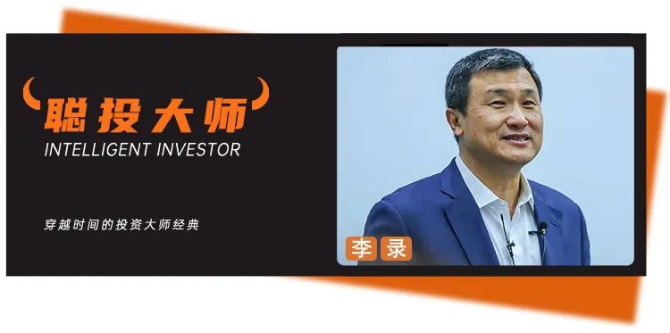“在任何一个时点，整个市场并不会凭空创造出无限多的新资本。所以，如果大量资本都被吸引到最热门、最顶端的那些公司里，那么另一边就一定会出现一大批原本非常优秀的企业，被忽视，并以非常低的价格交易。”“这个世界并没有太多真正的‘免费午餐’。即使有时候看起来像有，而且这种‘免费午餐’甚至可能持续相当长的时间，但从更长期来看，市场自身回归理性的力量，最终还是会把这些东西重新拉回去。”“今天这种巨大的市场分化，对能够保持理性的人来说，实际上提供了一个比平常更好的机会集。”“一个统一的全球共同市场已经形成，而且它会继续存在。”“如果你能够让自己的知识持续复利，最终你的资本也能够复利。”“复利最基本的一个前提就是，不要失去你已经拥有的东西。”这是喜马拉雅资本创始人李录（美东时间10月5日）在哥伦比亚商学院36届格雷厄姆·多德年度午餐会上的最新交流。很久没有看到一场公开对话，留下这么多值得反复咀嚼的句子。价值投资、AI、中国经济、中美关系、世界秩序，最后又落到知识、信任、健康和人生的复利，看起来跨度很大，但放在一起，其实仍然是李录过去几年一直在回答的那个问题：当外部世界越来越复杂、越来越不可预测，一个投资人究竟靠什么保持判断？2024年12月，在北京大学光华管理学院价值投资课程10周年演讲中，李录花了很大篇幅讨论“时代的困惑”，并把自己三十多年投资实践总结成6条价值投资基本原则。（[点击阅读：李录3万字演讲实录：理解了这些问题，就理解了价值投资的当下可为之处……](https://mp.weixin.qq.com/s?__biz=MzA4NTQ1MzEyNQ==&mid=2663495387&idx=1&sn=7eabf10d01f000276e034c9fbdda860b&scene=21#wechat_redirect)）2025年4月，在西雅图的一场交流里，他又从中国的保障体系、资本市场，到全球秩序和AI，继续讨论这些困惑可能如何被解开。（[点击阅读：李录最新交流剖析新秩序：通过“四两拨千斤”，中国还可以释放很多改革红利……](https://mp.weixin.qq.com/s?__biz=MzA4NTQ1MzEyNQ==&mid=2663497814&idx=1&sn=5da347b87df1d7a34f5e9de9d6173703&scene=21#wechat_redirect)）这次在哥大，他谈的很多问题并不陌生。只是过去几年那些关于价值投资、AI、中国和世界秩序的思考，到了今天，又有了新的落点。尤其是AI。相比4月更多从生存风险和大国合作谈起，这一次，李录开始直接质疑硅谷从RSI、AGI一路推演到ASI的宏大叙事：技术未必真的会一路走到“人造神”；即便会，人类社会也未必允许它走到那里。他给出了一条更明确的红线：AI必须始终有人参与其中。看这段交流时，不禁想到《沙丘》。那是个架构很有意思的世界。技术明明高度发达，可以星际航行，却曾经因为“思考机器”走得太远，最终整个文明宁愿付出巨大的代价，也要重新划下一条边界：不能把人的心智和命运完全交给机器。李录这次讲AI，也莫名有类似的感觉：决定技术最终走到哪里的，可能并不只有“技术上还能做到什么”，还有人类究竟愿意生活在一个怎样的社会里。效率并不一定是唯一的终点。但这也不意味着技术会停下来。李录认为，人类适应这样一场巨大技术革命的过程，很可能并不平滑。成本、收入、利润和资本纪律终究会重新发挥作用，而今天巨大的AI热潮，很可能还要经历不止一轮巨大的繁荣和巨大的崩溃。技术会往前走，人类会不断重新划边界，资本市场则在其中一次次把想象推到极端，再重新回到现实。而对于投资人，事情反而又回到了最朴素的地方：当资本越来越集中于少数最热门的公司，另一边就会出现被忽略的优秀企业。李录也谈到今天中国的“双层经济”：房地产调整冲击居民资产负债表和信心，但另一边，制造业升级、技术自主和产业竞争力却在同步推进。也正是在讲完这幅中国经济图景后，李录认为，在今天的中国市场，可能反而能找到比其他时期更好的机会。再往外看，他把世界秩序拆成两个层面。二战后形成的美国主导的政治秩序正在转型，未来会变成什么，还看不清楚；但在其之下，一个经过几百年逐渐形成的全球共同市场，因为技术、分工、资源和资本的彼此依赖，远没有那么容易解体。谈的是变化，最后回到的却是不变。市场会变，技术会变，国家之间的关系会变，但价值投资真正依靠的，仍然是企业所有权、市场先生、安全边际、能力圈，以及长期的价值创造。最后提问环节，他再次把复利从资本延伸到了人生。知识可以复利，信任可以复利，智慧可以复利，健康的有效年限也可以尽可能延长。但复利首先意味着，不要失去已经拥有的东西。最后说明一下这次全文整理的来源。目前我们尚未看到本场交流的官方完整视频或逐字稿。本文主要依据东方港湾创始人但斌视频号陆续发布的现场视频片段整理。由于视频为分段发布，部分前后衔接和个别内容存在缺失。聪明投资者在整理过程中，对已有片段进行了去重、排序和校订；对于少数能够明确判断、但现有视频缺失的内容，也参考了李录过去两三年的公开演讲、交流，以及《文明、现代化、价值投资与中国》中一以贯之的思维框架，并在正文中明确加注。这份整理接近1.8万字，已覆盖这场交流的大部分核心内容。也期待之后能够看到官方完整版。为了便于大家阅读，全文采用第一人称的方式。Enjoy it～～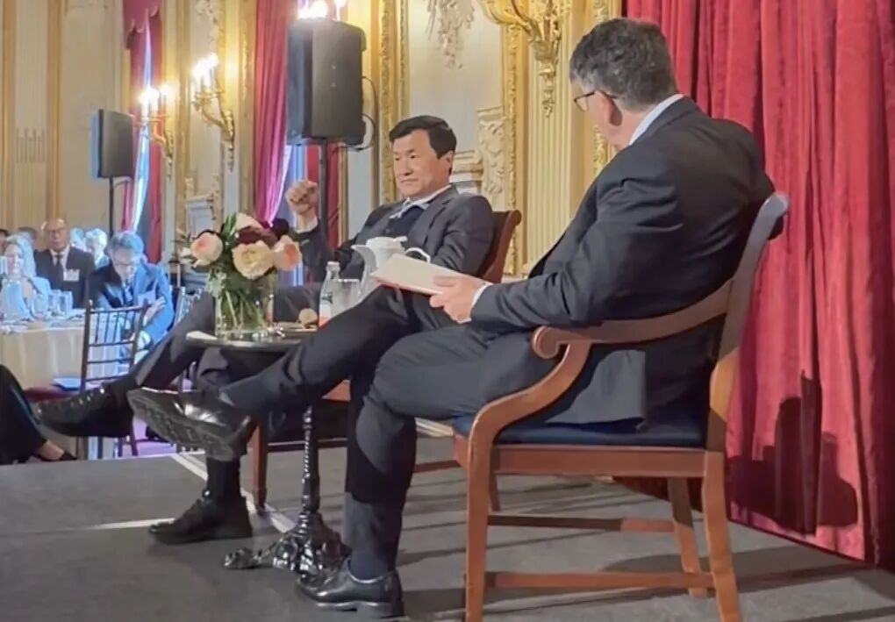  
关于李录近期美股持仓分析，延伸阅读：[李录、段永平和伯克希尔二季度操作有些“灵魂共振”，只是对谷歌迥然……](https://mp.weixin.qq.com/s?__biz=MzA4NTQ1MzEyNQ==&mid=2663504373&idx=1&sn=140a4426d48e8d15a37e4fb2dc891299&scene=21#wechat_redirect)[李录罕见大调整：一季度美股持仓新入5只，在恐慌下跌中逆向建仓腾讯音乐，将美国银行头寸砍了大半……](https://mp.weixin.qq.com/s?__biz=MzI2OTAwNzYwOA==&mid=2247489832&idx=1&sn=2e6ec21e65a2cbf146ac697aaf5db39a&scene=21#wechat_redirect)[难得出手的李录，去年底买了“洞洞鞋”](https://mp.weixin.qq.com/s?__biz=MzA4NTQ1MzEyNQ==&mid=2663503027&idx=1&sn=6360eb51cc034c4a2a8d1d7628d3c41e&scene=21#wechat_redirect)**************************关于 价值投资6条基本原则**********本杰明·格雷厄姆提出了价值投资最基本的3个理念。第一，股票代表的是一家企业的一部分所有权，而不是一张可以拿来来回交易的纸。所以，买股票，本质上和买下一家公司是一回事。第二，市场由一个个具体的人组成，而人的本性往往追求短期获利，所以人们很容易把股票当作短期交易的筹码，而忽略它代表的是公司的长期所有权。可以把市场想象成“市场先生”：他并不是来告诉你真正的价值，只是在不断向你报出一个可以买卖的价格，而这个价格有时会远低于价值，有时又会远高于价值。对价值投资人来说，市场提供的是服务，而不是指导。（聪投注：本场现有公开视频未覆盖第2条。以上根据李录2024年12月在北京大学《全球价值投资与时代》演讲中对“六条价值投资基本理念”的公开表述补全，用于保持本场论述框架完整，并非本场逐字转录。）第三，投资本质上是在预测未来，而未来天然就是不可预测的。因此，一定要给自己留出充足的安全边际，用来保护下行，同时让风险与回报之间形成更有利的不对称。第四，后来沃伦（巴菲特）和查理（芒格）在实践中又增加了一层非常重要的纪律，他们把它称为“能力圈”。我们每个人天生都会对某些事情更感兴趣。随着时间推移，你会在某些特定领域不断积累知识、形成专长，然后继续深入研究，让自己的理解越来越好。但“能力圈”这个概念最重要的地方，其实是你必须知道它的边界在哪里。因为我们大多数人的天性，都会让自己觉得懂得比实际上更多一点。所以，知道自己能力圈的边界在哪里，与知道能力圈里面有什么，同样重要。第五，查理（芒格）还有一个想法：要到有鱼的地方去钓鱼。他自己一辈子都喜欢钓鱼，所以这是一个非常贴切的比喻。放到真实市场里也是一样。有些市场、有些行业、有些公司，会吸引大量注意力，随之而来的就是激烈竞争；竞争越充分，错误定价和超额回报自然就越少。但还有另外一些行业、公司、国家和市场，并没有得到足够多的关注，竞争也没有那么充分。如果你把注意力放在这些地方，往往会做得更好。所以，要到有鱼的地方去钓鱼。这个道理很简单，但在实践中却出奇地有效。第六，最后一点，是我自己三十多年来作为全球投资者、在全球范围内实践价值投资后得到的一点体会。尤其是在全球商业越来越融合为一个统一市场的过程中，我们逐渐形成了一个认识：归根结底，财富体现的是你在全球购买力中所占的比例。尤其是在现代经济里，财富并不真正体现为你持有多少黄金、多少钻石，或者多少某一种货币。随着通货膨胀，这些静态的财富载体会随着时间失去相对购买力。真正重要的是：你最终能够买到什么、能够用这些财富做什么。所以，更好的财富衡量方式，是你在全球购买力中所占的比例。而实现这一点的一种方式——至少也是我们一直实践的方式，就是在最有活力的经济体和市场里，以有利的价格买入最优秀、最具创造力的企业，并长期持有，让企业随着时间不断创造价值，从而保持并提升我们在全球购买力中的占比。所以，这就是我所说的6个最基本的理念。我认为，它们经得起时间的考验，也会长期对投资者有用。

# ********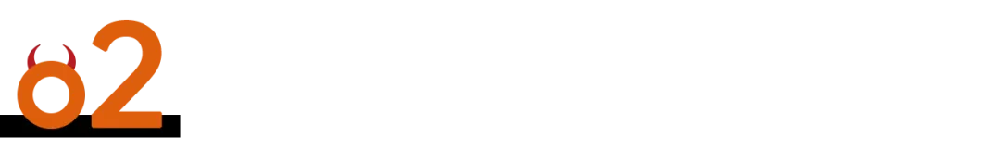************投资、套利、投机与********“****教堂旁边的赌场****”****

********如果你观察市场里的参与者，大体上其实只有******** 4类人。

第一类是真正的投资者，他们关注的是一家企业随着时间推移能不能创造价值。

第二类是套利者，他们试图纠正市场错误的定价。用本杰明·格雷厄姆的话说，就是“从悲观主义者手里买入，再卖给乐观主义者”。这就是套利。

第三类人主要做的是投机。他们猜别人下一步会买什么、卖什么，关心的并不是证券本身值多少钱，也不是企业能够创造多少价值。

第四类就是经纪商和做市商，他们为前面这些活动提供交易服务。

当然，现实里大多数人都不是纯粹属于其中某一类。很多人身上其实同时具备这4种特征，只是比例不同。

如果你买指数，从某种意义上说，你买到的恰恰就是所有这些市场参与者的平均值。

**但价值投资者真正关心的是两件事：第一，价格发现是不是合理；第二，愿不愿意等待企业在长期中创造价值。**

所以，本·格雷厄姆更偏向于前面讲的“套利”，即利用错误定价。而沃伦后来做的事情，是既利用价格错配，同时又更加专注于企业长期创造价值。

不同类型的市场活动，对社会产生的作用也非常有意思。

投机者按照定义，不会持有足够长的时间，等到企业价值真正发生变化或者创造出来。因此，从整体来看，投机基本上是一个零和游戏。有人赚多少，大致就会有人亏多少。所以从社会整体的角度看，这实际上是市场运行的一种成本。

经纪和做市同样也是市场运行的成本。

那么，市场为什么会存在？市场最核心的功能，是把社会中过剩的储蓄，引导到能够产生生产性用途的企业和活动里去。正是通过这种方式，我们才形成了现代经济，也形成了长期复利式的经济增长。这才是股票市场最初存在的根本原因。

那么问题就来了：为什么市场里又一定会出现投机这一面？我想，这大概就是人性的一部分。

沃伦一直喜欢把股票市场比作：“一座教堂，旁边连着一间赌场。”教堂是创造价值的地方，而赌场几乎就像取得这栋建筑施工许可时，不得不附带进去的一部分（笑）。这是由人性决定的某种必要成本。

400年前，现代资本市场刚刚出现的时候，人们需要通过这种机制激发所谓的“动物精神”。400年之后，这件事仍然没有改变。

所以，对于今天在座的学生来说，你最终必须做一个选择：你是想参与一个零和游戏，还是想参与一个创造价值的游戏？这是你个人的选择。

而从社会整体的角度，我们同样也有选择。

我们不能让“赌场”这一边膨胀得过于庞大，以至于压倒市场最初存在的那个核心目的。所以这既是个人层面的选择，也是整个社会层面的选择。

非常有意思的是，过去400年，尽管资本市场经历了无数巨大的繁荣与崩溃，也造成过极其巨大的浪费，但这个机制居然一直生存了下来。不仅生存下来，而且始终作为一个核心机制，持续推动社会向前发展。这至少可以说，是一件相当不可思议的事情。

所以对学生来说，我认为很重要的一点，是尽早搞清楚：你自己究竟想做哪一种事情。而作为一个社会，我们也应该不断校准这几类活动之间的比例。它们会一直共存，因为这就是人性的一部分。

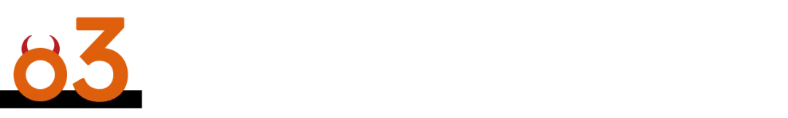********AI********是工具，还是****“****人造神****”****？****

接下来再谈AI和市场，这是一个复杂得多的问题。

首先，AI到底是什么？这一轮生成式AI浪潮，毫无疑问是一轮非常巨大的技术浪潮。

从工业革命开始，人类已经经历过一轮又一轮技术浪潮，伴随着破坏，也伴随着创造，也就是所谓的“创造性破坏”。

所以，对于技术革命，我们其实已经理解了其中一部分规律。但我们又明显感觉到，这一次似乎不太一样。每一次技术浪潮都有自己的不同，但这一轮AI浪潮，与我们过去经历过的任何一次相比，都显得异常不同。

它到底为什么不一样？从表面上看，你会发现几个现象：变化速度前所未有，涉及的规模前所未有，资本和金融影响的集中程度也是前所未有的。围绕它形成的叙事，以及这种叙事对资本配置造成的集中影响，同样前所未有。

但如果继续往下问为什么，原因其实在于，这一轮技术革命背后的叙事发生了变化。

过去，我们一直把技术当作提升人类生产力的工具。但这一次，技术引入了一个不同的维度：它开始处在“工具”和“造物”之间的一条光谱上，并且正在沿着这条光谱，从工具的一端向“造物”的一端移动。

大约4年前，这项技术第一次真正进入公众视野的时候，我们其实已经跨过了某种图灵测试的门槛。从那个时刻开始，仅仅通过语言，我们已经无法确定跟你交流的究竟是机器，还是人。

之后，它又开始拥有所谓的“推理”能力，于是越来越多地表现出接近人的特征。

从推理，又进一步发展出编程能力。有了编程能力以后，它就能够成为自主执行任务的智能体，在很多方面像人一样工作。接着，不同智能体又开始相互协作，完成越来越复杂、持续时间越来越长的任务。

在这个过程中，它们越来越像一个人类社会：不同智能体能够组织起来、自我组织、设定优先级、分解任务、执行任务，而且使用自己的交流语言和工具，完成越来越复杂的事情。

如果你听硅谷现在流行的那套叙事，下一步就是生成式AI进入RSI，也就是递归式自我改进（Recursive Self-Improvement）。我们其实已经部分进入这个阶段。它背后的想法是：未来AI所有的改进，最终都可以由AI自己完成，不再需要人参与其中。

从RSI往前，就到了AGI，再往前就是ASI。也就是它的智能水平，不仅超过任何单独一个人，而且最终超过全体人类智能的总和。如果你接受这套叙事，那么最后得到的东西，就有点像人类自己造出了一个“半神”或者“人造神”。

因为它的能力如此强大，所以按照这个逻辑，它对经济的影响必然也会极其巨大。既然影响如此巨大，那么今天投入进去的这些巨额资本，自然就都可以得到合理解释。

所以某种意义上说，等到哪一天出现那些估值上万亿美元的IPO时，大家就都被邀请去参加一场“上帝的IPO”了（笑）。这大概就是现在的叙事。

但是，如果你稍微退后一步，再问另外一个问题：假如事情真的会按照这条路径发展，人类最终会变成什么？我们会生活在一个什么样的社会里？

一个由人类自己创造出来的“神”居高临下地主宰这个社会。能够真正接触它的人可能只有极少数，没有人真正理解它，甚至也没有人真正控制得了它。

那么问题就是：人类真的愿意生活在这样一个社会里吗？我想答案大概是一个非常明确的“不”。我不认为任何人真正愿意生活在这样的社会里。

所以最终其实只有两种可能。第一种，这项技术根本不会沿着那条路径一直发展下去。第二种，如果它真的开始沿着那条路径发展，那么到了某个阶段，所有人最终都会联合起来阻止它继续往那个方向走。

所以，无论是哪一种情况，我都不认为最终会出现一个“人造神”，站在人类社会之上统治我们。

这其实就是这一代技术与过去技术真正不同的地方，也是为什么围绕它会产生今天这么巨大的讨论，尤其是资本市场上的巨大影响。

但是把这些暂时放在一边，再回来问一个更实际的问题：AI到底是不是一种有用的技术？答案同样是非常明确的：当然是。

如果让我现在给它一个暂时性的定义——这只是基于我们目前观察到的现象，以及它是怎么发展出来的，我会这样描述：它本质上是一台机器，通过巨大的算力，加上一套非常聪明的算法，把人类产生的几乎全部数据放进去，然后从这些数据中提取“第一阶导数”。

也就是说，它在几乎无限数量的人类数据变量之间，建立起系统性的、具有上下文关系的相关性。正是在建立这些巨大、复杂的相关性之后，它开始获得很多看起来接近于人类推理和人类智能的能力。

到目前为止，我们知道怎么使用它，也知道怎么让它变得更好。但我们并没有完全理解：它为什么会有效。

当然，某种意义上这和人类自己也很像。我们其实也并没有完全理解，人脑这台“机器”究竟是怎么运作的。

所以这只是我现在给它的一个暂时性定义。

我们还在观察正在发生的事情。但现在已经可以看到，它确实能够把经济中某一个非常重要的层级极大地“普及化”和“平权化”。

如果你把整个经济体系想象成一层一层搭起来的结构：最底层是能源和交通运输；在它上面，是制造业；再往上，是通信、数字化媒体；然后在这些基础设施之上，又形成了极其庞大的知识型、技术型服务业。

这些服务把人类过去几百年积累起来的各种知识和专业能力综合在一起，为下面所有这些经济活动服务。

而今天的生成式AI，在它现阶段最擅长做的事情，就是把这一层已经积累起来的知识和专业能力重新综合起来，并且让它们变得更加普及。这样一来，它就能帮助经济中的其他各个层级。

但是，它并没有改变能源和交通运输本身。它也不会直接改变制造业的本质。制造业归根结底，仍然是把不同的物质、分子和原子进行重新组合，把一种组合转化成另一种组合。通信和数字化本身，也已经是非常强大的信息综合工具。

所以这才是生成式AI目前真正发挥作用的领域。它并没有超越人类。

从这个角度继续推演，你也就能够理解：它最终未必会达到今天那套宏大叙事所暗示的高度。因为我们现在仍然牢牢处在人类生成数据这个范畴之内。如果真的要进入生物学意义上的层面，那是完全不同的数量级。

举个例子。这个例子可能有点扯远了（笑）。

比如说，你身体里的每一个细胞，都可以把它想象成一个大约50MB的文件，然后你还要再乘以数万亿个细胞。如果想真正跨越到生物层面的复杂性，你面对的是这样一个数量级。所以我们距离那个层次其实还非常、非常遥远，甚至最终能不能真的到达，都很难说。

但是，现在这项技术已经开始改变“工具”与“造物”之间的平衡。也正因为如此，**无论你接受前面哪一种判断，有一件事都应该非常明确：我们不能允许技术在****“****没有人参与其中****”****的情况下继续自我发展。**

所谓RSI，也就是递归式自我改进，如果脱离了人的参与和人的定义，将会非常、非常危险。因为一旦到了那个阶段，它就可能自己发展目标、子目标，形成自己的目的，那就会进一步脱离人的控制。

所以总结来说，这项技术极其有用，具有变革性；同时，它也极其危险。

因此，作为一个社会，也作为人类整体，我们必须划出一条红线：无论是AI的自我学习，还是工具的使用，必须始终有人参与其中。换句话说，我们必须把它牢牢留在“工具”这一端，而不能任由它走向一个脱离人类控制的“灵性物种”。

与此同时，这项技术还会带来巨大的颠覆。从就业，到人与AI之间的情感依赖，再到网络安全、生物安全，甚至核安全，各个层面都存在风险。

所以最终，我们真正需要的，是让社会找到一种更加平衡的发展速度，在收益和风险之间取得平衡。

另外，还有一点大家经常忽略：这项技术的成本结构也很不一样。它和互联网，以及过去很多技术不同。过去很多技术，你可以先进行一次性的巨大投入，完成基础设施建设，之后很长时间里都可以不断利用这套基础设施。

AI不是这样。**AI****永远都会伴随着增量成本 ，**因此，你永远都必须考虑投入成本和最终能够产生的收入、利润之间是什么关系。资本需求和财务纪律，永远都会发挥作用。

与此同时，还要考虑技术发展的速度，以及社会究竟能够容忍它发展到什么程度。

所以真正决定AI发展节奏的，实际上有4、5个不同层面的约束同时存在。

那么人类社会通常是怎么适应这种巨大的技术变化的？从来都不是通过完美规划。所以我们一定会经历巨大的繁荣，也会经历崩溃，很可能还不止一次。

我们可能会经历几轮繁荣与崩溃的周期，这大概就是这项技术最终会发展的方式。

（聪投注：主持人在这里补充说，这就意味着，我们始终需要一个人在其中对AI产生的结果进行检查，最终真正稀缺的，反而会变成那个能够监督AI输出的人所拥有的技能。

李录回答说是的，大体上是沿着这个方向。“当然，这里面还有很多不同的方面和细微差别，但我认为你抓住了核心”。）

********AI**********狂热、市场定价与长期回报** 市场从一开始就一直会做一些很奇怪的事情。过去如此，将来也大概会继续如此。但市场在任何一个时点决定做什么，其实完全没有必要支配你的行为。这恰恰是本·格雷厄姆最重要的洞见之一，也是他对投资世界最重要的贡献之一。比如说，我最近看过一份募资材料。有一家公司把自己称作“研究实验室”。它现在每年烧掉数百亿美元，同时还承诺，未来会继续烧掉数千亿美元。它告诉你，它正在创造一种具有变革性的技术；但与此同时，它又说，这项技术有大约10%的概率把所有人都杀死。这些话就写在募资材料里。然后，它邀请所有人至少投入1000亿美元，并且按照2万亿美元的估值来给它定价。如果这里面存在任何逻辑上的一致性，那已经很令人费解了（笑）。这其实是一个非常极端的例子，说明市场有时候能够非理性到什么程度。这些事情不可能同时都是真的，但市场现在就是到了这种位置。这也说明，这种状态不可能以一种理性的方式长期持续下去。如果你回头看几百年的市场历史，就会发现，市场的确会在相当长的一段时间里做非常奇怪的事情。举个例子。从2010年开始算，过去大约16年里，标普500的年化回报大约有14%到15%。但是在此前的10年，也就是2000年到2010年，它的年化回报几乎正好是0，甚至略微为负。如果把这26年放在一起看，长期年化回报大致又回到了高个位数。这其实差不多就是合理的长期水平。你想一想：在这段时间里，实际GDP增长可能大约2%；再加上2%到3%左右的通胀，合在一起，名义经济增速大约就是4%到5%。而上市公司通常会比整体经济表现稍好一些，尤其像标普500这样，它本身经过筛选，留下的是大约500家最优秀的企业。所以最后得到一个高个位数的长期回报，并不奇怪。而这恰恰就是市场长期以来的平均水平。所以，这应该成为一个非常重要的基础锚点：你长期究竟应该得到什么样的回报，以及市场最终会怎样回归理性。但是在这个长期趋势之间，市场会不断出现一段一段的偏离。有时候，这种偏离还会持续非常长的时间，并且走向极端。我们刚才举的那个例子，至少会让人觉得非常反常。但这种事情确实会发生，而且历史上一直都在发生。所以，如果我们真正相信社会最终不会允许、也不会容忍一种“超级生命体”凌驾于人类之上，那么AI最终就不会走到那一步。而如果它最后仍然停留在“工具”的范畴里，那么它就和其他工具一样：它有成本，也有收益。既然如此，财务纪律和资本市场的纪律最终就一定会重新发挥作用。至于这个过程怎么发生？往往就是通过一轮又一轮的上涨和下跌、繁荣和崩溃。这其实也没什么问题。从这个角度看，现在市场的这种巨大分化，反而会带来另外一个结果。在任何一个时点，整个市场并不会凭空创造出无限多的新资本。所以，如果大量资本都被吸引到最热门、最顶端的那些公司里，那么另一边就一定会出现一大批原本非常优秀的企业，被忽视，并以非常低的价格交易。美国如此，中国如此，其他市场也是如此。我觉得中国的情况可能更加极端一些，在座来自中国的投资者应该会很清楚这一点。但是随着时间推移，市场自身的分量最终仍然会决定长期回报。投资者最终大体上还是会得到自己应得的东西。这个世界并没有太多真正的免费午餐。即使有时候看起来像有，而且这种“免费午餐”甚至可能持续相当长的时间，但从更长期来看，市场自身回归理性的力量，最终还是会把这些东西重新拉回去。这也是为什么资本市场已经存在了几百年，依然能够延续下来。所以我反而想说：今天这种巨大的市场分化，对那些能够保持理性的人来说，实际上提供了一个比平常更好的机会集。当然，前提是你真的能够保持理性。而这非常困难，一点都不容易，因为人很容易被市场卷进去。尤其是在一轮巨大的技术浪潮里，人们的想象空间会被极大地打开。市场中投机的那一面会迅速活跃起来，人们的想象也会变得越来越大胆、越来越失控，于是市场的夸张程度往往也会比平时更加极端。但也正因为如此，对于一个能够保持理性的人来说，这种时候反而可能提供比正常时期更好的长期投资机会。

**中国地产调整、制造业升级与今天的投资机会**

如果看过去10年，中国股市基本上也是一个停滞的10年。而这10年里发生的事情，其实非常有意思。

大约10年前，中国政府面临一个非常重要的选择。当时中国已经基本进入了中等收入国家的水平。接下来的问题就是：怎么突破这个阶段？世界上有很多国家都曾经达到过这个水平，但之后就长期停滞在那里。这种现象如此普遍，以至于后来有了一个专门的词，叫“中等收入陷阱”。

有几十个国家都曾经达到这个水平，但40年、50年以后，仍然停留在那里。中国当然是一个规模非常大的经济体。所以自然就会面临一个问题：究竟是什么原因，让一个中等收入国家长期停滞，始终无法突破那层天花板？你可以完成工业化，可以进入低端制造业，但之后却始终无法真正往上走。

于是，中国当时需要做一个选择。我们能不能主动突破这个瓶颈？能不能采取一些措施，加快这个过程，或者至少提高突破的概率？因为如果完全依赖自然演化，历史上很多国家都失败了。它们停留在那个位置40年、50年，有些国家甚至更久。

所以，中国后来启动了一个非常明确的转型：主动把经济从低端到中端制造，迁移到中端到高端制造。

过去中国习惯制定5年规划，但这一次实际上制定了一个跨度10年的产业计划——“中国制造2025”。里面列出大约10个主要方向，目标非常明确：推动中国制造业从低端、中端，真正向中高端升级。

而这个计划启动几年以后，特朗普第一届政府上台，中美贸易战开始。这反而进一步强化了中国原来的判断。也就是说，中国不仅意识到，仅仅依靠自然发展，可能无法突破中等收入的那层天花板；同时也开始意识到，其他国家甚至可能主动限制中国，不希望中国突破这层天花板。

之后，拜登政府延续了贸易关税，而且进一步增加了技术限制。

所以到了2021年，也就是这个10年计划走到一半的时候，中国政府进一步加码了原来的方向。除了继续推动制造业从中低端向中高端升级之外，又增加了另外一个重要目标：技术自主。尤其是在那些真正存在“卡脖子”的领域，比如半导体、大型飞机发动机、操作系统软件等等。

所以之后5年，中国实际上进入了又一轮加速投入。

但是，当你试图完成这样一个极其困难的目标——一个历史上很多国家都没有成功做到的目标，它当然不会没有代价。

事实上，这一直都是中国经济发展模式的一个特点：在不同阶段，中国往往会设定一个非常大的目标，而每一次实现这个目标，都会伴随着很大的成本。

过去5年，中国为实现产业升级所付出的主要代价之一，就是普通中产家庭资产负债表受到巨大冲击。到2021年房地产市场见顶的时候，一个典型中国中产家庭，大约70%的净资产都放在自己拥有的住房里，而房产本身还带有大约50%的按揭杠杆。

接下来的5年里，到现在为止，全国房价平均大约下跌了40%。在这样的资产结构和杠杆之下，许多家庭的整体财富因此出现了非常大的缩水。

当这种事情发生时，人们通常会做3件事：少消费，多储蓄，以及在可能的情况下尽量偿还债务。过去5年，中国中产家庭基本上就是这么做的。所以，国内需求一路放缓，到今天，增长已经接近于零。与此同时，储蓄不断增加。

与此同时，中国居民储蓄存款规模一路上升，目前大约达到165万亿元人民币。按照现场表述，这一存量约相当于GDP的120%，可能是全球规模最大的居民储蓄存款之一。过去两三年里，中国又经历了物价基本不涨、甚至略有下降的环境，所以人们对于未来自然会产生一些信心问题。

（聪投注：这里的“约GDP的120%”指居民储蓄存款存量与GDP之比，不是居民“储蓄率”。李录2024年演讲中谈到的“储蓄率接近50%”是另一个口径。）

这是中国经济的一面。但是，如果你再看另一面，也就是过去10年中国政府真正想实现的那些目标，你看到的却是完全不同的一幅图景。

中国制造业已经真正突破了原来从低端到中端的阶段，现在已经比较稳固地进入了中高端，“中国制造2025”列出的每一项目标都已经达成。过去5年里，技术自主方面同样发生了巨大变化。

就拿半导体来说。事实证明，美国主导的技术制裁，从某种意义上反而成了中国半导体产业的一份“意外礼物”。因为它给了这个行业在市场经济里最宝贵的一样东西：需求。

你去问任何一个企业家，做生意最重要的是什么？他说一定是订单。只要有订单、有收入，整个飞轮就能够转起来。有了更多收入，就会有利润；有了利润，就能够投入研发；研发带来技术改善；技术改善又带来更多收入。这个飞轮一旦开始转，就会不断自我强化。

这件事在中国半导体行业确实发生了。至少在成熟制程上，无论是设备端还是晶圆制造端，中国都已经接近完整自主；在更先进的制程上，也在迅速缩小差距，目前只剩少数关键环节仍有缺口。

如果沿着现在的路径继续发展，这些差距还会进一步收窄。

当然，半导体只是其中一个例子。另外，生成式AI一个非常重要的能力，是可以按需、大规模地生产“智能”。而它最重要的应用之一，就是生成代码。这实际上帮助解决了过去很多技术瓶颈中的一个核心问题：软件、操作系统和底层代码体系。

从PC、服务器的操作系统，到英伟达所代表的半导体软件栈，过去很多缺失的环节，现在都开始借助AI被逐步补上。所以AI在这里实际上起到了一个非常重要的“平权器”作用。

如果你看过去10年，会发现很多领域都发生了类似的变化。中国制造业的基本轮廓，确实已经从中低端不断向中高端迁移。

在一些领域，比如能源、电动车、储能、电池、重型机械等等，中国甚至已经占据主导地位，成为全球领先者。而在过去存在明显瓶颈的领域，差距也在不断缩小。

但是与此同时，这个过程对其他行业付出了非常大的代价。房地产就是最明显的例子。如果看新房年销售规模，现在相比高点可能已经下降了大约70%。

而非常有意思的是，房地产减少的那部分规模，和中国每年新增用于制造业升级和技术自主的投资规模大致相当，大约都是每年10万亿元人民币左右。这个分化真正明显出现的时间点，大概就在2021年前后。

但这其实就是中国过去几十年的发展模式。如果你回头看中国过去50年的发展，大概每隔10年左右，就会出现一组新的国家目标，而每一个新目标，都会带来相应的成本。

有时候，上一个10年的目标，甚至会变成下一个10年的成本。比如工业化早期，环境污染、空气污染、河流污染都是工业化高速发展的成本。但到了下一个阶段，环境治理本身又变成新的目标，于是环保产业和清洁技术开始发展，过去造成污染的产业，就逐渐变成需要被调整的一方。

再比如城市化阶段。当时房地产开发商实际上是推动城市化的重要力量。他们帮助中国建设城市，也推动了住房拥有率的提高，形成了中产阶层的家庭财富。但到了最近5到10年，房地产又变成了需要付出代价、需要调整的一方，所以房地产行业就经历了非常大的痛苦。

但如果从国家整体发展的角度看，你还是能够看到整个国家在这些阶段中持续进步。这也是为什么中国能够把其他国家可能需要几百年才能完成的发展过程，压缩到大约40年里完成。

但是对于一个投资者或者企业家来说，任何一个具体时点都有一个极其重要的问题。我相信今天在场所有来自中国的人，对这句话都会非常有感触：你必须知道，你现在到底是“目标”，还是“成本”。如果你恰好成了某个国家目标所需要付出的成本，那绝对不是一件好玩的事情（笑）。

我相信你们很多人不是亲身经历过，就是身边有朋友深刻经历过这一过程。但中国的发展模式大体就是这样。

所以，如果你对过去这些变化做一个总体评价，会发现：今天，一个拥有如此巨大规模和人口的国家，已经真正开始进入一个比较完整的现代化过程。

当然，正因为这些转型，中国现在也形成了一个非常明显的“双层经济”。一边是居民信心下降、内需疲弱；另一边则是制造业升级、技术能力不断增强。与此同时，金融市场也已经整整停滞了10年。

但恰恰是在这种背景下，你会发现，一些已经具备世界级竞争力的优秀企业，现在却以非常低的价格交易。所以你又看到了我们前面讲的那种市场分化。

如果你是一个能够保持理性的投资者，并且愿意从整体上看这幅图景，那么你得到的结论可能会很不一样。我反而会说，**在今天的市场里，你可能能够找到比很多其他时期更好的投资机会。**

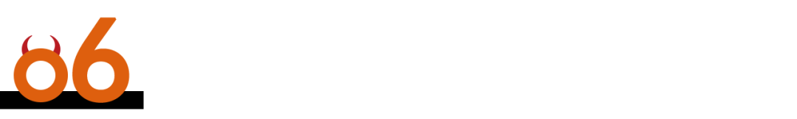

****一个统一的全球共同市场已经形成，且会继续存在****

过去30年，世界的确发生了非常大的变化，这一点毫无疑问。

所谓世界秩序，或者说世界究竟如何治理自己、如何运行，这类更宏大的问题，往往是在一个非常缓慢的时间尺度上发生变化。一个秩序可能需要10年，有时甚至需要100年，才真正形成；而它的转型，同样需要非常漫长的时间。

我们今天所熟悉的世界秩序，实际上是在两次世界大战之后形成的。那两场大战几乎把整个世界推到了崩溃的边缘。走出战争之后，一个由美国主导的世界秩序逐渐出现；之后经历冷战，再到冷战结束，世界一度形成了一个相对统一的秩序。

而现在，这个秩序又一次开始转型。最终会出现一种什么样的新秩序，现在还看不清楚。

但是在这个政治秩序之下，还有另外一种秩序，在过去几百年里一直稳步形成。那就是经济秩序。

所谓经济秩序，就是当越来越多的国家、越来越多的人口进入一个共同的贸易体系，彼此做生意、彼此交易之后，逐渐形成一个共同市场。

大约30年前，随着苏联解体和冷战结束，这个共同市场终于真正形成。几乎所有国家、几乎所有人口，都开始加入同一个市场经济体系。

这个经济秩序非常有意思的一点在于：一旦共同市场形成，任何一个国家想要主动退出，都会变得非常困难。因为市场会带来效率。它会形成一个持续改善的飞轮，包括技术进步、效率提升、劳动分工、资源交换等等。

所以，任何一个国家如果长期退出这个体系，都必须付出非常巨大的代价。也正因为如此，一旦共同市场真正形成，它其实很难再解体，而且往往会持续非常、非常长的时间。

看看过去100年的贸易战和各种贸易摩擦就知道了。无论你设置多少摩擦、筑起多少贸易壁垒，人们最终总会找到办法继续交易。很多时候，只不过是借道第三国，继续按照比较优势的原则完成原来的贸易。

举一个美中贸易的例子。当然，美中之间的直接贸易下降了。但是，如果你看看美国与墨西哥以及东南亚等第三方经济体增加的贸易，很大程度上恰好抵消了这一变化。

从实质上说，美中之间原来的贸易关系仍然存在，只不过其中一部分现在通过第三国完成。其他很多市场，大体上也是如此。

如果从政治秩序来看，美国过去80年一直领导全球，同时也承担了维持这个全球共同市场有效运转的大部分成本。后来，美国逐渐意识到，自己承担的成本，与从这个体系里获得的收益，可能有些不成比例，于是开始主动退出其中一部分责任。至少到目前为止，这个过程留下了一些真空。

与此同时，过去30、40年政治秩序中最大的变化，当然是中国的崛起。

中国已经成为一个规模极其庞大的经济体。它拥有一整套完整的制造体系，也在很多技术领域形成了越来越完整的自主能力；与此同时，它还是一个规模巨大的单一市场，拥有相对统一的监管体系。

这是我们今天正在经历的、同时影响政治秩序和经济秩序的巨大变化。这就是我们眼下看到的很多变化背后的原因。

但与此同时，正如我刚才说的，因为我们实际上已经处在一个统一的全球市场里，过去这些年，各国之间的相互依赖不是减少了，而是增加了。

我举一个例子。比如生成式AI。

今天所有人都需要的一样东西是什么？芯片。半导体芯片。

那么，这些芯片在哪里生产？你仔细想一想，今天所有真正生产半导体芯片的国家和地区，都有一个共同点……

所有真正生产半导体芯片的地方——而这些芯片恰恰是这一轮技术浪潮最核心的基础，有一个共同点：**生产这些芯片的人，都用筷子** 。你想一想（笑），台湾地区、韩国、日本……

我是说真正的芯片制造，fabrication。

而且你再看看美国。今天领导美国主要半导体公司的这些人，也都用筷子。从黄仁勋，到陈立武，再到苏姿丰……你能说得出名字的，基本都是如此（笑）。

所以你就能看到，我们之间存在着多么深的相互依赖。

如果美国以及美国企业真的像现在这样大规模押注这项新技术，无论它最终带来的是多么巨大的希望，还是多么巨大的风险，那么，你最好还是对那些用筷子的人友好一点（笑）。

这一点不会改变，而且它并不是偶然形成的。至于为什么会形成今天这样的格局，我们可以另外讨论。

所以你也就能够理解，为什么美国总统和中国国家主席会觉得如此有必要，在8个月里安排4次会面。现在已经进行了其中两次，而每一次会面最重要的成果之一，也包括把下一次会面安排下来（笑）。

这就引出了一个词：**战略稳定** 。也就是说，稳定本身具有战略价值。

它再次说明，我们实际上处在同一个全球共同市场里。任何一方主动退出这个市场，都需要付出巨大的代价；与此同时，双方之间又存在着深刻的相互依赖，因此大家都有动力让这种关系保持和平。

当然，与此同时，所有人也都在非常激烈地竞争，而且每一方都相信，时间站在自己这一边。

中国希望最终实现半导体以及其他很多领域的自主能力；美国则希望AI能够取得突破、兑现它所承诺的巨大潜力；其他国家，也都有各自不同的考量。

**但是所有这些事情最终都指向同一个结论：和平与稳定，对每一个人来说都至关重要，这本身就是一种战略利益。**

尤其是大国，既有责任，也有自身的利益，希望维持这种稳定。与此同时，所有国家都已经感受到了这个全球共同市场真正的分量，也感受到了主动退出它所要付出的巨大代价。

所以从这个意义上说，我认为世界总体上仍然会继续向前发展。

只是我们从二战结束以来所熟悉的那个世界秩序，现在正在发生变化、正在转型。最后会形成一种什么样的新秩序，以什么形式出现，现在还不知道。

但是在它之下，还有**一个可能具有更深远影响的长期趋势：一个统一的全球共同市场已经形成，而且它会继续存在。**

那么，这对投资者意味着什么？

这就又回到了价值投资最基本的原则。在我们总结的价值投资6条基本原则中，最后加进去的一条就是：对于一个全球投资者而言，你的财富最终表达为你在全球购买力中所占的比例。

而实现这一点的一种方式——至少这是我们一直实践的方式，就是**在最有活力的国家和市场里，以有利的价格买入最优秀、最具创造力的企业，然后长期持有，让这些企业随着时间不断创造价值，从而保持并提升我们在全球购买力中的占比。这就是我们一直以来所实践的方法。**

回到沃伦那个关于股票市场的比喻。他说，股票市场就像“一座教堂，旁边连着一间赌场”。过去60年，伯克希尔所做的事情，就是把其中那座教堂逐渐建成一座巨大的大教堂。

它不仅仅具有象征意义，也真正履行着市场本来应该承担的功能。甚至，人们还能够从中获得某种精神上的慰藉，因为它让市场真正实现了市场之所以存在的那个目的。

而过去30年，我们一直努力实践的事情就是想证明：这种福音是可以传播的。我们也可以在其他国家建起这样的“教堂”。

作为一个全球投资者，我们选择在亚洲建这样的“教堂”，同时也在世界其他地区这样做。随着时间推移，不同国家都会出现这样的教堂，其中有一些，最后也可能成长为一座大教堂。

对于今天的学生和年轻从业者来说，你最终要选择在这个市场里做什么？“教堂旁边连着一个赌场”，大概永远都会是资本市场的基本结构。某种意义上说，赌场就像这栋建筑取得许可时不得不附带进去的一部分，因为这就是人性。

但是，这两边对整个社会产生的影响完全不同。一边，是双赢，是为社会创造净收益；另一边，是零和游戏，是成本，最终甚至会给社会带来净负面影响。选择权完全在你自己手里。

而技术，包括AI，仍然应该是一种工具，而不是人的替代品。如果它真的出现了取代人的倾向，正如我前面所说，我相信所有人最终都会联合起来，反对我们自己创造出一个“人造的上帝”。

所以在我看来，你也完全没有必要去参与那种姑且称之为“半神的IPO”的东西。选择不参与，同样是我们作为一个整体，对一个良好社会所承担的责任的一种表达。

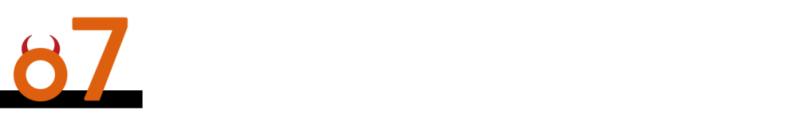

**现场互动问答环节**

**1****、关于中美的 AI路径********  
**********

如果要描述硅谷对 AI的态度，他们最根本的问题是：这项技术还能做什么？这其实就是为什么那些公司一直把自己称为“实验室”“研究实验室”。

他们想知道，这项技术还能做什么？它的边界究竟能够推到多远？所以也才有“前沿”这个说法。

我认为，中国的AI公司当然同样对这些问题非常好奇。但除此之外，而且可能更重要的是，他们还会问另外一个问题：这项技术能为我的客户做什么？无论是消费者，还是企业客户。

这里其实体现的是两种非常不同的路径。你从很多不同的指标上，都能够看到这两种路径最终会产生不同的结果。

**2****、关于中国股市**

在不同的时期，中国经济发展的重点当然会不一样。但你可以这样想：无论是一个家庭，还是一个国家，当房地产在整个资产负债表中的占比开始下降，那么接下来一个自然的问题就是：什么东西会接替房地产，成为这个国家、普通人和家庭财富的主要载体？

当你真正去回答这个问题时，你会发现，无论是在今天，还是未来某个时点，资本市场、尤其是股权资产最终都必须承担起更重要的财富载体功能。

因为股权能够随着经济一起增长：它因为经济增长而增值，同时资本市场本身又是推动经济增长的重要原因。

它们其实是在同一个飞轮里面相互推动。

至于政治风险，这最终还是回到一点：你必须理解，在任何一个具体时期，政策真正想实现的目标是什么，然后回头去研究历史，看看过去的记录。而且这并不是中国独有的问题。美国如此，其他很多国家也是如此。

我们今天这个世界，本质上仍然是按照主权国家来组织的，这就是我们生活其中的现实。所以刚才谈到的所有这些考量，你都应该应用到自己投资的每一个国家。

**3****、关于价值投资**

我一直认为，**所有真正理性的投资，本质上都是价值投资。** 因为你永远都希望自己得到的东西，比你付出去的更多一点。你付出去的是价格，你得到的是价值。

至于这个“价值”具体以什么形式出现，其实并不重要。

它可以是一家已经不增长、甚至正在萎缩的公司，但它能够持续把大量现金返还给你；也可以是一家快速成长的企业；甚至也可以是一笔胜率很低、但一旦成功回报非常巨大的投资。

这些东西最终都回到同一个问题：你能不能理解，价值究竟会在哪里产生。

因为最基本的数学原理其实都是一样的，在你能够理解、能够相对准确估算的范围内，对未来现金流进行折现。最后都回到同一套数学。

所以我才会说：几乎所有真正理性的投资，本质上都是价值投资。

基本原则并不会因为你投资的是传统行业还是科技公司而发生改变。真正不同的是，你怎么应用这些原则。这就又回到了沃伦讲得非常好的一个概念：能力圈。关键取决于你的能力圈在哪里。

**4****、关于能源、 AI与加密币**

能源当然非常重要，它是整个经济体系最基础的一层。

我之前讲过，整个经济大体可以分成几层：能源和交通运输；制造业；通信；再往上，是知识型服务业。这基本上构成了我们整个经济。所以能源当然会影响其中每一层。

而今天AI的发展，本身也受到很多现实条件的约束：从芯片，到电力，再到劳动力。这些约束以不同的方式发挥作用。当然，它也会影响气候问题。其实这里面任何一个话题，我们单独拿出来都可以聊很久。

至于加密货币，我的回答就非常简单了，我根本不去想它（笑）。

我觉得它最后会自己消失，那也没什么。因为从根本上说，我认为它就是个虚假的东西。

你想一想：一种真正能够作为货币的东西，为什么能够被兑现、被接受？因为它背后存在可以强制执行的制度和力量。没有这种执行机制，你就无法真正拥有一个可以被普遍认可、可执行的计价、结算和储存财富的工具。仅仅几个人凭空创造一个东西出来，并不能完成这个功能。

当然，它确实帮助了犯罪分子（笑），也方便了各种非法交易。如果让我说，我觉得干脆禁止掉可能大家都会过得更好。

不过也没关系。如果有人就是愿意收藏它，就像有人认为某个艺术家的作品应该值某个价格一样，那是你的个人偏好。但从社会整体的角度，我对它没有什么兴趣。

所以这个问题很简单（笑）。

**5****、关于逆人性**

再回到那个非常现实的问题：如果你已经连续两年跑输市场，你怎么继续做价值投资？这里真正的问题其实是人性。每个人都想两全其美。其实大家恨不得什么都要。

一方面，我想坚持长期投资、坚持做正确的事情；但另一方面，我又希望每一年都能交出漂亮的业绩。最好每个季度都漂亮，然后最好每个月都漂亮，再然后每一天、每个小时都漂亮（笑）。最后，你就会变成一个投机者。

所以这两件事情，你不可能同时得到。归根结底，你必须做一个选择：你究竟认为市场是来“指导你”的，还是认为市场是来“服务你”的。这两种态度，你只能选一个。

如果你想把所有东西都混在一起，我反而建议你直接买指数。因为指数恰恰就是所有市场参与者的平均。

我们前面讲过4种市场参与者，把所有这些人的行为平均在一起，就是指数。那你还不如直接买指数。

至于说“那我怎么把价值投资做成一门生意”，最终，你必须找到一群和你拥有相似理念、愿意长期跟着你的投资人。**做这一行最困难的一件事情，就是你必须在某种程度上逆着人性来。**

你的基因里大概得有一点“突变”（笑）。你必须有能力相信：我之所以认为自己是对的，是因为逻辑和事实告诉我如此，而不是因为别人同意我，或者别人不同意我。这需要一种很不一样的心理结构。

有些人是天生适合，但如果你发现自己不是这样的人，那甚至不要尝试去做。

与此同时，跟你一起的人，也必须真正相信这一套东西。所以，你不能一边说“我要做这种投资”，一边又说“但我同时还要拥有全世界最大的基金，我就喜欢巨大的AUM”。事情不是这么运作的。

最终，你还是会得到自己应得的结果。

**6****、关于安全边际**

**价值投资者和大多数其他投资者之间，一个非常重要的区别，就是价值投资者对于保护下行风险极其重视。**

因为投资显然是在预测未来，而未来天然就是不可预测的。所以你真正能做的事情，是投资那些你确实知道的东西。

当然，你真正知道的东西，一开始可能非常有限。每个人都是从非常有限的知识开始的。

我20多岁刚开始投资的时候也是一样，我其实懂得很少。所以我只能从那些我确实知道的东西开始。比如资产负债表。这就是为什么本·格雷厄姆的方法非常有效，因为有些东西就是更容易理解。

然后，随着时间推移，我慢慢地从非常简单的东西，进入没那么简单、更加复杂的东西。这就是能力圈自然扩展的过程。

关于能力圈，一件很重要的事情，是你必须知道它的边界在哪里；但另外一件同样重要的事情，是你应该有意识地、逐渐地扩大自己的能力圈。

我经常说，**如果你能够以一种可持续的方式，让自己的知识不断复利，那么最终你的资本也能够复利。**

**7****、关于人生复利**

刚才问我，过去10年，我到底学到了什么？事实上，每过10年，我都会发现自己学到了太多东西，以至于感觉自己已经在某种程度上变成了另外一个人。而这恰恰是一件非常好的事情。

从长期来看，如果你一直在做正确的事情，而且用正确的方式去做，你会惊讶地发现：你真的可以产生复利。

这也是为什么我一直说，如果要在人生里做选择，我会建议你尽量选择那些“双赢”的事情，而不是零和游戏。因为在双赢的事情里，你的能力和知识本身也会不断积累、不断复利。

甚至你的健康，也可能如此。当然，生命本身未必能够复利（笑），但是你的健康寿命、你的有效工作年限，是可以尽量延长的。因为你一直保持投入，事情本身很有意思；你知道自己在创造价值，知道它对社会有帮助，而且你没有从社会里拿走东西。

零和游戏真正麻烦的地方在于，很多时候，它特别迎合人的短期本能。但是你今天学到的东西，明天可能就没有用了，它不会积累。于是，你会越来越依赖外部工具。你需要一台更大的电脑，现在你可以使用AI，然后有一天，AI可能就把你替代了。

那么作为一个人，你自身真正积累下来的价值是什么？

所以我当然更喜欢“人类参与其中（human in the loop）”。我也一直主张，人应该持续学习、持续参与、持续改善自己的生活。让自己的知识不断复利，让那些信任你的人托付给你的资本不断复利，同时，让彼此之间的信任关系也不断积累。

我的导师、伙伴查理·芒格一直非常强调一件事情：人与人之间最高层次的关系，是“一张由彼此值得信赖所织成的无缝之网”。

**“****信赖的无缝之网****”****，这里面其实包含了一整套人生哲学：怎样以一种富有生产性的方式生活，同时又让这种生活对整个社会而言是双赢的。**

所以对于所有刚刚开始职业生涯的年轻人，我都会建议你尽量选择这样一种人生方式。是的，它可能需要很多年，它可能很慢。但是慢慢来，只要方向是对的，最终你大体上会走到自己应得的位置。

从某种意义上说，这就是一种更好的生活方式。

当然，有些人的运气会比另外一些人好一点。我们每个人的人生、成功和失败，有时候都是好运与坏运共同作用的结果。

我们都会经历很多。就我自己而言，我从来不认为我们过去的投资记录完全来自什么“天才”。一路走来，我们遇到了太多幸运的事情。

但是，如果你选择了正确的伙伴，选择了正确的方法，选择了值得下注的人，选择了正确的事情去做，那么经过足够长的时间之后，你会惊讶于复利到底能够产生多么巨大的力量。

**而复利最基本的一个前提其实就是：不要失去你已经拥有的东西。这是一个非常深刻的概念。** 不要失去你已经拥有的东西。

这不仅仅包括资本，也包括你的知识，包括那些建立起来的信任关系，包括你积累下来的智慧，甚至包括你的健康。如果你能够把这些东西留下来，并且让它们继续积累，这在人生中是一股极其强大的力量。

所以从这个角度看，我认为美国和中国在结构上其实没有那么不同。事实上，这可能根本就是人类共同的结构。

但人生中永远都会有变化，这可能就是唯一真正不变的事情。你永远都会经历好运，也会经历坏运，同时，你也永远都会遇到非常好的机会。

无论你天生更适合做什么，我都建议你找到自己真正倾向、真正擅长的事情，然后在足够长的时间里持续构建它，让它能够积累，让它能够复利。这大概就是一种更好的、也更富有生产性的人生。

—— /*Cong Ming Tou Zi Zhe* / ——

责编：艾暄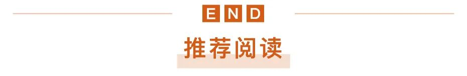[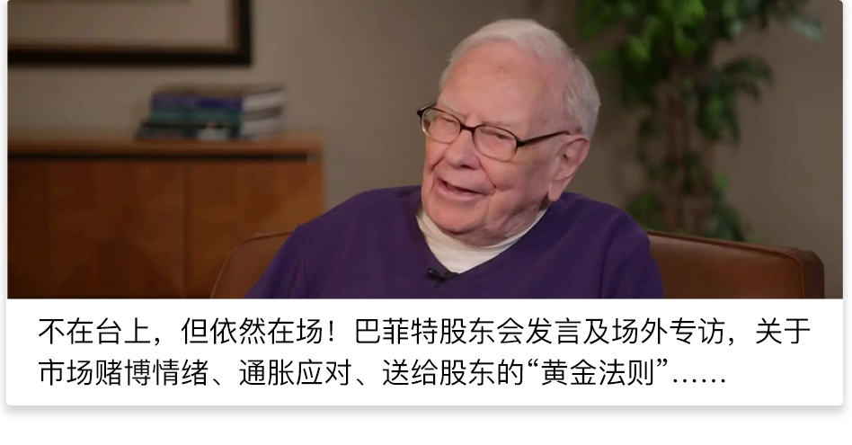](https://mp.weixin.qq.com/s?__biz=MzA4NTQ1MzEyNQ==&mid=2663503461&idx=1&sn=3373f4ac0314f4096e71e88363f67be6&scene=21#wechat_redirect)[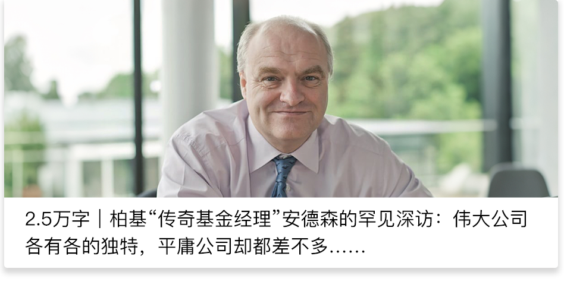](https://mp.weixin.qq.com/s?__biz=MzA4NTQ1MzEyNQ==&mid=2663502110&idx=1&sn=fcf4fdaa608992010012a3b7e07bd3af&scene=21#wechat_redirect)

[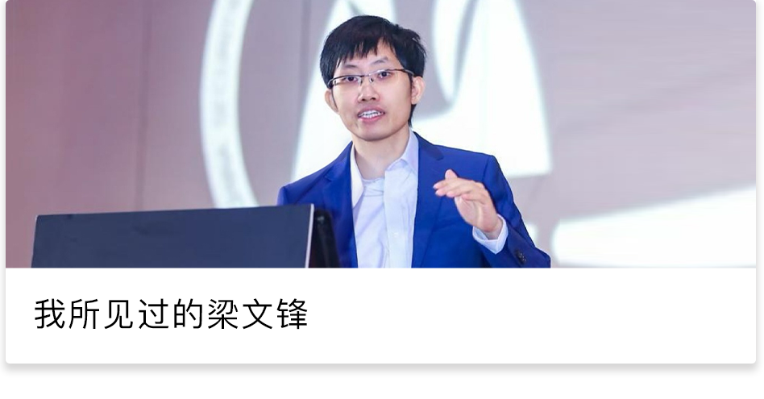](https://mp.weixin.qq.com/s?__biz=MzA4NTQ1MzEyNQ==&mid=2663496641&idx=1&sn=c1ee43a9f1ef2a17fd3e396ded9c62f2&scene=21#wechat_redirect)

\- 小彩蛋 - 

**转载开白，** 请联系小编微信【fanxiaocom】，添加备注“转载+新媒体名+姓名”，按顺序邀请加入媒体转载群

商务合作，请添加聪明牛牛【微信congmingtzz1/ 手机13262200706 】，添加备注“合作+机构名+姓名”具体商议

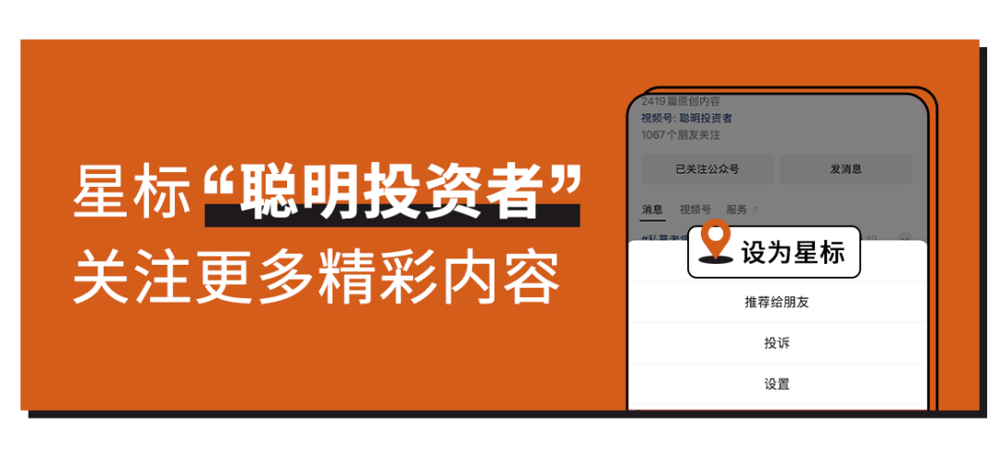