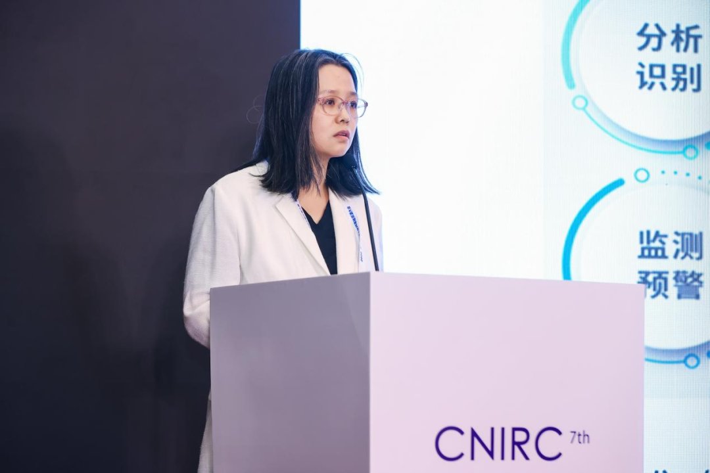

9月29日，2026（第七届）中国互联网基础资源大会“域名基础设施智能与安全”论坛在京召开。中国电子技术标准化研究院技术总监、正高级工程师王惠莅受邀出席并发表题为“关键信息基础设施和人工智能安全国家标准进展”的主旨演讲，系统介绍了我国关键信息基础设施安全国家标准、人工智能安全国家标准建设的最新进展。

**以下为王惠莅****演讲内容，经整理发布。**

随着人工智能等新技术新应用快速发展，网络安全标准化在支撑国家网络安全保障体系建设和数字经济健康发展中的作用日益凸显。当前，我国围绕关键信息基础设施安全保护和人工智能安全两大重点领域，体系化推进网络安全国家标准研制，初步形成了层次分明、覆盖全面的标准体系。

**一是关键信息基础设施安全保护标准体系初步形成**

依托《网络安全法》《关键信息基础设施安全保护条例》等法律法规，结合国家关键信息基础设施安全保护工作部署，我国体系化推进关基安全保护标准研制。目前，已发布关基安全保护标准1项，在研6项，初步形成关键信息基础设施安全保护标准体系。

《信息安全技术关键信息基础设施安全保护要求》（GB/T 39204-2022）是关基安全保护领域的首项国家标准，明确了关基安全保护工作的分析识别、安全防护、检测评估、监测预警、主动防御、事件处置六个方面内容；关基安全保护标准体系框架围绕这六个方面，具体分为基础类、分析识别类、安全防护类、检测评估类、监测预警类、主动防御类、事件处置类等七个方面。

与此同时，《关键信息基础设施边界识别方法》《关键信息基础设施安全保护能力指标体系》《关键信息基础设施安全监测预警实施指南》《关键信息基础设施安全主动防御实施指南》《关键信息基础设施信息技术产品供应链安全要求》《关键信息基础设施安全检测评估方法》等6项标准正在加快推进，从边界确定、能力评价、监测预警、主动防御、供应链安全和检测评估等环节，为运营者开展关基安全保护工作提供全流程标准支撑。其中，《关键信息基础设施边界识别方法》从保护视角出发，提供基于信息流识别关键信息基础设施资产的方法；《关键信息基础设施安全保护能力指标体系》给出基础保护、抗击防御、极限运行三类能力指标，采用“类—族—组件—指标”逐层展开的统一结构；《关键信息基础设施安全检测评估方法》统一关基安全检测评估方法，规范检测评估内容，提升测评的精准度与有效性。

**二是人工智能安全国家标准体系加快构建**

我国在第三届“一带一路”国际合作高峰论坛上提出《全球人工智能治理倡议》，发出人工智能治理的中国声音。为落实倡议精神，《人工智能安全治理框架》持续迭代更新：V1.0版2024年9月发布，V2.0版2025年9月更新，V3.0版于2026年9月14日济南网络安全宣传周正式对外发布，推动行业对AI安全治理原则、实施举措形成广泛共识。

为落实《框架》要求，结合人工智能安全领域技术特点和产业发展现状，我国从基础共性、安全管理、关键技术、测试评估、产品与应用等方面入手，构建人工智能安全标准体系。目前，已发布人工智能安全国家标准6项（含强制性国家标准1项），在研国家标准28项（含强制性国家标准1项、指导性技术文件9项），在研项目5项。

其中，《网络安全技术人工智能生成合成内容标识方法》（GB 45438-2025）是人工智能领域的首个强制性国家标准，支撑国家网信办、工信部等四部门联合发布的《人工智能生成合成内容标识办法》，构建“1+1+N”标识工作体系。目前已发布配套实践指南7项、在研10项，并建设人工智能生成合成内容标识服务平台，注册用户超4200家，累计完成检测17万余次。

此外，面向AI行业落地，我国推进研制人工智能应用安全分类分级标准，确立分类管理、分级保护的整体框架，为各地区、各部门及行业领域开展分类分级工作提供支撑；同步组织编制《人工智能应用安全指引 总则》，联合政务、交通、医疗、广电、教育、金融等行业主管部门制定行业细分领域人工智能应用安全指引，形成“1+N”协同使用模式，为人工智能赋能行业高质量发展提供坚实的安全保障。

**三是全国网络安全标准化技术委员会统筹推进标准研制与国际标准化工作**

全国网络安全标准化技术委员会为网络安全国家标准统一技术归口单位，接受国家标准委直接管理、中央网信办业务指导，国际层面对接ISO/IEC JTC1 SC27、SC44，秘书处设立在中国电子技术标准化研究院。标委下设9个工作组、1个特别工作组以及1个国际标准研究组，汇聚企业、高校、科研院所等800余家单位参与标准化工作。

国家标准层面，截至2026年3月底，网安标委累计推动发布网络安全国家标准421项，在研制修订项目100余项，覆盖密码技术、鉴别授权、安全评估、通信安全、安全管理、数据安全、人工智能安全等方向，建成包含3个一级子类、9个二级子类、46个三级子类的标准分类体系，有力支撑国家网络安全保障体系建设。

国际标准化层面，我国在SC27牵头、参与网络安全国际标准项目合计75项，其中38项已正式发布、37项处于研制阶段；在SC44成功推动3项预研项目立项。2025年9月，我国于昆明承办SC27工作组会议、全体会议，并举办首次SC44线下会议，我国在网络安全国际标准化领域的话语权与影响力持续提升。

王惠莅最后指出，网络安全标准是国家网络安全保障体系的重要基础。下一步，全国网络安全标准化技术委员会将继续统筹推进关键信息基础设施安全保护、人工智能安全等重点领域国家标准研制，深化国际标准化交流合作，以高标准支撑网络强国和数字中国建设。