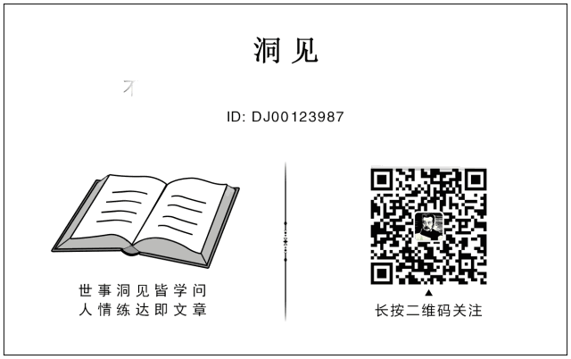

***洞见*** *（DJ00123987）*** *——不一样的观点，不一样的故事，3000万人订阅的微信大号。点击标题下蓝字“洞见”关注，我们将为您提供有价值、有意思的延伸阅读。***

作者：洞见·夜泊

多长一点本事，少发一些脾气。

♬ 点上方播放按钮可收听洞见主播楚翘朗读音频

  

职场多年，我见过太多人，都栽在了情绪上：

  

被领导批评两句，立刻心生抵触，消极怠工；

  

和同事意见不合，当场黑脸较劲；

  

遇到麻烦的工作，总是抱怨和敷衍……

  

他们不是输在专业短板，不是败在能力不足，而是毁于习惯性情绪对抗。

  

在职场，无论发生什么事，对抗都是成本最高的解决方式，更是最愚蠢的自我消耗。

  

看似是争一口气、守一份面子，实则是断送你的机遇，阻碍你的成长。

  

抱着对抗心态上班的人，无论在哪都难以出头。

  

01

  

自媒体人@焱公子讲过自己的经历。

  

他早年在一家企业做文案，有一次方案被部门经理当众否了，还被批评了几句。

  

他觉得脸上挂不住，当场顶了回去，两人不欢而散。

  

那之后，他心里憋着一股气，经理安排的活，他阳奉阴违，开会点名，他爱搭不理。

  

他以为自己是在维护自己的尊严，其实是在给自己的工作埋坑。

  

由于工作敷衍，三个月后，他在部门考评垫底，被扣绩效，而那位经理却没有任何影响。

  

很多时候，你对抗的不是领导，不是同事，而是你自己的心力。

  

每一次赌气、消极怠工，消耗的都是你处理正事的能量。

  

你把多少心力花在怄气上，就有多少心力从正事上流失，到最后拖垮的只有自己。

  

我认识一位在国企做技术主管的老周。

  

去年公司上了一个新项目，老周负责的模块和另一个部门的接口对不上。

  

对方在群里甩了一句：“你们这代码写得也太业余了吧。”

  

老周当场就炸了，在群里连发十几条语音，从代码规范讲到职业道德，最后撂下一句：“有本事你来写。”

  

结果对方直接截图发给了双方领导，项目推进会变成了批斗会。

  

老周不仅被扣了季度奖金，还被贴上了“不好合作”的标签。

  

后来复盘时老周才发现，那个接口问题其实只需要改三行代码，几分钟就能搞定。

  

周国平说，一个人把精力全用来对抗他人、计较小事，就没有力气去在乎重要的事情。

  

情绪对抗的本质，是把自己放在了“受害者”位置。

  

一旦你认定自己是受害者，全世界都是加害者——老板是压榨者，同事是竞争者，客户是麻烦制造者。

  

你越这么想，就越对抗，结果就陷入恶性循环当中，让自己的职场路越走越窄。

  

一个人一旦习惯了用情绪回应世界，就再没能量回应机会了。

  

说到底，情绪对抗就是押上自己的心力、口碑和前程，换来一时的痛快。

  

  

02

  

耶鲁大学做过一项调查研究。

  

他们向数百位企业家、公司高管、职场精英发放了一张问卷，让这些成功人士列出他们取得成功必不可少的因素。

  

结果显示，约有80%的参与者都将“不被情绪左右”列为最重要的因素。

  

不带对抗情绪上班，几乎是所有职场精英的共识。

  

稻盛和夫刚工作时，进了一家叫松风工业的陶瓷小厂。

  

当时工厂因为经营不善而濒临倒闭，工资都快发不出来了，同期进厂的大学生走得干干净净。

  

留下来的人天天聚在一起，不是骂老板，就是罢工、拉横幅、跟资方谈判。

  

稻盛和夫也曾愤懑不已，跟着工友们骂过、闹过。

  

但他很快就发现，骂完闹完之后，那些问题一个都没解决，人倒是先累垮了。

  

于是他迅速调整心态，打算干点实事，逐渐投入到工作当中。

  

后来他干脆搬到破实验室里住下，自己做饭、烧窑、试配方。

  

那一年，他研制出一种新型陶瓷，拿下了松下的订单，把快散架的厂子拽了回来。

  

后来，这家工厂就成为他一生事业的起点。

  

正如稻盛和夫所言：成功不要无谓的情绪，你把情绪拿掉，剩下的才是实力。

  

一个人情绪管理的能力，会在很大程度上影响他未来的成就。

  

在职场，随意宣泄情绪，很多小麻烦就会变成大麻烦，小问题就会变成大问题。

  

真正的职场高手，永远不会被情绪牵着鼻子走。

  

他们会迅速从负面情绪中抽离，将注意力聚焦在如何解决具体的工作问题上。

  

单位里从不缺闹情绪的人，缺的是能把事情办成的人。

  

跳过情绪，放下对抗姿态，你就已经迈出了走向强大的第一步。

  

  

03

  

亚马逊创始人贝索斯有句箴言：把一切集中在可控的事情上，而不是被动地对外界做出反应。

  

在强者的世界里，个人情绪从来不是主角，最终结果才是衡量一切的标尺。

  

事情做成了，你的委屈才有分量；事情没做成，你的愤怒就只是噪音。

  

职场顶级的智慧，是摒弃对抗，专注做事。

  

猎豹移动CEO傅盛，曾讲述过早年的工作经历。

  

他当时有个领导，是出了名的脾气火爆，对下属要求近乎苛刻。

  

傅盛和同事们向他汇报、请教，经常会遭到批评。

  

不少同事都心生不满，工作时就带着情绪，敷衍应付，尽量少和领导沟通。

  

傅盛同样觉得难堪委屈，但每次他都是把情绪压下去，认真做事。

  

有一回，他带着整理好的方案去找领导请教。

  

领导扫完方案，当场就厉声质问：这么明显的漏洞都看不出来，你怎么写出来的？

  

傅盛脸上发烫，心里五味杂陈，却还是沉下心听对方拆解逻辑。

  

有些关键点他没有听懂，哪怕知道大概率会再次挨批，他也硬着头皮继续追问。

  

等沟通结束，回到工位他还通过复盘，吸收其中有用的知识点。

  

正是能把情绪和事情剥离，傅盛的认知和能力快速迭代成长，很快成为业务核心，后来进入了更大的平台。

  

其实有一个道理，很多职场人始终没想明白：

  

在单位里，你反对领导，领导还是领导，你抵触同事，同事照样拿工资。

  

对抗改变不了任何局面，解决不了任何问题。

  

你真正应该去做的，是证明自己的能力，让情绪靠边站，让结果去说话。

  

多长一点本事，少发一些脾气，才是职场生存的硬道理。

▽

人在单位，最亏本的买卖，就是把情绪当成武器。

  

你赌气、摆烂，工作不会因此变容易，问题也不会消失，反而堵死了自己的路。

  

职场从来不是争输赢的地方，而是攒本事的地方。

  

成熟的打工人，都懂得恪守人事分离的原则：情绪可以放下，事情必须做成。

  

等你的本事足够硬，那些曾让你咬牙的人和事，都会变得不值一提。

  

往后工作中，少对抗，多做事，不争一时之气，自能积长久之功。

  

看更多走心好文章

请长按下方图片

识别二维码 关注洞见

**3秒加星标，再也不担心找不到洞见君↓↓**

**你若喜欢，为洞见点个 ♡****哦**