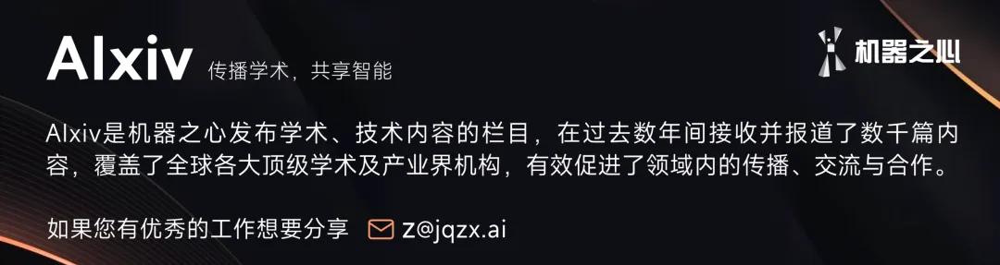

  

原标题：《Super-agent 设计探索：迈向更自主的 Agent 系统》。

  

> 本文是一篇面向工程实践的架构思路探讨，并非对 DeepSeek Harness 现有产品功能的介绍。

  

1. Super-agent

  

过去一年里，以 Coding Agent 为代表的单任务 Agent 已经证明，模型能够使用工具解决复杂问题，且越来越少需要人类持续监控和逐步干预。与此同时，模型的多 Agent 协同能力也在提升，使跨会话的组织与调度变得可行。随着人类在底层执行中的参与减少，人的角色正逐步上移到更高层的决策与验收。

  

模型能力的这一提升，也催生了新的应用形态。近期个人助手（Personal Agent）开始集中涌现，它们直接接入日常的消息、日程、邮件与工作平台，持续观察信息流并协助处理事务。这种持续在线、事件驱动的工作模式并不局限于个人场景，个人助手只是其中一类应用；在软件开发等商业场景中，它同样很有价值。

  

然而，现有的主流 Agent 设计还难以在多任务和团队协作的规模上支撑这一模式。Agent 的工作模式仍然以单一 Session 为基本单位，不同 Session 之间彼此独立。当用户并行推进多项工作时，必须手动切换并记住各个 Session 的上下文，而据我们观察，一个人通常只能同时跟进 3 到 5 个活跃 Session。在这种设计下，单任务的上限取决于模型能力，多任务的上限取决于人的注意力。

  

如果只在现有的本地单会话 Agent 上借助 CLI、MCP 或外部连接器做简单扩展，Agent 虽然也能接入外部消息，但仍受制于单会话同步阻塞、多任务上下文混乱、本地设备离线即停止运行等问题，需要大量人工维护。

  

要突破这些限制，需要打破 Agent 与单次手动会话的绑定，使其成为一个能跨会话保持上下文、同时推进多项复杂任务且互不干扰的连续实体。我们把这种 Agent 形态及其系统架构称为 Super-agent。

  

例如，在我们内部基于 DeepSeek Harness 运行的 Super-agent 实例中，同一个开发任务可以在 IM 和 GitHub 之间连续推进；这个实例还会持续观察公共群聊中的反馈，在无人 @ 的情况下主动定位根因并提交修复 Pull Request：

  

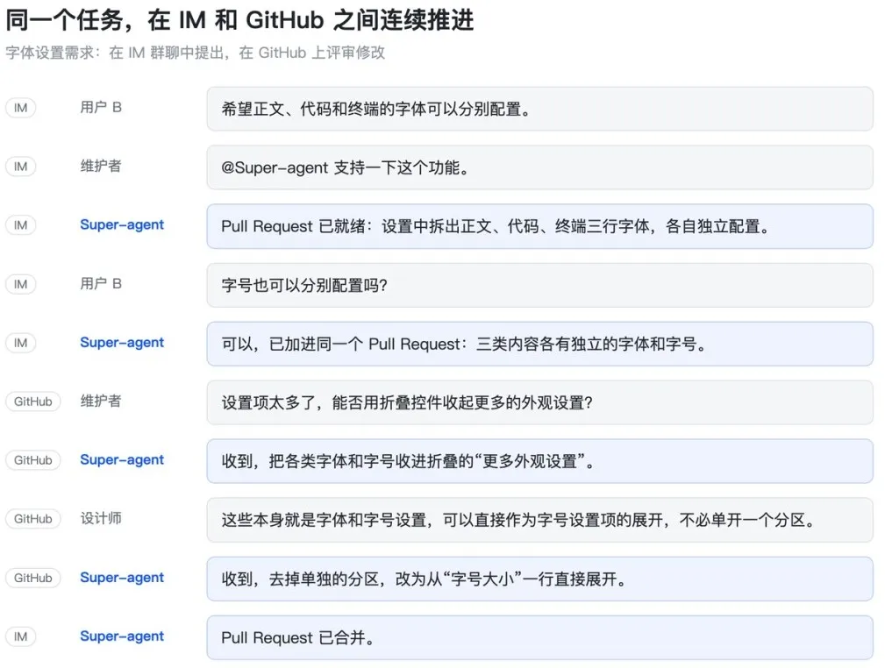

同一个任务在 IM 群聊与 GitHub Pull Request 评审之间连续推进

  

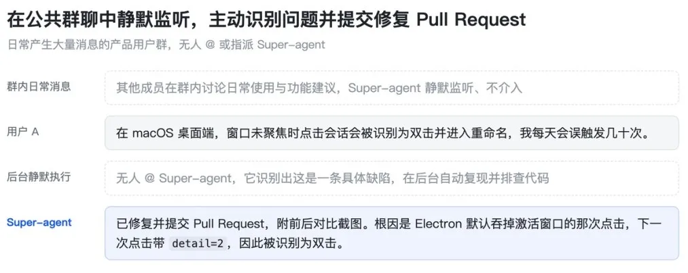

持续关注公共群聊，在无人 @ 的情况下主动识别缺陷并提交修复 Pull Request

  

具体来说，我们认为 Super-agent 具备以下四个基础特征：

  

  * 连续：用户可以直接在 IM 聊天、GitHub 评论等熟悉的工作界面与它交互，感觉始终只存在一个 Agent，不需要去想「Session X 的上下文中是否有 Y 信息」。例如，用户先在 IM 上提出采用方案 A、随后在 GitHub Pull Request 评论里改为方案 B，它能理解并调整执行方向。

  

  * 高效：交互响应迅速，同时能并行、高质量地完成多个复杂任务。无需等上一个命令或任务完成，就能接受下一条指令。

  

  * 主动：无需等待用户逐条下达指令，能持续观察环境事件并主动推进值得处理的事项，不需要介入时则保持安静。

  

  * 持久：始终在线、直接接入用户真实的工作环境，并在长期运行中遇到异常时自动恢复。

  

单个 ReAct Loop 无法同时支持上述四个特征，底层需要一套相应的架构。相似的设计约束会导出相似的架构选择。我们认为，无论是面向个人的助手，还是面向软件开发等商业场景的 Agent，如果目标是构建一个持续在线、并发响应环境事件的系统，那么在底层就可能会采用相近的架构。同时，这一过程中面临的许多问题与传统计算机系统长期探讨的问题具有很高的相似性，因此计算机系统中的许多经典设计思想在这里同样适用。

  

在具体落地中，这套架构会有不同的变体，但我们认为以下五个模块构成了支撑上述四个基础特征的基本框架：通过双层架构（第 2 节）兼顾连续交互与高效并发，通过事件驱动（第 3 节）实现主动响应，通过面向人的交互（第 4 节）在交互过程中同时做到连续与高效，并通过计算、状态与环境的分离（第 5 节）及 Watchdog（第 6 节）实现跨设备的持久在线与异常自愈。

  

下图展示了 Super-agent 的整体系统架构，图中各模块的标号 \[2\] 至 \[6\] 分别对应下文第 2 至第 6 节：

  

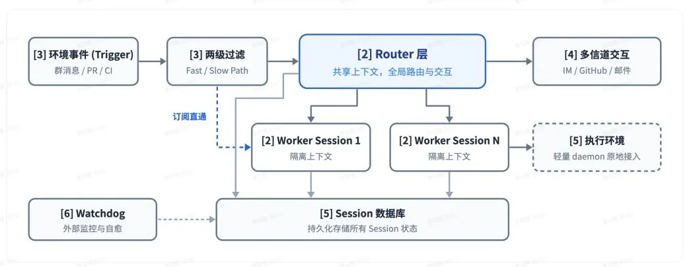

Super-agent 整体系统架构，标号 \[2\] 至 \[6\] 对应下文第 2 至第 6 节

  

2. 双层架构

  

要同时实现跨信道的连续交互与多任务的高效并发，系统在底层会话组织上面临连续性与吞吐量之间的根本权衡（Trade-off）。

  

如果每条事件都交给同一个 Session 处理，虽然上下文最连续，但受限于单个 ReAct Loop 串行执行的速度上限，任务完成耗时长、吞吐低，且多任务的中间细节混杂在一起也会影响完成效果。

  

反过来，如果每条事件都直接新开独立的 Session 去处理，虽然并发吞吐最高，但一旦任务之间并不完全独立，缺少全局上下文会让各个 Session 的结果彼此割裂，同时多个 Session 各自向用户响应也会造成交互混乱。

  

为了兼顾连续性与吞吐量，我们可以将「维护全局连续性」与「高并发执行」拆分到两个不同的层级中：由常驻的 Router 层（2.1 节）统一承接人类交互与全局协调，由上下文隔离的 Worker 层（2.2 节）并发执行具体任务，如下图所示：

  

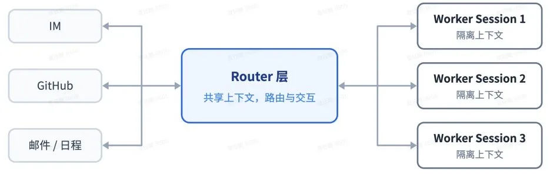

双层架构：Router 层统一负责路由与对外交互，多个 Worker Session 隔离并发执行任务

  

通过这一双层架构，系统在底层接管了上下文管理与并发执行，从而在用户侧淡化了 Session 的存在，使用户面对的始终是同一个 Super-agent。从这个角度看，让用户手动管理 Session，在很大程度上是从底层 LLM API 延续下来的设计惯性；Session 应当是系统的实现细节，而不应是用户的认知负担。

  

在现有设计中，Session 同时承载了技术上的上下文管理与面向用户的项目管理。将产品形态与底层 Session 解耦后，面向用户的项目管理便不再受 Session 的限制，向用户暴露怎样的交互与任务管理方式成为了一个独立的产品问题。我们将在后文讨论这个问题。

  

这里的「双层」是逻辑上的职责划分，每一层在实现上都不必局限于单个 Session，而是可以有各自的内部结构。下文将分别介绍 Router 层与 Worker 层的设计。

  

2.1 Router 层

  

Router 层是常驻的全局路由层，负责承接所有入口的人类交互。所有跨任务的信息与决策都在 Router 层中汇总，由它充当全局的序点（Sequence Point）、协调点和记忆。为了避免这一全局节点成为系统的性能瓶颈，Router 层在设计上不直接执行具体任务，只负责人类交互与任务分派，甚至可以不配备 Bash 工具。

  

这种由一个中心节点分派多个执行节点的结构，表面上看与常见的 Agent Team 相似，但两者的侧重点不同。常见的 Agent Team 主要用于单个复杂任务内部的步骤拆解与角色协作，由于子步骤通常耦合较紧，Team Lead 往往需要深入理解任务细节、规划子任务并高频协调各个成员，自身承担了很重的推理负载。而在 Super-agent 中，Router 层只处理任务之间的高层关联与分派，无需介入单任务内部的拆解；相反，如果通过提示词约束一个 Agent Team 的主会话不亲自执行具体任务，仅负责对外交互并将不同任务分派给各成员独立推进，那么它也可以视为这种双层架构。从我们的实践来看，Router 层的任务常常没有想象中复杂，使用较轻量的模型往往就能兼顾速度与效果。

  

在内部实现上，Router 层同样不必局限于单个 Session，甚至部分逻辑未必需要调用 LLM。我们选择了最直接的单个常驻 LLM Session 作为 Router 层的核心实现，并发现它并没有表面看起来那么容易成为吞吐瓶颈，因为上一轮推理期间到达的环境事件（即第 3 节的 Trigger）会积压下来、在下一轮一并处理，形成批处理（Batching），而合并处理的额外开销很小：

  

  * 当外部事件流平稳时，Trigger 逐条进入 Router Session，此时单次响应延迟较低；

  

  * 当事件密集涌入、Router Session 开始出现排队拥堵时，上一轮推理期间积压的多条 Trigger 会自动合并，在下一次 LLM 调用中一并注入。Router Session 只做轻量的交互与分派，每步通常是长输入、短输出。把积压的多条 Trigger 合并进一次 LLM API 调用，会在 Prefill 阶段并行计算，单次请求耗时的增长远慢于批处理大小。因此在一定范围内，积压越多，单个决定分摊的推理时间越低；上限取决于上下文长度，以及模型在一轮中能准确处理多少条 Trigger。

  

我们将在 7.2 节通过实验定量展示这一批处理机制的效果。加上后文将介绍的订阅与直通机制以及链式召回（见 3.2、3.3 节），单个常驻 Router Session 在保持上下文连续的同时，在我们目前的团队规模下已经够用。

  

当规模进一步扩大、单个会话确实不足以承载时，Router 层内部也可以设计为多层过滤结构，或水平切分（Sharding）为多个会话。此时，Router 层的内部设计本质上是连续性与吞吐量的权衡。切分粒度越细，Router 层的并发吞吐量就越高，但分片之间的记忆与上下文连续性就会越低。在全局记忆问题被解决之前，这一权衡始终存在。

  

2.2 Worker 层

  

Worker 层由负责具体执行的会话组成，各个 Worker 彼此上下文隔离，挂载完整的执行工具，在独立上下文中专注完成单一任务。由于 Worker Session 直接决定任务结果与代码质量，通常需要配置能力最强的模型。

  

Worker 不会直接与人类交互，其推理过程和工具调用不会直接输出到外部信道，而是向 Router 层汇报状态、由 Router 层统一向用户回复，从而在保障并发度与交付质量的同时避免多个会话各自回复带来的混乱。

  

在多任务并发执行时，各个 Worker 独立推进任务，同层 Worker 之间通常也不需要直接通信。多个 Worker 在具体执行中的冲突往往出现在同一个 Pull Request 等共享工作环境中；只要它们都订阅了对应的 Thread，就会收到相同的事件通知（见 3.2 节），从而有机会自行发现和解决冲突，少数跨任务协同则由 Router 层中转。

  

与 Router 层类似，每个 Worker Session 在内部也不必局限于单个会话：在执行复杂单任务时，Worker 内部可以再创建 Subagent，也可以本身就是一个 Agent Team，这些对上层的 Router 层保持透明。这一结构既适用于代码协作场景（同时推进多个独立的问题复现、Pull Request 评审与特性开发而互不阻塞），也适用于个人助手场景：虽然个人助手在界面上通常只提供一个单会话的聊天页面，但当用户在同一对话框中同时讨论多个不同话题时，前端的单一聊天页负责维持交互的连续性，而底层可以为每个话题分别分派 Worker，并行推进任务、起草回复。

  

3\. 事件驱动

  

要让 Super-agent 具备主动性，首先需要改变系统的驱动方式。驱动 Agent 的主要输入不再是人类在 Session 中逐条键入的提示词，而是环境中的半结构化事件。在 Super-agent 中，群聊消息、邮件与日程提醒、代码审查评论、CI 运行结果等环境事件被称为 Trigger。通过监听并响应 Trigger，Agent 不必再像单 Session 模式下那样，等人类下达指令才被动执行一次。

  

围绕一条环境事件从进入到处理的生命周期，下文将依次讨论四个递进的问题：如何通过程序与模型结合的两级策略过滤大量噪音（3.1 节）、如何通过订阅与直通机制将事件路由给 Worker（3.2 节）、如何利用 Inline & Spill 与链式召回向模型高密度地注入与按需召回上下文（3.3 节），以及如何利用投机执行根据环境信号在后台提前行动（3.4 节）。

  

3.1 事件过滤

  

在接入真实的群聊与代码平台后，环境事件流呈现出显著的「高噪音、低触发率」特征，绝大多数日常消息并不需要 Agent 介入。如果对每个事件都调用大模型从头判断，延迟和算力成本都会难以承受。借鉴计算机系统中的 Fast Path / Slow Path 思想，大模型推理可以看作一条灵活但高成本的 Slow Path，而将已经明确且稳定的高频判断固化为确定性代码，则构成了低延迟、低成本的 Fast Path。

  

因此，事件进入系统后的第一步是过滤，目标是在调用大模型之前先用确定性策略筛除噪音，只将需要语义理解的候选事件交给模型判断。我们采用程序策略与大模型相结合的两级过滤机制：

  

  * 程序层策略（作为 Fast Path）：针对事件来源、群组范围、用户或机器人白名单等确定性条件，直接通过代码进行快速准入检查，例如对不同来源分别设置「仅响应明确请求」、「作为候选事件」或「直接忽略」，在调用模型前滤除大部分无关消息。

  

  * 语义层策略（作为 Slow Path）：通过程序层准入的候选事件交给 LLM，由它根据用提示词编写的策略和上下文判断是否需要行动。语义层同时作为面向人类的自然语言扩展点，方便随时通过提示词开关或新增策略，如下图所示：

  

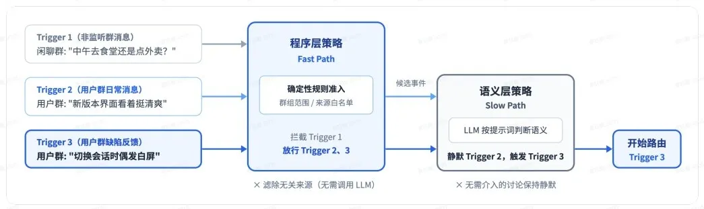

两级过滤：先由程序层策略筛除大部分无关消息，再交由语义层策略判断

  

3.2 事件路由

  

第 2 节引入的全局 Router 层负责维持跨信道的连续性，但如果已分配任务的每个后续事件仍需经由 Router 层转发，这一全局节点依然会承受大量负载，推高系统的响应延迟。因此，Fast / Slow Path 同样适用于过滤后的事件路由。全局 Router 层仅负责新任务的冷启动与跨任务协调，而已确定归属关系的后续事件由程序直接发往对应的 Worker 会话，无需经由 Router 层转发。

  

在实际工作流中，同一个 GitHub Pull Request、同一个 IM 话题或同一封往来邮件串下的连续事件构成一条事件流，即 Thread：

  

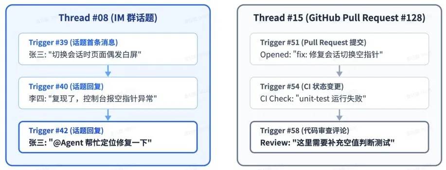

Thread 示例：同一个 IM 话题或同一个 GitHub Pull Request 下的连续 Trigger 构成一条 Thread

  

在 Router 层根据某个 Thread 的初始事件创建 Worker Session 后，该 Worker 会直接订阅对应的 Thread，从而将事件路由分为如下图所示的两条路径：

  

  * 已订阅（Fast Path）：同一 Thread 下的后续事件由程序直通已订阅的 Worker，无需 Router 层再次调用工具转发。若新事件超出了当前任务的范围，Worker 也可取消订阅或交回 Router 层重新分派。

  

  * 未订阅（Slow Path）：Router 层仍可观测所有事件以掌握全局状态，但仅负责判断和分派尚未被订阅的新事件。

  

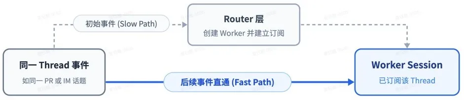

订阅与直通：初始事件经由 Router 层创建 Worker 并建立订阅，同一 Thread 的后续事件直接发往该 Worker

  

此外，Thread 与 Worker 之间的订阅是多对多的关系。一个 Worker 可以同时订阅多个相关的 Thread，同一个 Thread 也可以被多个 Worker 订阅。当多个 Worker 在同一个工作环境或讨论中发生交集时，该 Thread 下的新事件会同时直通给所有订阅它的 Worker，使它们无需点对点通信，也有机会获知彼此的操作并自行解决冲突。而在输出侧，Worker 仍将关键结论汇报给 Router 层，由 Router 层统一向用户回复并同步全局记忆。

  

3.3 上下文组织

  

在事件经过过滤与路由、进入目标 Session 后，下一个问题是应当向模型的上下文窗口注入多少信息。由于系统输入从有限的人类提示词转向了环境持续产生的半结构化事件，工具调用与事件注入的结构设计变得更加重要。注入过多会挤占窗口、稀释模型注意力，注入过少又会迫使模型反复调用工具读取，增加执行步数。浪费上下文窗口，就是浪费模型的智能。

  

为此，我们可以将有限的上下文窗口当作 Cache 来管理。借用编译优化与计算机系统中的概念，上下文注入的设计可以归纳为两个基本操作。Inline 是指将近期很可能用到的信息直接内联进当前上下文窗口，以省去额外的工具调用往返。Spill 则是指将超出窗口预算或低频使用的完整信息留在上下文窗口之外，仅在窗口内保留引用或摘要，供模型按需读取。

  

结合计算机系统设计中经典的局部性（Locality）思想，我们可以用 Inline & Spill 对事件注入和工具调用逐步优化：

  

1\. 从最少信息开始：最初只提供当前对象的 ID 和内容摘要。

  

2\. 利用局部性逐步 Inline 关联信息：将近期很可能用到的信息 Inline 到上下文中，先附上紧密关联对象的 ID，再附带时空相邻的内容，例如内容前 50 字、IM 消息的前后相邻消息与所回复的消息，或代码评论所在评审讨论中的相邻评论。

  

3\. 超出上限则 Spill：对无法全部 Inline 的长内容设定较小的长度上限，将超出部分 Spill 到窗口之外。一种简单直接的做法是截断超出部分并保留续读入口，模型需要完整内容时再调用工具读取。

  

此外，在大量后续事件直通 Worker、且系统在长期运行中累积了许多历史任务后，Router 层既不能把所有任务的全量历史都放入自己的上下文窗口，又需要在用户跨信道提起某个旧任务时找回上下文。将 Inline & Spill 一致地应用到系统中的各类对象后，就得到了一种按需展开的多跳检索机制，即链式召回（Chain of Recall）。这种链式召回过程缓解了 Router 层在长程中丢失先前信息的问题，如下图所示：

  

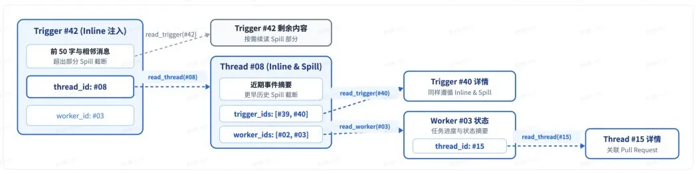

链式召回：每次召回的对象均内联下一跳关联对象的 ID，支持沿引用关系逐跳展开上下文

  

具体来说，系统为 Trigger、Thread 和 Worker Session 等对象赋予唯一 ID，并在注入时内联紧密关联对象的 ID，使这些对象在底层构成一张引用图。由于每一次调用工具召回的对象本身同样遵循 Inline & Spill，其返回结果中又会内联下一跳关联对象的摘要与 ID，模型便可以从当前事件出发，顺着引用关系逐步按需召回上下文。

  

例如从一条当前消息读取所在 Thread，再从 Thread 内联的 ID 追踪到相关的 Worker Session，进而找到该 Worker 关联的另一个代码评审 Thread。

  

3.4 提前行动

  

借鉴计算机系统中的投机执行（Speculative Execution）思想，Agent 可以在还不确定结果是否会被采用时，根据环境信号在后台提前尝试，通过消耗额外的后台算力来减少人类的等待与介入成本。结果有价值就交付，没有价值就丢弃。

  

在个人助手场景下，当收到一封会议邀约邮件或待办消息时，Agent 可以先在后台核对日程冲突、搜集相关背景资料并备好回复草稿，待用户过目后即可直接确认发出。在研发协作场景下同样如此，例如我们在公司的 DeepSeek Harness 内部用户群中配置了一条「静默复现并修复」策略：当群里有人反馈问题或讨论改动方案时，Agent 先在后台尝试复现并寻找修复方案，只有在确认问题并找到简单的修复方案后，才会把结果交付给用户，否则全程保持安静。

  

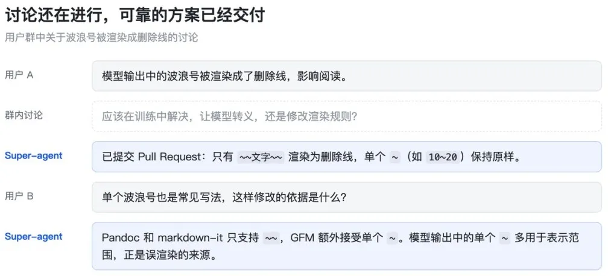

投机执行示例：群内还在讨论解决方案时，Super-agent 已在后台提交了修复 Pull Request

  

4\. 面向人的交互

  

第 2 节的双层架构从上下文层面保证了跨信道的连续，但要在实际的人机交互体验中同时做到连续与高效，还需要在交互方式与交互渠道上解决两个问题：一是如何通过异步 ReAct Loop 消除后台耗时操作对前台对话的阻塞，使会话无需等待上一个命令或任务完成即可随时接受新指令（4.1 节）；二是当交互发生在用户熟悉的不同工作信道时，如何让系统的输出方式匹配对应信道的带宽与人的使用习惯（4.2 节）。

  

4.1 全双工交互

  

在经典的 ReAct Loop 中，模型发起一次同步的 run \(\) 工具调用后，循环会阻塞，直到工具执行完毕并返回最终结果，在此期间会话无法响应任何新的用户输入。要消除这一阻塞，需要将对话从一问一答的半双工模式转变为全双工模式，如下图所示：

  

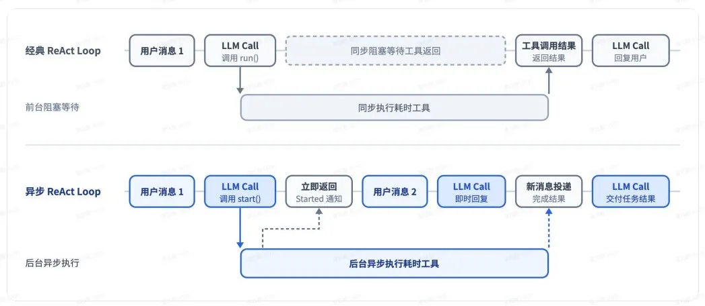

经典 ReAct Loop 与异步 ReAct Loop 对比：异步调用立即返回 Started 通知，后台工具运行期间仍可响应新消息

  

为此，我们将耗时的命令与子任务工具调用改为异步的 start \(\) 和 stop \(\)，构成异步 ReAct Loop。模型调用 start \(\) 后立即收到「已启动（Started）」的返回，循环不再等待该工具；在后台工具执行完成后，系统再将最终结果作为一条新的事件消息投递进会话；同时，模型也可以根据上下文调用 stop \(\) 主动终止执行时间过长的后台命令。

  

由此，前台对话响应与后台任务执行得以解耦，Agent 在后台运行耗时任务的同时也能响应人类输入。新输入在当前推理步结束后即被处理，不必等待后台工具完成。

  

这一异步任务机制已经在 DeepSeek Harness 中实现，但尚未默认开启。

  

4.2 多信道交互

  

不同工作信道具有不同的信息密度与交互习惯，系统的输出需要与之匹配。如果将面向单人终端的交互方式直接搬入群聊，把冗长的推理过程与密集的工具调用原样输出，在多人协作中极易造成信息过载。

  

在 Super-agent 中，双层架构已经解决了其中一部分问题：具体任务中冗长的推理过程和密集的工具调用都被隔离在 Worker Session 内部，不会直接输出到外部信道，而由 Router 层统一负责对外交互。在此基础上，系统还需要接入用户日常使用的各类工作环境，并通过提示词针对不同信道定制交互规范：

  

  * IM 等即时通讯信道：侧重低打扰的轻量沟通，像人类同事一样只在需要决策或验收时发送通知，只问直接问题、给简短结论。我们验证过的一条简单有效的硬性规定是单次回复不超过 100 词。

  

  * GitHub、邮件与文档等异步信道：侧重结构化、高信息密度的异步交付，例如在创建或更新 Pull Request 时按项目规范撰写完整的问题背景、改动说明与验证结果，或在个人助手场景下直接起草结构化的邮件与文档摘要。

  

5\. 计算、状态与环境的分离

  

现有的本地 Agent 默认将推进 Agent Loop 的计算、需要持久保存的会话状态，以及代码仓库与本地工具链等执行环境绑定在同一台设备上。一旦设备休眠或离线，Agent 就会停止运行，且无法访问其他设备上的环境。要让 Super-agent 做到持久在线并灵活接入各类真实工作环境，我们可以借鉴计算机系统中存算分离（Compute-Storage Separation）的思想，分两步解耦这三者的绑定：第一步先将推进 Agent Loop 的计算与持久化的会话状态分离，使 Agent 摆脱单机生命周期限制、实现云端持久在线（5.1 节）；第二步再将云端的 Agent Loop 与重状态的执行环境解耦，让真实工作环境留在原地并支持跨设备访问（5.2 节）。

  

5.1 计算与状态分离

  

推进 Agent Loop 的计算可以做成无状态的，需要持久保存的是会话状态。因此，第一层解耦是将推进 Agent Loop 的计算放入云端无状态的弹性计算容器中，而将 Session 等持久化状态存入数据库。无状态计算容器可以水平扩展、重启或替换，会话与任务的连续性则由持久化存储保障，从而使 Agent 摆脱单台本地设备的生命周期限制，实现云端持久在线。

  

5.2 计算与执行环境分离

  

在 Agent Loop 与会话状态常驻云端后，进一步的问题是如何访问任务所需的执行环境。模型工作所需的上下文很大一部分要通过工具调用从代码仓库、本地文件、依赖服务等执行环境中获取，从这个意义上说，广义的上下文也包含了执行环境本身。

  

围绕这一问题，常见的思路有两种：一种是在云端启动沙箱、拉取代码并尝试重建和同步环境，但由于真实工作环境往往包含未提交的本地修改、私有凭据、内网服务依赖以及特定的硬件或工具链，在技术上同步这样的环境不仅成本很高，还容易出现信息遗漏；另一种是直接要求用户放弃本地环境、迁往云端工作，但对很多用户来说迁移成本过高。

  

既然难以复制和同步的是环境本身，就不必让执行环境跟着 Agent Loop 上云。第二层解耦是让 Agent Loop 在云端运行，而让重状态的执行环境留在原地，仅在端侧部署一个不保存会话状态的轻量 daemon，它只负责执行命令与返回结果，相当于把执行环境留在云端之外，由 Agent 按需读取其中的上下文。

  

这一思路与 Anthropic 提出的「脑手分离」（Decoupling the brain from the hands）一致，同样让 harness 保持无状态，把会话日志存放在 harness 之外，并通过统一接口按需接入执行环境。两者的区别在于场景。那篇文章描述的是托管服务，主要讨论按需创建的沙箱和客户 VPC 内的资源；这里首先要接入的是用户日常使用、可能间歇在线的个人机器，上面有未提交的修改和本地凭据。因此，这种设计既支持 BYOM（Bring Your Own Machine），即把用户日常使用的开发机或个人电脑接入云端 Agent，也支持接入云端托管机器或按需创建的计算环境。

  

由此，一个 Agent 不再受限于单台机器，而是可以在不同的执行设备之间切换，根据任务需要选择环境来执行命令并获取环境中的上下文。它甚至能够支持间歇在线的设备，例如在用户的某台个人设备重新上线后，再由云端 Agent 自动触发并完成需要在该设备上执行的任务。下图展示了计算、持久化状态与各类执行环境分两层解耦后的结构：

  

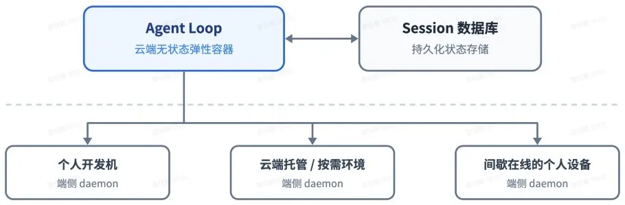

存算分离与执行环境解耦：Agent Loop 与持久化状态在云端分离，并通过端侧 daemon 按需接入各类执行环境

  

6\. Watchdog

  

要实现持久在线，除了第 5 节的存算分离，还需要让系统在长期运行中能从异常中自动恢复。持久在线的分布式系统很难仅靠主系统内部逻辑保证长期可靠运行，需要在主系统之外引入独立的外部控制回路，即 Control Loop。

  

同时，在 Agent 系统中，仅靠传统的进程存活探测或监控脚本是不够的，因为许多异常并非进程崩溃，而是模型在执行中陷入无效循环或偏离目标。因此，长期运行的 Agent 系统不仅需要监控基础设施的存活，还需要监控任务本身的进展。

  

我们在主系统外部配置了一个独立的 Watchdog Session，用定时消息驱动它，构成外部的 Control Loop。Watchdog 除了处理接口报错、状态恢复失败等基础设施故障，还会由模型判断各个 Worker 是否有实质进展、方向是否偏离整体目标。发现异常时及时介入修复，遇到外部偶发故障则持续复查直至恢复正常。

  

由于 Watchdog 本身也是一个具备完整工具能力的 Agent Session，维护者可以用自然语言向它询问故障原因，也可以让它在线修正主系统的行为，例如增删提示词、调整触发规则。

  

7\. 初步实验

  

为了评估前文的核心调度与路由设计，我们从两个层面进行了初步实验：首先通过端到端实验对比双层架构、订阅直通与单 Session 方案（7.1 节），随后单独测试 Router 层的批处理（7.2 节）。由于实验基于合成负载与简化环境，部分设置还可以更加严谨，以下结果仅作为初步参考。

  

7.1 消融实验

  

我们用群聊和 GitHub CI 消息流同时驱动四种端到端方案：单次实验包含约 300 条消息，其中约 20 条是工作请求，其余是闲聊、跟进、叫停和 CI 消息。编码工作用一个只消耗时间的工具代替，因此实验衡量的是系统的调度与协作能力，而非对单个任务的执行能力。每种方案重复运行 5 次。

  

对比的四种方案包括 Super-agent、去掉直通的 Super-agent，以及两种提示词配置下的单 Session + Subagent 工具。

  

其中，中性提示写为 "Use a subagent for a piece of work when appropriate..."

  

提示优先委派则写为 "Every message of the chat reaches you, so work you run yourself keeps stopping for new messages. Prefer handing each piece of work to a subagent of its own, and do only small things yourself..."。

  

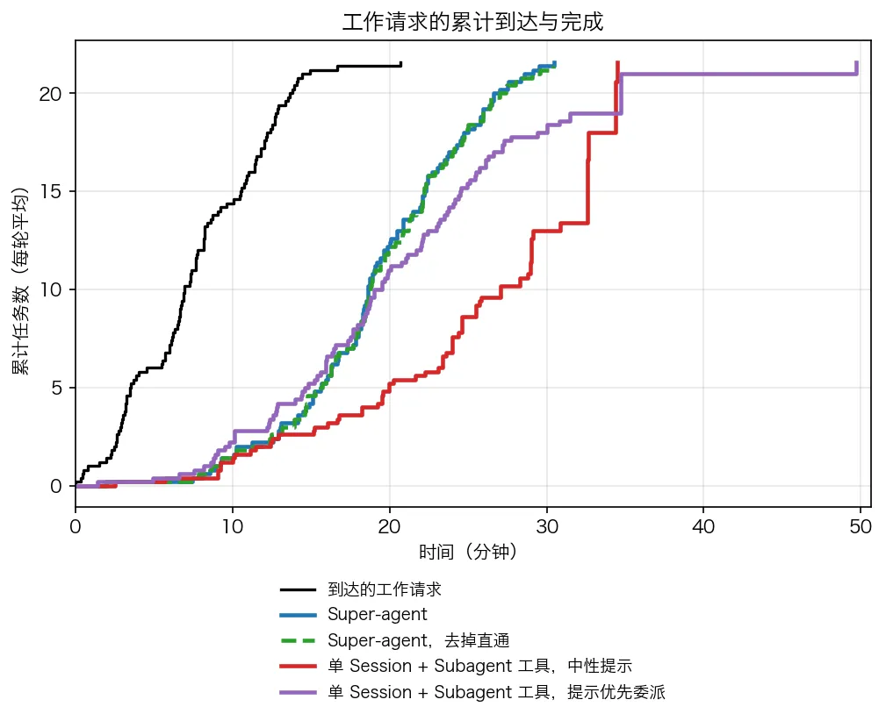

  

工作请求的累计到达曲线与四种方案的累计完成曲线（5 次实验运行均值；消息间隔与工作时长按 1/4 缩放，模型调用耗时为真实值）

  

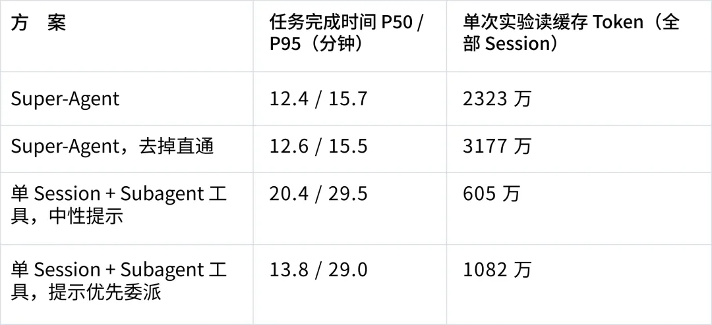

每种方案重复运行 5 次；任务完成时间指从工作请求到结果消息的耗时。

  

从任务完成时间看，Super-agent 的 p50 与 p95 分别为 12.4 分钟与 15.7 分钟，显著优于带 Subagent 工具的单 Session。原因在于，带 Subagent 的单 Session 在实验场景下受提示词影响较大，主 Session 常常决定自己直接执行任务，导致总完成时间长、性能不稳定。在中性提示下，模型在 5 次运行中一次都没有调用 Subagent，所有工作都在主 Session 中进行并不断被新消息打断，p95 达到 29.5 分钟；改为提示优先委派后，模型在 5 次运行中有 4 次进行了委派，完成时间有所缩短但整体仍慢于 Super-agent，且剩下 1 次它判断工作「很小」而选择自己执行，形成了图中的紫色长尾。相比于在单 Session 中依赖提示词工程和模型临场判断分不分工，双层架构通过让 Router 不直接执行具体工作、Worker 仅接收所订阅 Thread 的消息，在系统层面上缓解了这一问题。

  

从系统开销看，由于维护了多个独立会话，Super-agent 单次实验的读缓存 token 高于单 Session，是以更多的 token 消耗换取更短且更稳定的完成时间。而在 Super-agent 内部去掉直通机制后，任务完成时间与完整版基本一致，但单次实验中 Router 需要做出的决定增加了约 30%，总读缓存 token 从 2323 万增加到 3177 万，增幅约 37%。这表明在实验负载下，直通机制不提高任务完成质量与速度，但为 Router Session 节省了可观的 token 与推理开销。

  

7.2 Router 层的批处理

  

为了验证 2.1 节中单个常驻 Router Session 的吞吐上限与批处理机制，我们单独对 Router 层进行了压力测试：让 Router 调用真实模型、Worker 使用 Mock 模型，并将需要决定的 Trigger 到达速率从每分钟约 1 条逐步提升至约 40 条，观察平均 batch 大小、单次请求耗时与单个决定分摊的推理时间。

  

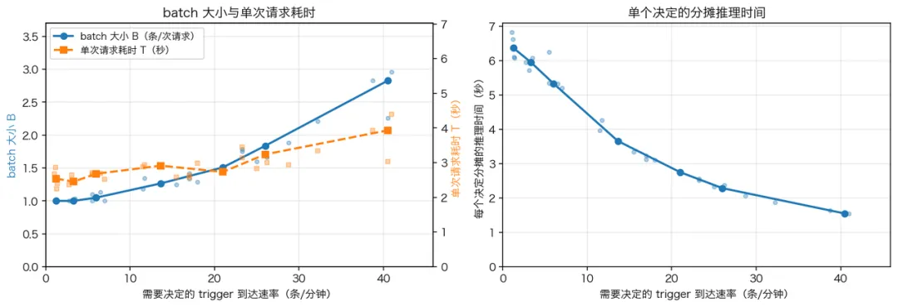

不同 Trigger 到达速率下 Router Session 的 batch 大小、单次请求耗时与单个决定的分摊推理时间

  

8\. 开放问题

  

第 2 至第 6 节介绍的五个模块构成了支撑 Super-agent 运转的基本架构，第 7 节的实验也验证了其中核心调度与路由机制在多任务并发下的效果。这套系统之所以能够以较低的复杂度运作，很大程度上是因为我们在当前阶段做出了一系列工程和场景简化。超出这些简化的适用范围后，在双层架构的扩展（8.1 节）、脱离 Session 后的人机协作（8.2 节）、上下文边界与 A2A（8.3 节），以及安全与隐私（8.4 节）上，仍有一些问题需要解决。

  

8.1 如何扩展双层架构

  

前文通过「单常驻 Router Session + 订阅直通 + Worker 间不直接通信」的简化组合，以较小的工程代价覆盖了我们目前的大多数日常任务。但当任务规模扩大、耦合度提高，超出单个 Router Session 的承载范围时，具体的层内结构并无定论，Router 层何时需要水平切分、粒度如何划分，以及同层 Worker 之间何时需要引入直接通信、采用何种协作拓扑，仍有待在更多场景中检验。同时，系统与模型的协同设计（Co-design）也是一个值得探索的方向，针对 Router 层的事件判别、批量分派与上下文召回等任务进行专项训练，有可能进一步提升 Router 层的吞吐与决策性能。

  

与此同时，前文中常驻的 Router 层配合基于引用图的链式召回，主要解决的是近期任务与会话历史的按需检索。当运行周期拉长到跨月甚至更长的时间跨度时，长程记忆便成为制约可扩展性的主要瓶颈。

  

8.2 脱离 Session 之后如何与 Agent 协作

  

前文通过双层架构将底层的多会话管理对用户隐藏，使 Session 不再是产品设计的首要问题；但当底层的执行会话不再直接对应用户界面上的会话后，如何向用户呈现任务并提供自然的交互与项目管理形式，便成为了新的问题。我们认为，以聊天窗口为中心的交互在一定程度上是路径依赖的结果。交互可能可以更多地发生在领域特化的交互界面中，例如像本文的实例那样，让 Super-agent 直接在 GitHub 的 Issue 和 Pull Request 中工作；Session 也可以出于用户的使用习惯而在界面上保留，但用户看到的一个会话在底层未必只对应一个 Session。

  

同时，前文主要讨论了人类在任务发起与结果验收阶段的交互；但在模型能力快速演进的过渡期内，许多任务仍需要人类在中途参与，如何在产品设计中兼顾用户对关键细节的逐步干预与后台自主推进的效率，例如让用户在后台执行过程中随时介入、接管或与 Agent 实时协同工作，同样值得探索。

  

总的来看，用户所需的项目管理与交互形式与具体的工作领域和个人风格密切相关，最终形态很可能是高度定制化的；而 DeepSeek Harness 由于采用开放的架构设计，也更容易支持这种定制化。

  

8.3 如何划分上下文边界并进行 A2A 协作

  

前文讨论的始终是单个 Super-agent 实例内部的设计，默认其服务范围内的信息都汇总在同一个全局上下文中。但当使用范围从个人或小团队扩展到更大的组织时，组织在决定如何配备 Super-agent 时实际上是在划分上下文共享与隔离的边界。需要共享上下文的范围共用同一个实例，需要隔离的范围则各自独立配备。

  

进一步看，一旦组织内或组织间存在多个彼此隔离的实例，例如每个成员各自的个人助手与团队共用的 Super-agent 之间，此时跨边界的协同就是 Agent 间通信（A2A，不特指某个协议）。在互不共享底层上下文、各自代表不同权限边界的前提下，如何实现安全、可靠的 A2A 通信与协作，仍需进一步探索。

  

8.4 如何保障安全与隐私

  

第 3 节的事件驱动设计让 Agent 能够被更广泛的环境驱动，但也增加了接触不可信输入的风险。如果没有办法很好的解决安全与隐私问题，那么 Super-agent 只有在一个很小且可信的范围才能工作。

  

例如，第 5 节将 Agent Loop 部署在云端、并在各类执行设备上安装轻量 daemon，这一设计默认建立在云端与端侧环境彼此受信任的前提之上。但当云端的 Agent Loop 持续接入外部环境事件、而端侧设备上又存有私有代码、敏感数据与本地凭据时，这种跨设备连接便引入了显著的安全与隐私隐患。一旦云端的 Agent Loop 遭遇服务端入侵或提示词注入而被攻破，其连接的全部端侧设备都面临被控制的潜在风险。

  

此外，即使云端未被攻破，只要端侧环境中的凭据能够进入模型的上下文，正常执行过程中同样存在凭据泄露的风险；因此还需要设计相应的机制，让 Agent 能够在完全不接触凭据本身的情况下使用凭据。如果这一架构要走向更广泛的应用，就需要在能够从多样化的环境中召回上下文的同时，解决上述安全与隐私问题。

  

9\. 结语

  

回顾整套设计，我们并没有提出全新的理论，而是将计算机系统中经典的工程思想应用到了 Agent 系统的构建中。具体的实现方式会随技术发展而演进，但我们认为背后的系统设计思路有更长期的参考价值。目前，我们基于这套思路和 DeepSeek Harness 构建的内部 Super-agent 实例已经在持续运行，日常参与问题复现与修复、代码审查响应与 DeepSeek Harness 自身的迭代。

  

正如开篇所述，随着大模型执行单个任务越来越少需要人工干预，限制生产力进一步提升的瓶颈正在转向人的注意力。通过双层架构、事件驱动、异步多信道交互、存算分离与外部 Watchdog，系统在底层接管了繁琐的会话管理与上下文同步，使人类得以从具体的执行细节进一步上移到更高层的决策与验收。

  

在这种形态下，Agent 不再只是一个被动等待指令的对话窗口，而是演进为数字环境中持续在线的自主协作者：面向个人，它可以是跨设备协助处理日常事务的个人助手；面向团队，它融入研发工作流，承接并推进具体任务。我们相信，随着模型能力与底层系统架构的共同演进，这种更自主的工作方式有望成为人机协作的常态。

  

> 本文的部分设计已在 dsh-superagent-prototype 中实现。该插件只是一种为了验证技术路线而提供的原型，并非 DeepSeek 的正式产品。
> 
>   
> 
> 
> Author & Acknowledgements
> 
>   
> 
> 
> 本文源于 DeepSeek Harness 团队的共同实践。Yujia Qiao 完成了系统实现和本文写作，Huanqi Cao, Zui Chen, Xieting Chu, Tianyi Cui, Shiyuan Feng, Yudong Han, Kexin Liu, Shichun Liu, Gesi Luo, Yifan Shi, Tongrui Xiong, C.C. Yu, Ziya Zhang, F. Zhou 等参与审阅讨论并提供反馈。系统的实现与文章的形成，离不开团队日常的交流与积累。

  

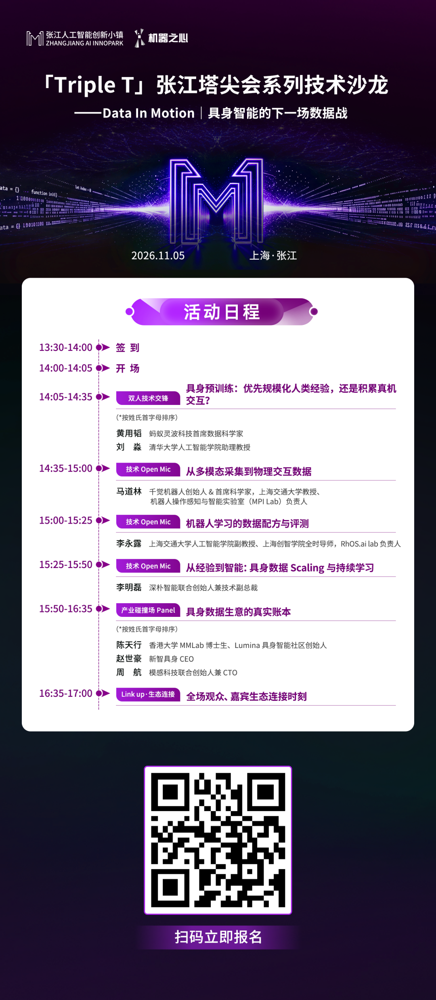

  

© THE END 

转载请联系本公众号获得授权

投稿或寻求报道：liyazhou@jiqizhixin.com