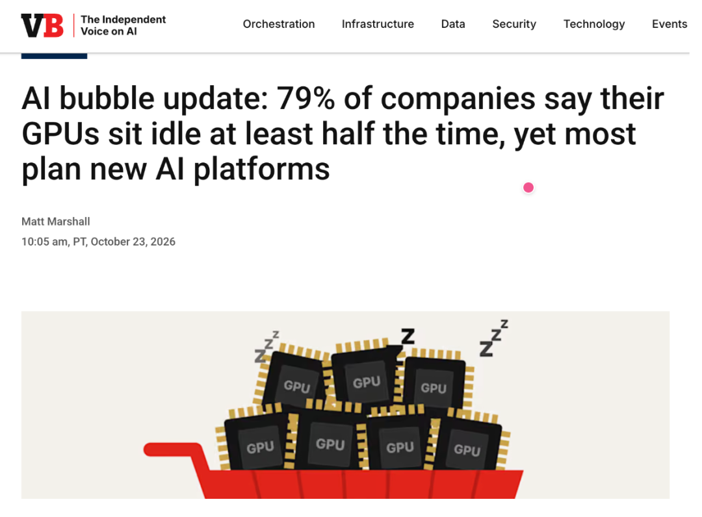
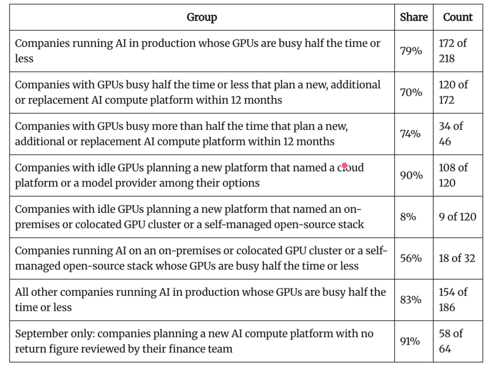
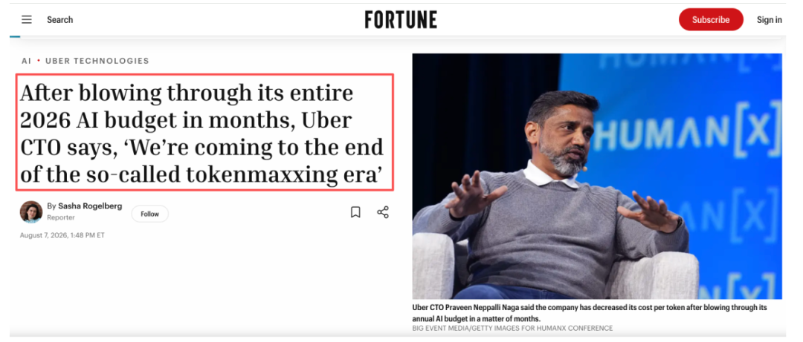

机器之心编辑部  

AI 军备竞赛打到现在，场面似乎开始变得魔幻……

  

近日，科技媒体 VentureBeat 旗下研究机构 VentureBeat Intelligence 汇集的 2026 年第三季度连续调研数据显示，79% 的企业受访者表示，其 GPU 算力至少有一半时间处于完全闲置状态。

  

这一数据在三个月中始终稳定维持在 77% 至 81% 的高位。换句话说，在这批受访企业中，GPU 使用不充分已经成为一个持续存在的现象。

  

  

但更令人匪夷所思的是，在这批 GPU 平均利用率不超过 50% 的企业里，70% 的公司仍计划在未来 12 个月内引入、扩充或更换新的 AI 计算平台。

  

VentureBeat 旗下研究机构 VentureBeat Intelligence 汇总了其在 2026 年 7 月、8 月和 9 月开展的三轮人工智能基础设施与算力领域 VB Pulse 调查结果。三轮调查共吸引了 385 名符合条件的受访者，他们来自员工人数不少于 100 人的机构，其中也包括代表其主要客户作答的咨询顾问。

  

一边是硬件在机房吃灰，一边是 AI 预算账单仍在加速狂飙，问题已然浮出水面：现有资源尚未充分利用，企业为什么还要继续寻找新的 AI 平台？

  

再看投资回报。VentureBeat 今年 9 月的调查显示，在 64 名计划采用新 AI 平台的受访者中，58 人没有经过财务部门审核的投资回报率（ROI）数据，占比高达 91%。

  

这意味着，相当一部分受访企业在准备下一轮 AI 投入时，尚未形成经过财务审核的收益测算。

  

当然，没有经过审核的 ROI，不等于项目没有收益。同一调查中，没有新平台采用计划的受访者也普遍缺少这类数据，但它至少表明，企业 AI 投资的财务评估，可能还没有跟上基础设施投入的速度。也就是说，AI 能力正在快速进入生产环境，但到底花了多少钱、创造了多少价值，仍是许多企业没有完全回答的问题。

  

这些数字之所以重要，是因为华尔街正在激烈争论 AI 是否已经形成泡沫，而 VentureBeat 基于调查提出了一个颇具争议的判断：AI 泡沫的风险，可能已经出现在企业内部……

  

错位的两套账单：

闲置的「算力」与烧钱的「API」

  

表面上看，这种「一边闲置、一边加码」的现象极度违背商业常理，尤其是在多数技术负责人正面临削减 AI 预算压力的当下：一些技术负责人告诉 VentureBeat，在今年秋季的预算季，他们正承受着削减 AI 账单的巨大压力。

  

但深入企业内部架构会发现，企业的真实 AI 需求并没有消失，而是精准地落在了现有硬件根本承接不住的地方。

  

专业人士和消费者正在使用越来越多的 AI，而其中大量工作依赖 Anthropic 和 OpenAI 提供的前沿模型，这种需求将在未来一段时间内继续支撑这些公司在算力方面的投入。

  

真正的错配发生在更下游的企业内部：企业当前正同时为两类截然不同的 AI 支出买单，而这两者之间存在无法逾越的鸿沟：

  

  * 恐慌驱动的算力储备：前两年全球算力短缺的焦虑下，大量企业出于「防踏空」心理提前锁定并采购了 GPU 集群。然而，硬件到位后，企业却缺乏成熟的内部场景与工程能力将其跑满。

  * 对闭源前沿模型的路径依赖：业务团队与工程师更倾向于直接调用 OpenAI、Anthropic 和 Google 旗下最顶尖的闭源前沿模型。企业通过这些公司的 API 按 Token 付费，或者通过月度订阅、大型云服务商购买模型能力，无法将其直接部署到自己此前掌控的本地或托管 GPU 上。

  

这就造成了一个极为讽刺的局面：自建算力成了沉没资产，而调取闭源 API 的成本却以惊人速度吞噬预算。

  

今年 8 月的时候，《财富》杂志就曾报道过，Uber 首席技术官透露，由于公司鼓励员工尽可能多地使用 AI 工具，甚至专门设立了「排行榜」，根据软件工程师使用这些工具的情况进行排名。

  

结果就是，几个月内便耗尽了 2026 全年的 AI 预算，企业不得不宣告「Token 狂欢（Tokenmaxxing）」时代的终结。

  

  

调研数据进一步佐证了这种结构性割裂：在计划采购新计算平台且 GPU 闲置的企业中，90% 将目光投向了公有云与模型 API 服务商，仅有 8% 考虑扩建本地私有集群。与此同时，91% 计划引入新平台的企业，根本拿不出任何一份经过财务部门审核过的实际 ROI 评估。

  

当然，一部分算力闲置可能是企业有意为之，比如为了应对需求高峰而预留 GPU 资源，而计划引入的新平台也可能用于替换旧平台。

  

从「算力军备竞赛」转向「推理经济学」

  

如果说 GPU 闲置暴露的是基础设施利用效率问题，那么 Agent 的普及，则可能让企业面临更加复杂的成本挑战。

  

VentureBeat 预计，接下来企业 AI 支出中用于模型调用的比例将越来越高。尤其是伴随业务从简单的生成式对话迈向多步骤自主的 AI Agent，企业的算力矛盾正在被进一步放大。

  

Gartner 预测，到 2028 年，单个 Agent 工作流的推理成本将上升 5 倍以上。

  

这并不意味着模型的 Token 单价会越来越贵，事实上，随着推理基础设施和模型效率持续优化，单位 Token 价格可能继续下降，但真正的问题是，Agent 完成任务时消耗的 Token 数量，可能增长得比单价下降更快。

  

其中一个很容易被忽视的成本来源，就是上下文。以 AI 编程为例，模型不仅需要理解当前问题，还需要不断读取项目代码、系统指令和历史执行记录，随着任务推进，这些上下文可能在多次请求中重复出现。如果每次都重新处理，成本会迅速累积，这也是上下文缓存越来越受到重视的原因。

  

NVIDIA 工程师在一份技术指南中提到，在其研究的 Claude Code 会话场景中，首次调用之后，后续请求约 85% 至 97% 的上下文可以通过缓存复用，而 Anthropic 的缓存读取价格，根据模型和定价条件，可以低至普通输入 Token 价格的四十分之一至十分之一。

  

对于需要持续执行任务的 Agent 来说，这种优化可能带来相当可观的节省。

  

另一个变量，则是 Agent 数量。行业评测机构 Vals AI 的一项编程任务测试发现，采用主 Agent 调度多个子 Agent 的方案，成本达到单 Agent 的 1.8 至 5.1 倍。

  

然而，在四种测试配置中，只有一种取得了统计显著的性能提升。换句话说，增加 Agent 可能带来更强的能力，也可能只是让更多模型同时消耗 Token。

  

告别粗放扩张：企业务实自救的路径

  

面对极高的闲置率与失控的模型调用账单，对于企业来说，或许粗放式的「盲目采购」正在成为过去。业内普遍认为，在企业签署下一份算力合同之前，应当优先在既有资产中挤出效率：想办法利用已经付费购买的算力和 Token，完成更多实际工作。

  

具体来说，需要做好以下几件事情：

  

  * 衡量每项已完成任务的成本，同时考虑 GPU 算力资源和 API 调用支出；

  * 测试不同模型和推理强度，确定企业的默认配置：评价标准应当是每项已完成任务的成本，而非单个 Token 的价格。因为便宜的模型可能消耗更多 Token，最终导致每项任务的成本反而更高；

  * 只向 Agent 提供它实际需要的上下文，并缓存重复使用的内容： 无论通过模型供应商 API，还是在企业自有基础设施上运行，都应当如此；

  * 只有当任务能够拆分为可并行执行的部分时，才增加第二个 Agent；

  * 将常规、高频任务从前沿模型 API 迁移到运行在闲置算力上的开放模型， 例如分类、信息抽取和文本摘要；

  * 利用剩余的 GPU 闲置时间处理可以延后执行的任务，例如批量推理、模型评测和微调。

  

最终的目标，是让企业为每一项实际完成的工作，支付更合理的成本。

  

这也让开篇那组令人惊讶的数据有了新的意义，79% 的 GPU 低利用率，与 70% 的新平台采用意愿，并不能直接证明 AI 泡沫已经形成，更不能说明整个 AI 行业正在走向产能过剩。但它提醒企业：资源投入与实际需求之间，确实可能存在需要重新审视的落差。

  

过去几年，AI 行业习惯用参数规模、训练算力和资本开支衡量进展。随着技术逐渐进入真实业务，这些指标之外，还需要一套更加务实的评价体系：企业究竟用 AI 完成了多少工作？成功率有多高？节省了多少时间？又付出了多少成本？

  

对于模型厂商来说，这意味着竞争将不只围绕模型能力展开，还会延伸到推理效率、部署灵活性与整体任务成本。对于企业来说，比继续囤积算力更重要的，可能是先想办法把已经拥有的 GPU 和 Token 用好。

  

毕竟，GPU 买来是为了干活的，真正值得关注的，是它最终创造了多少价值……

  

参考链接：

https://venturebeat.com/infrastructure/ai-bubble-update-79-of-companies-say-their-gpus-sit-idle-at-least-half-the-time-yet-most-plan-new-ai-platforms

https://fortune.com/2026/08/07/uber-ai-spending-tokenmaxxing-is-over-cto/

  

  

© THE END 

转载请联系本公众号获得授权

投稿或寻求报道：liyazhou@jiqizhixin.com