这里是「算力网络架构手记」北京

  

  * **专注 AI 集群网络架构与性能优化**

  * **深入 GPU×RoCE×NCCL×K8s 跨层瓶颈**

  * **只拆真实问题，不写概念科普**

  

  

* * *

  

👇 试听内容

  

* * *

  

00

觉得被骗了？

  

你向服务器供应商询问：

“这台机器配的是不是 CX-8 800G 网卡？”

  

对方回答：

“是的，单卡800G。”

  

机器交付后，你却发现每张网卡下面出现两个400G端口。

交换机侧也是两根400G线。

`ethtool` 看到的是400000Mb/s。

`mlxlink` 看到的也是400Gb/s。

  

于是问题来了：

**说好的单口800G，为什么变成了双口400G？**

  

更让人困惑的是，另一台CX-8机器只有一个OSFP笼子，却也被叫作800G网卡；某些资料又写着“XDR 800G单端口”；到了RoCE组网方案里，厂商却坚持让你按两条400GbE rail设计。

  

到底谁说得对？

答案是：

**他们可能都没说错，但说的根本不是同一层。**

  

一张CX-8上，至少同时存在五种容易混淆的“口径”：

  *   *   *   *   * 

    
    
    网卡芯片总处理能力物理连接器数量逻辑网络端口数量每个端口协商速率主机侧PCIe可用带宽

  

如果把这五件事压缩成一句“这是一张800G网卡”，工程设计一定会出问题。

  

> **CX-8不是固定等于“一个800G物理端口”，也不是固定等于“两张独立400G网卡”。800G通常描述的是产品级总网络能力，真正落地必须继续追问：哪个型号、几个笼子、什么协议、怎样拆分、PCIe怎么接。**

  

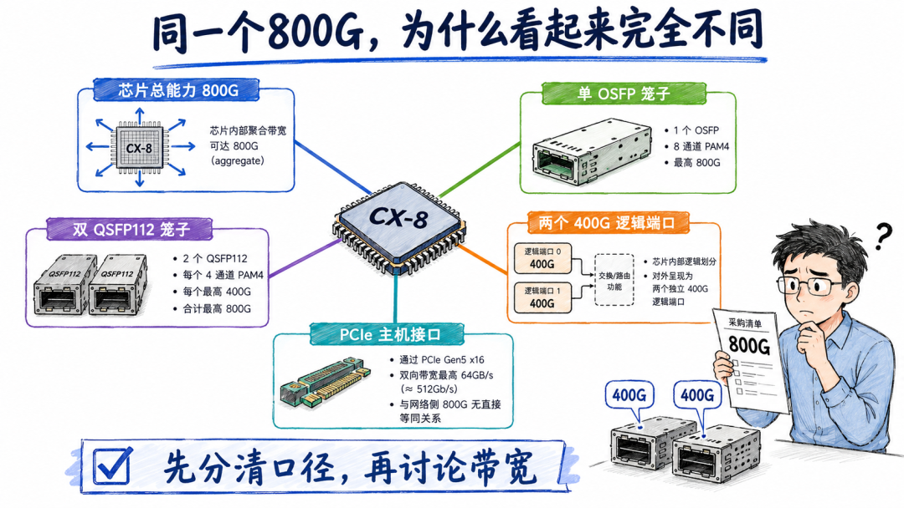

  

01

CX-8既可以是单口800G，也可以是双口400G

  

从产品家族看，CX-8并不是只有一种板卡形态。

按照NVIDIA当前公开的CX-8 SuperNIC资料，至少需要区分三类典型配置。

  

第一类是C8180

它采用单个OSFP笼子，设备总网络能力最高800Gb/s。默认可配置为一个XDR 800Gb/s InfiniBand端口；在Ethernet模式下，则可以拆成两个400GbE逻辑端口，还可以进一步拆成四个200GbE或八个100GbE端口。

  

第二类是C8240

它采用两个QSFP112笼子，默认就是两个400GbE端口，合计800Gb/s。

  

第三类是C8220

它同样采用双QSFP112形态，但默认是两个200GbE端口，也可以配置为一个400GbE端口。

  

  * 

    
    
    官方端口配置文档明确列出了：C8180支持一个XDR 800G IB端口或两个400GbE端口；C8240默认支持两个400GbE端口。

  

所以，“CX-8是单口800G还是双口400G”这个问题，本身缺少三个前提：

  * 具体OPN是什么？  
        

  * 运行InfiniBand还是Ethernet/RoCE？  
        

  * 当前端口拆分配置是什么？

  

在InfiniBand XDR场景中，C8180可以表现为真正的单逻辑端口800Gb/s。

  

在RoCE场景中，当前典型落地方式是两个400GbE逻辑端口，总能力800Gb/s。它可能通过一个OSFP笼子承载两组400G，也可能通过两个QSFP112笼子分别承载400G。

  

这就是为什么你会同时听到：

  * “CX-8是800G网卡”  
        

  * “CX-8是双口400G网卡”  
        

  * “CX-8只有一个物理口”

三句话可能同时成立。

  

> **判断端口形态，不能只看“CX-8”这个芯片代际。必须看到具体板卡型号、连接器、协议模式和端口拆分结果。**

  

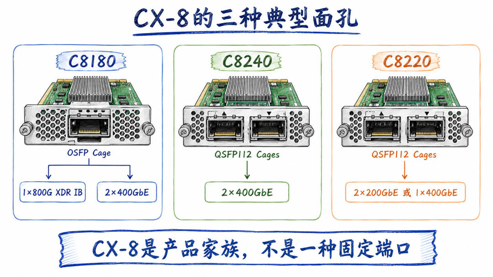

  

02

一个物理笼子，为什么能变成两个400G端口

  

很多争议，源于把“笼子”和“端口”当成同一个概念。

其实它们不是一回事。

  

笼子，是服务器面板上能够插入模块或线缆的物理空间。

逻辑端口，是芯片和操作系统能够独立识别、配置、建链和承载流量的网络接口。

  

高速接口内部不是一根“800G数据线”，而是由多条SerDes lane组成。

以C8180为例：

  *   *   *   *   *   *   *   *   *   * 

    
    
    XDR 800G IB：4条200G级lane→ 组成一个800G逻辑端口  
    2×400GbE：前4条100G级lane→ 组成400GbE端口1  
    后4条100G级lane→ 组成400GbE端口2

  

OSFP能够容纳较多高速lane，所以一个OSFP物理笼子可以承载两个400G逻辑连接。交换机侧可能使用对应的双400G OSFP方案，也可能通过分支线缆连接到两个独立400G端口。

  

相反，QSFP112通常按四条100G级lane组成一个400G端口。因此C8240使用两个QSFP112笼子，分别承载两个400GbE。

  

这时必须区分四个概念：

  

概念| 回答的问题  
---|---  
物理笼子| 面板上能插几个模块  
高速lane| 底层有多少组SerDes信号  
逻辑端口| 系统能独立管理几条链路  
PF/netdev| 操作系统最终暴露几个功能和接口  
  
端口拆分后，你可能看到两个PF、两个netdev、两个RDMA port，甚至两个不同的RDMA设备命名。

但这并不代表服务器里真的多出两颗网卡芯片。

  

它们仍可能共享：

  * 同一个CX-8芯片；
  * 同一组板卡供电；
  * 同一套固件；
  * 同一条或同一组PCIe上行；
  * 同一个散热与复位域。

  

> **“两个400G逻辑端口”提供的是两条可独立建链的数据路径，不等于“两张完全独立的400G网卡”。**

  

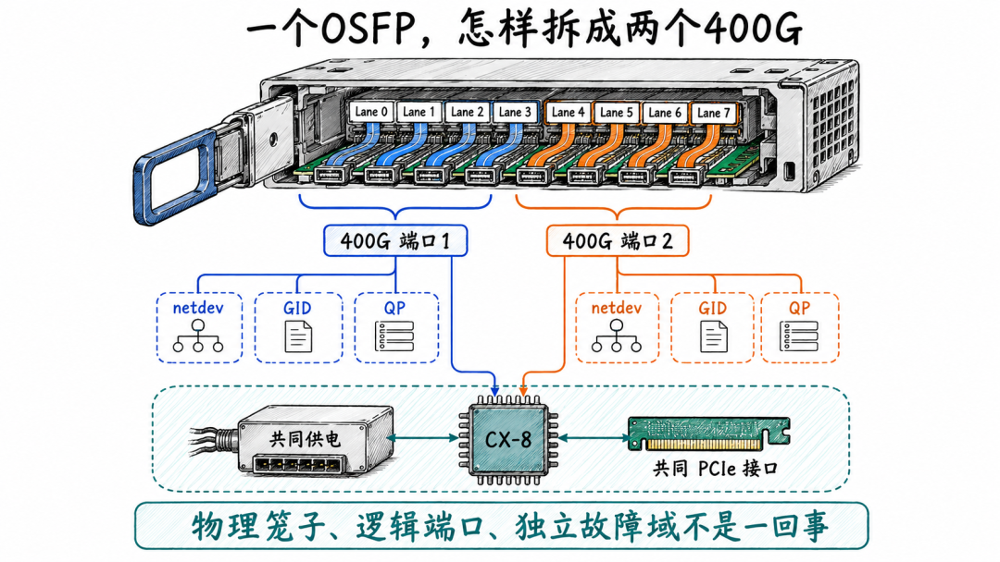

  

03

800G不能靠“400G发送＋400G接收”算出来

  

还有一种常见误解：

“一个400G全双工端口，发送400G、接收400G，加起来不就是800G吗？”

不是。

  

行业在描述Ethernet、InfiniBand端口速率时，通常按**单方向线速** 命名。

  

一个400GbE全双工端口表示：

  *   *   * 

    
    
    发送方向最高400Gb/s同时接收方向最高400Gb/s

但它仍然叫400GbE，不叫800GbE。

  

同理，两个400GbE端口合计800Gb/s，是指：

  *   * 

    
    
    发送方向聚合能力：2×400Gb/s接收方向聚合能力：2×400Gb/s

不能再把收发相加，宣传成“1.6T网卡”。

对于AI训练，这个区别非常重要。

  

  * 

    
    
    AllReduce不是单纯只发不收。一个rank在集合通信过程中，往往同时发送和接收数据。Ring AllReduce中的Reduce-Scatter和AllGather阶段，都要求节点在不同方向持续交换数据。

  

因此，400G全双工意味着网卡能够同时处理400G发送和400G接收，而不是收发总和只能在400G里二选一。

  

但是，双口400G也不意味着单个QP能跑到800G。

  

一个绑定在port1上的RC QP，数据面仍受port1的400G线速限制。要想利

用两条400G，需要至少满足：

  * NCCL或上层通信库确实创建了跨两个端口的通信路径；
  * 两个端口都建立了QP；
  * GPU数据能够被分配到不同channel或不同peer路径；
  * PCIe和GPU-NIC路径能承载聚合流量；
  * Fabric两侧的rail映射保持一致；
  * 对端也能对称地接收这两条路径。

  

> **双口400G的800G，是多路径聚合能力，不是单流自动翻倍，更不是收发方向相加得到的数字。**

  

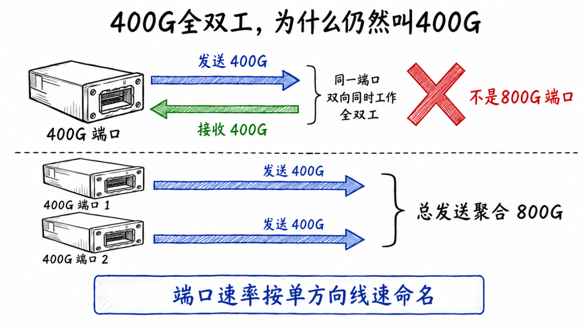

  

04

网卡外面有800G，PCIe里面就一定送得动吗

  

网络端口只解决“线缆侧能跑多快”。

数据最终还要经过主机侧。

  

典型路径是：

  *   *   *   *   * 

    
    
    GPU显存→ GPU DMA→ PCIe路径或内部PCIe交换结构→ CX-8→ 网络端口

  

如果主机侧PCIe带宽不够，外面的两条400G即使都Link Up，也不代表业务能够同时跑满。

  

CX-8支持PCIe Gen6 x16。PCIe Gen6单lane为64GT/s，x16原始传输能力约为1024Gb/s，也就是128GB/s，方向彼此独立。

800Gb/s网络线速换算后是100GB/s。

  

从原始速率看，PCIe Gen6 x16具备承载800G网络流量的空间。当然，真实可用带宽还要扣除PCIe编码、FLIT、协议头、DMA事务和软件路径开销。

  

但如果CX-8实际协商成PCIe Gen5 x16呢？

其原始带宽大约只有512Gb/s，也就是64GB/s。单条Gen5 x16无法在一个方向上承载完整800Gb/s有效网络数据。

  

  * 

    
    
    因此，CX-8还提供Socket Direct扩展方案：通过额外的辅助卡和MCIO连接，再引出一条x16 PCIe通路。官方文档说明，Socket Direct将32条PCIe lane拆成两组x16，分别接入两个PCIe插槽；在Gen5服务器上可以支撑800Gb/s级连接，在Gen4服务器上对应400Gb/s级能力。NVIDIA CX-8 Socket Direct说明

  

这也是为什么你不能只执行：

  * 

    
    
    lspci | grep -i ethernet

看到CX-8就宣布“主机侧800G没有瓶颈”。

  

至少要看：

  *   *   *   * 

    
    
    lspci -Dnn | grep -i -E 'NVIDIA|Mellanox'  
    lspci -s <BDF> -vv | \egrep 'LnkCap|LnkSta'

  

重点确认：

  * 当前PCIe代际是多少？  
        

  * 实际宽度是不是x16？  
        

  * 是否发生x16降为x8？  
        

  * 是否存在第二条Socket Direct通路？  
        

  * GPU与CX-8之间经过什么PCIe路径？

    
    
      
    

> **800G能力成立的前提，不只是网口能协商800G，还包括主机侧PCIe路径能持续把数据送进这张网卡。**

  

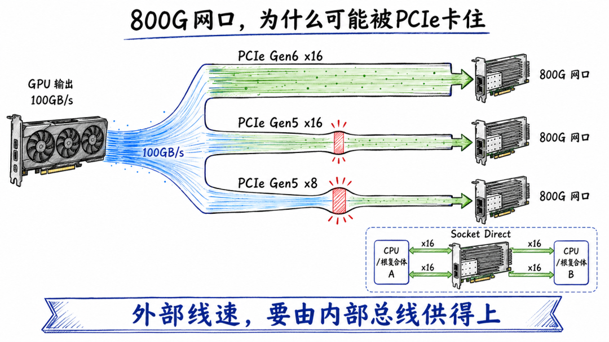

  

05

双口400G，究竟该接同一台Leaf还是两台Leaf

  

确认网卡是双口400G之后，新的问题马上出现：

这两个端口应该怎么接？

  

工程上通常有三种方案。

###   

### 方案一：两个端口接入同一台Leaf

优点是简单。

VLAN、路由、运维边界都比较集中。两个端口可以增加服务器到Leaf的聚合带宽。

  

但它的问题也很明显：

  *   *   *   *   *   *   *   * 

    
    
    Leaf故障→ 两条链路同时失效  
    Leaf上联拥塞→ 两个端口共同受影响  
    同一出口发生Incast→ 双口不能消除拥塞热点

它提高了链路数量，却没有形成真正的Leaf级冗余。

###   

### 方案二：两个端口接入两台Leaf

这可以降低单Leaf故障影响。

  

但前提是你必须明确，两台Leaf属于同一平面，还是两个互相隔离的plane。

  

如果Linux路由、GID、VLAN和NCCL选卡没有对齐，可能发生：

  *   *   *   *   * 

    
    
    从port1发出→ 经plane A到达  
    回程却从plane B返回→ 落到port2

普通IP通信可能仍然能通，但RoCE CM建连、GID映射、ARP学习和故障定位会变得复杂。

###   

### 方案三：两个端口分别进入两个rail或两个plane

这是AI集群里更常见的工程建模方式。

  

例如：

  *   * 

    
    
    CX-8 port1 → rail3-plane ACX-8 port2 → rail3-plane B

两个端口服务同一个GPU或同一组GPU，但进入不同的故障域。

  

这样做的目标不只是叠加带宽，还包括：

  * 让NCCL拥有两条可选择的物理路径；
  * 降低单模块、单线缆、单Leaf端口故障影响；
  * 将流量分散到不同交换平面；
  * 维持各节点rail编号的一致性；
  * 给故障恢复提供备用建连路径。

  

但要注意：如果两个端口来自同一颗CX-8，它们仍共享网卡芯片和部分PCIe路径。

  

> **双口接两台Leaf可以隔离Leaf故障，却不能隔离CX-8芯片、板卡供电、固件和PCIe故障。拓扑冗余必须按真实故障域计算。**

  

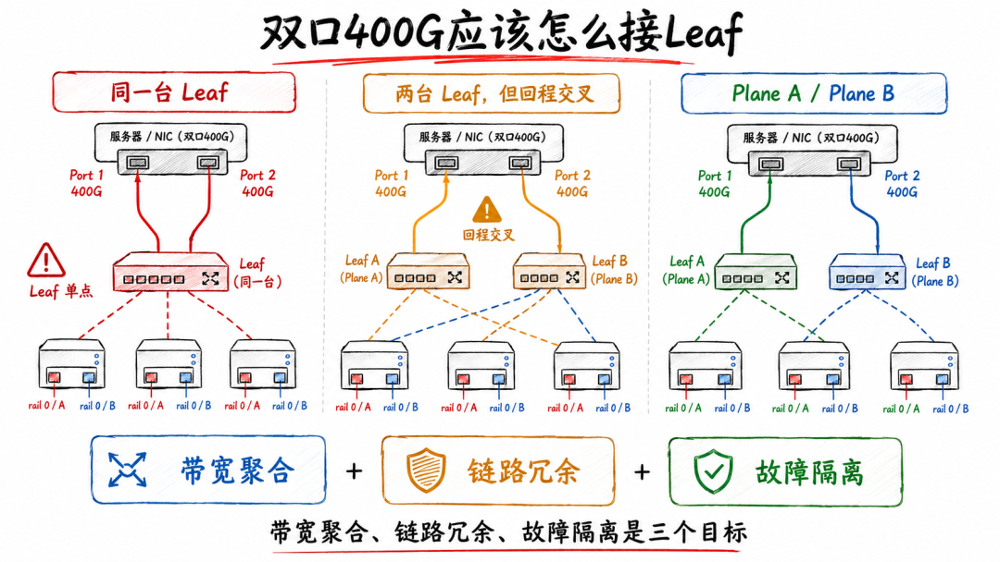

  

06

两条400G都Up，NCCL为什么只跑了一条

  

这是生产现场最容易踩的坑。

  

工程师看到：

  *   * 

    
    
    port1：400G，Link Upport2：400G，Link Up

于是默认认为NCCL一定会把它们叠加成800G。

  

实际上，Link Up只证明物理链路和协议协商完成。

NCCL是否使用两个端口，还取决于：

  * RDMA设备和端口是否被正确发现；
  * 两个端口是否有可用GID；
  * `NCCL_IB_HCA`

  * 是否把其中一个过滤掉；
  * GPU-NIC拓扑是否允许优先使用两个端口；
  * channel数量是否足以形成多路径；
  * Ring、Tree或其他算法怎样分配通信流；
  * `NCCL_CROSS_NIC`

  * 策略是否适合当前rail结构；
  * 对端节点是否拥有对称的HCA和端口映射；
  * NCCL是否认为跨NIC会增加拓扑代价。

  

因此，双口400G至少要分三层验证。

  

第一层，操作系统看到了两个网络身份：

  *   *   *   * 

    
    
    rdma link showibdev2netdevdevlink port showip -br link

  

第二层，两个端口都有正确的RoCE身份：

  *   *   * 

    
    
    show_gidsibv_devinfoip -br address

  

要把下面这条链完整对应起来：

  *   *   *   *   *   *   *   * 

    
    
    HCA→ RDMA port→ GID index→ netdev→ IP→ VLAN→ Leaf端口→ rail/plane
    
    
      
    

  

第三层，NCCL真的使用了它们：

  *   * 

    
    
    export NCCL_DEBUG=INFOexport NCCL_DEBUG_SUBSYS=INIT,NET,GRAPH

  

然后把NCCL日志里的HCA、port和channel，与测试期间两个netdev的字节增量对应起来。

  

如果port1增加400GB，port2只增加几MB，不能因为总线都Up就说“双口800G已经生效”。

  

> **Link Up证明“这条路存在”，NCCL日志和端口流量增量才证明“业务真的从这条路走了”。**

  

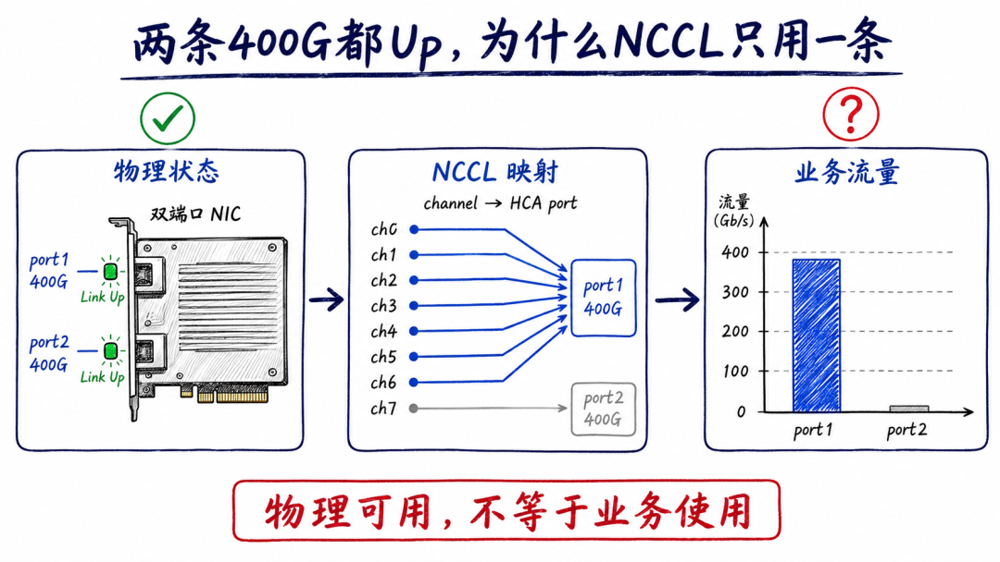

  

07

双口都启用后性能异常，不能先怪RoCE

  

现场经常出现一种更棘手的现象：

单独启用port1，业务正常。

单独启用port2，业务也正常。

两个端口同时启用后，带宽不升反降，甚至出现超时、重传、尾延迟放大。

  

这时不能简单得出“CX-8双口有问题”。

因为单口到双口，改变的不只是带宽。

  

它同时改变了：

  * QP数量  
        

  * NCCL channel分布  
        

  * PCIe DMA并发  
        

  * GPU-NIC数据路径  
        

  * 交换机入口数量  
        

  * 出口队列竞争  
        

  * ECN/CNP反馈节奏  
        

  * CPU或CQ polling压力

  

假设两个400G端口都向同一目标Leaf出口汇聚。

发送能力从400G提高到800G，但下游出口仍只有400G。

  

结果不是吞吐翻倍，而是：

  *   *   *   *   *   *   *   * 

    
    
    两个入口同时突发→ 400G出口队列快速升高→ ECN开始标记→ 接收端返回CNP→ DCQCN对不同QP降速→ 部分QP恢复速度不同→ NCCL出现slow channel→ AllReduce等待最慢rank

这就是典型的Incast或局部超卖放大。

  

还有一种情况是，两个端口分别连接两个plane，但服务器的PCIe路径、GPU DMA通路或某一RC仍是共享瓶颈。此时网络侧看到两个400G，主机侧却没有足够数据喂给它们。

  

正确的对照顺序应该是：

  1. port1单独测试  
         

  2. port2单独测试  
         

  3. 双口并发、不同对端  
         

  4. 双口并发、同一对端  
         

  5. 同GPU双口  
         

  6. 不同GPU分别使用两口  
         

  7. NCCL单节点对、双节点对、全规模

  

并同步观察：

  * PCIe吞吐与重放
  * 两个端口的Tx/Rx字节增量
  * ECN marked增量
  * CNP发送与接收增量
  * PFC pause增量
  * NCCL channel和slow rank
  * GPU利用率与step time

  

> **双口问题必须用“单口正常＋双口异常”的对照继续切分：是PCIe共享、GPU亲和、QP调度，还是Fabric出口拥塞，而不是把所有异常统称为800G跑不满。**

  

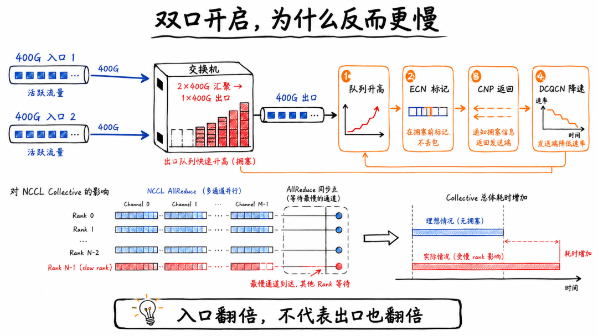

  

08

双口400G能不能直接做Bond，变成一个800G接口

  

从传统Ethernet思维看，答案似乎很简单：

两个400G端口做bond或LAG，不就得到一个800G逻辑接口了吗？

  

对普通IP网络，这可能是一种可行方式。

但对RoCE和NCCL，必须更谨慎。

  

第一，LAG通常按流哈希

它不会把同一个RC QP的每一个数据块轮流分到两条成员链路。少量大流时，两个400G端口可能天然不均。

  

第二，RoCE数据路径不仅识别IP

它还涉及GID、RDMA port、QP、源MAC以及驱动对RoCE LAG的具体支持。普通TCP bond能够工作，不等于RoCE QP一定按预期分流。

  

第三，NCCL本身具备多HCA、多端口和多rail调度能力

把两个端口先在Linux里隐藏成一个bond，有时反而会让NCCL失去对物理rail的感知。

  

第四，LAG切换不等于RC QP无感迁移

某个成员口故障后，新的普通IP流量可能重新哈希到另一个成员口；但已经建立的QP是否能够保持，取决于具体硬件、驱动、RoCE LAG实现和故障类型，不能把传统链路聚合的预期直接套到RDMA。

  

对于AI训练网络，更常见的做法是：

  *   *   * 

    
    
    两个400G端口分别拥有IP、GID和rail身份→ NCCL显式发现两个HCA port→ collective层决定怎样使用多路径

而不是一开始就把两个物理路径压缩成一个普通bond接口。

  

> **Bond擅长隐藏链路细节，NCCL多rail恰恰需要看见链路细节。是否聚合，必须根据RDMA LAG支持和故障模型决定。**

  

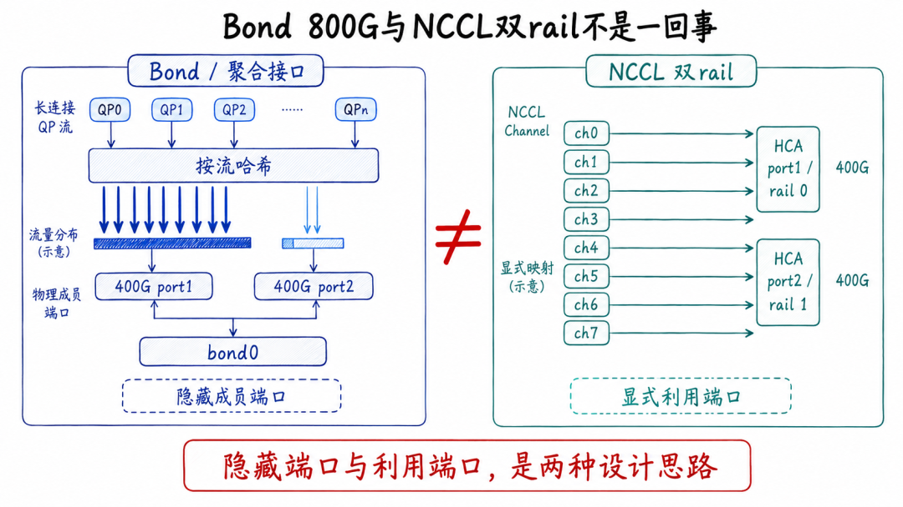

  

09

双口不是天然冗余，网卡Down/Up后QP也不会自动搬家

  

双口400G经常被描述为：

“一条坏了，还有另一条。”

  

这句话只说对了一半。

如果port1模块或线缆故障，port2仍然可能保持Link Up。新的通信连接也可能选择port2。

但已经绑定在port1上的RC QP不会因为Linux发现port2可用，就自动变成port2上的QP。

  

QP建立时，已经确定了：

  * 本地HCA和port  
        

  * 本地与远端GID  
        

  * QP号与PSN  
        

  * 路径MTU  
        

  * 超时和重试参数  
        

  * 远端地址信息

  

port1故障后，原QP会经历重试、超时或completion error。

NCCL communicator可能随之失败。训练框架需要重启通信对象、重组任务，或者从checkpoint恢复。

  

即使两个端口连接到不同Leaf，也要继续追问故障发生在哪一层。

故障位置| 双口能否隔离  
---|---  
单端口模块或线缆| 通常可以保留另一端口  
单个Leaf端口| 另一plane可能仍可用  
整台Leaf| 取决于另一端口是否接不同Leaf  
CX-8芯片故障| 通常两个端口一起受影响  
板卡供电或温度故障| 通常一起受影响  
PCIe链路故障| 两个端口可能同时失去主机连接  
驱动或固件复位| 两个端口及相关QP可能一起受影响  
  
因此，真正的高可用不能只画两根线。

  

它还需要：

  * 上层识别RDMA completion error
  * NCCL异步错误检查
  * communicator销毁和重建
  * 任务级弹性恢复
  * checkpoint或业务状态恢复
  * 故障端口隔离与重新纳管

  

> **双口提供的是备用物理路径，不是已经建立的RC QP无损迁移能力。链路冗余与业务无感恢复之间，还隔着通信对象重建。**

  

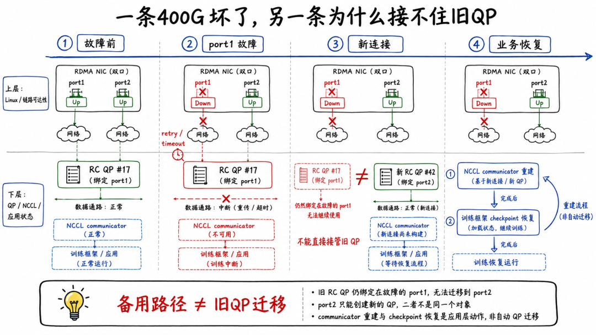

  

10

采购CX-8时，必须问清楚这八个问题

  

很多CX-8争议，其实不是技术问题，而是采购描述过于模糊。

  

采购文件如果只写：
    
    
    配置800G CX-8网卡

这远远不够。

  

至少应该问清下面八项。

  

### 1\. 具体板卡型号和OPN是什么

CX-8只是芯片代际。

C8180、C8240、C8220的端口能力就不一样。即使名称相近，散热、加密、Secure Boot、连接器和扩展方式也可能不同。

###   

### 2\. 是单OSFP还是双QSFP112

这决定了模块、线缆、交换机端口和布线方案。

“一个笼子”也不必然只有一个逻辑端口。

###   

### 3\. 运行InfiniBand还是Ethernet

同一板卡在IB和Ethernet模式下的端口组合可能不同。

C8180的“单口800G”首先对应XDR InfiniBand；RoCE则运行在Ethernet模式下，常见表现是2×400GbE。

###   

### 4\. 当前到底配置几个逻辑端口

不能只看面板。

应确认`NUM_OF_PF`、`MODULE_SPLIT`、`LINK_TYPE`、`NUM_OF_PLANES`等设备配置，并确认改变配置是否需要冷重启或power cycle。

###   

### 5\. 两个400G端口是否能同时达到目标吞吐

“双口都能分别跑400G”和“双口同时跑到接近800G聚合”不是同一项验收。

后者还要验证PCIe、GPU亲和和Fabric路径。

###   

### 6\. 主机侧PCIe是什么模式

要写清楚：

  * PCIe Gen6 x16  
        

  * 还是Gen5 x16  
        

  * 是否使用Socket Direct  
        

  * 实际协商宽度是否为x16

不能只引用网卡理论能力。

###   

### 7\. 两个端口属于怎样的故障域

是接同一Leaf、两台Leaf，还是两个独立plane？

共享哪些PCIe、供电、固件和散热资源？

###   

### 8\. 配套模块和交换机端口是什么形态

单OSFP承载2×400G，需要与交换机侧模块、分支方式和lane映射相匹配。

模块“能插进去”，不等于lane、速率、协议和FEC模式一定兼容。

  

> **合格的采购描述不是“1张800G网卡”，而是“具体OPN＋端口形态＋逻辑配置＋PCIe模式＋模块线缆＋目标组网＋双口并发验收标准”。**

  

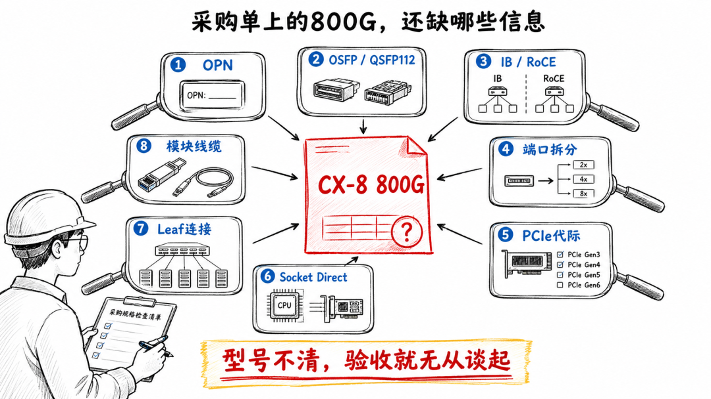

  

11

不要只跑一次`ib_write_bw`

  

  

CX-8验收至少要分成六层。

  

### 第一层：确认身份

  *   *   *   *   * 

    
    
    mst status -vlspci -Dnn | grep -i -E 'NVIDIA|Mellanox'ethtool -i <netdev>rdma link showibdev2netdev

  

目标是建立：

  *   *   *   *   * 

    
    
    PCI BDF→ mst设备→ HCA→ RDMA port→ netdev

###   

### 第二层：确认端口配置

  * 

    
    
    mlxconfig -d <mst_device> q
    
    
      
    

重点检查：

  *   *   *   *   * 

    
    
    LINK_TYPENUM_OF_PFNUM_OF_PLANESMODULE_SPLITPCIe相关模式

  

不要看到两个netdev就武断认为是两张物理网卡，也不要在未核对OPN和官方支持矩阵前直接修改这些参数。部分端口重构需要power cycle，生产设备必须保留带外管理和回退方案。

###   

### 第三层：确认链路与模块

  *   *   * 

    
    
    ethtool <netdev>mlxlink -d <mst_device> -p <port>ethtool -S <netdev>

  

检查：

  * 协商速率；
  * lane数量；
  * FEC模式；
  * 模块温度；
  * 收发光功率；
  * BER与FEC corrected/uncorrectable；
  * link down与恢复次数。

###   

### 第四层：确认PCIe

  *   * 

    
    
    lspci -s <BDF> -vv | \egrep 'LnkCap|LnkSta'

  

如果能力是Gen6 x16，实际却只有Gen5 x8，就不能用“CX-8本来就是800G”解释性能不足。

###   

### 第五层：逐端口和双端口压测

验收矩阵至少包括：

  * port1单向  
        

  * port1反向  
        

  * port2单向  
        

  * port2反向  
        

  * 双口同时、不同对端  
        

  * 双口同时、同一对端  
        

  * 长时间稳定性

  

结果不能只看峰值，还要看平台期中位数、重复稳定率和正反方向差异。

###   

### 第六层：NCCL真实业务验收

最后再跑AllReduce、AllGather、Reduce-Scatter和All-to-All。

同步记录：

  * NCCL busbw
  * 两个端口流量增量
  * channel与HCA映射
  * PCIe吞吐
  * ECN/CNP/PFC增量
  * GPU利用率
  * slow rank与step time
  * 端口或Leaf故障后的任务表现

  

> **验收顺序应该是：先证明端口身份，再证明单口能力，再证明双口聚合，最后证明NCCL确实把800G能力转化成了业务收益。**

  

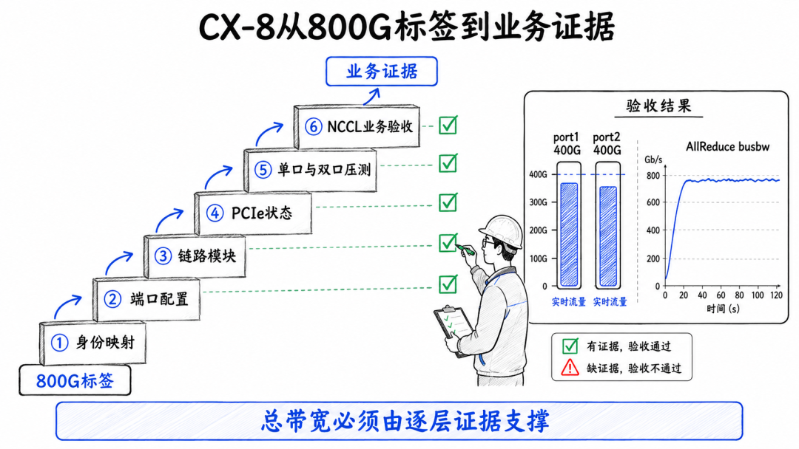

  

12

真正要问的，不是单口还是双口

  

回到标题：

CX-8到底是单口800G，还是双口400G？

  

准确答案是：

**看型号、看协议、看端口拆分，也看PCIe。**

  

C8180可以通过一个OSFP物理笼子提供一个XDR 800G InfiniBand逻辑端口，也可以在Ethernet模式下拆成两个400GbE逻辑端口。

  

C8240则通过两个QSFP112笼子，默认提供两个400GbE端口。

在RoCE工程里，“CX-8 800G”更应该理解为：
    
    
    这张SuperNIC最高具备800Gb/s聚合网络能力

  

而不是默认理解为：
    
    
    存在一个可以承载单个800GbE流的普通Ethernet端口

  

从采购到组网，再到NCCL验收，必须把整条路径展开：

  *   *   *   *   *   *   *   *   *   * 

    
    
    GPU→ PCIe/内部交换结构→ CX-8芯片→ PF与RDMA port→ GID与netdev→ 2×400GbE→ rail/plane→ Leaf-Spine Fabric→ 对端CX-8→ 对端GPU
    
    
      
    

任何一层只有400G，或者任何一层只实际使用了一条路径，业务就不会凭借“800G”标签自动翻倍。

  

同样，双口也不会自动带来高可用。

两条链路可以分散物理路径，却仍可能共享网卡芯片、PCIe、供电和固件；一条链路故障后，旧QP也不会自动迁移。

  

  * 具体是哪一个OPN？  
        

  * 一个OSFP还是两个QSFP112？  
        

  * IB还是Ethernet？  
        

  * 当前拆成几个逻辑端口？  
        

  * 每个端口实际协商多少？  
        

  * 两个端口能否同时跑满？  
        

  * PCIe是Gen6 x16还是Socket Direct？  
        

  * 两个端口分别接到哪个rail和plane？  
        

  * NCCL日志证明两个端口都被使用了吗？

  

这些问题都能回答，800G才从宣传参数变成工程能力。

  

> **真正的800G，不是网卡名字里写着800G，而是GPU、PCIe、CX-8双端口、RoCE Fabric和NCCL能够共同交付可验证的800Gb/s聚合数据路径。**

  

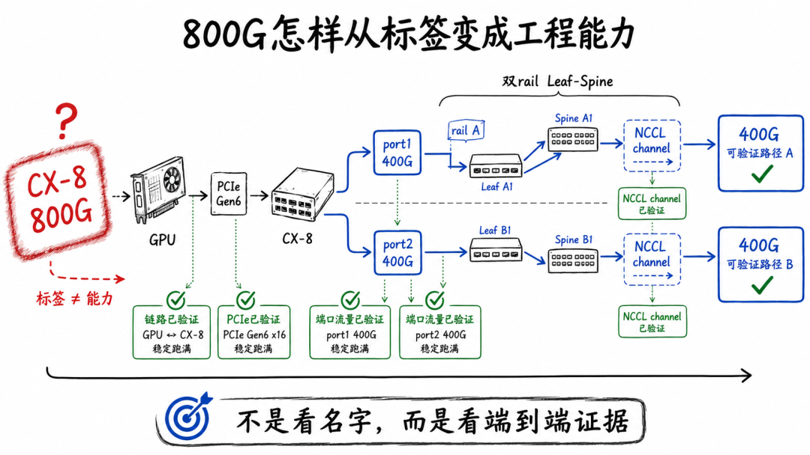

  

  *   *   *   *   *   *   * 

    
    
     # 参考资料## NVIDIA ConnectX-8 SuperNIC User Manual## NVIDIA ConnectX-8 Port Configurations## NVIDIA ConnectX-8 Specifications## NVIDIA ConnectX-8 Introduction与Socket Direct说明## NVIDIA ConnectX-8 SuperNIC for OCP 3.0 User Manual## NVIDIA：ConnectX-8 与 PCIe Gen6平台架构

##   

* * *

  

👉 AI 训练网络全路径拆解 → **私信：****AI网络**

👉 AI 推理网络全路径拆解 → **私信：****推理**

**👉 AI 算力网络架构系统（真机实验环境） → 私信：系统**

**👉** AI 算力网络架构专家（真机实验环境）**→ 私信： 专家**

**👉** AI 网络架构工程指南手册**→**私信：******工程指南**

👉 日常工作1对1答疑 → **私信：****答疑**

  

* * *

  

> **如果你也在做 AI 集群架构**
> 
> **欢迎关注「算力网络架构手记」**
> 
> **长期拆解真实算力网络问题**