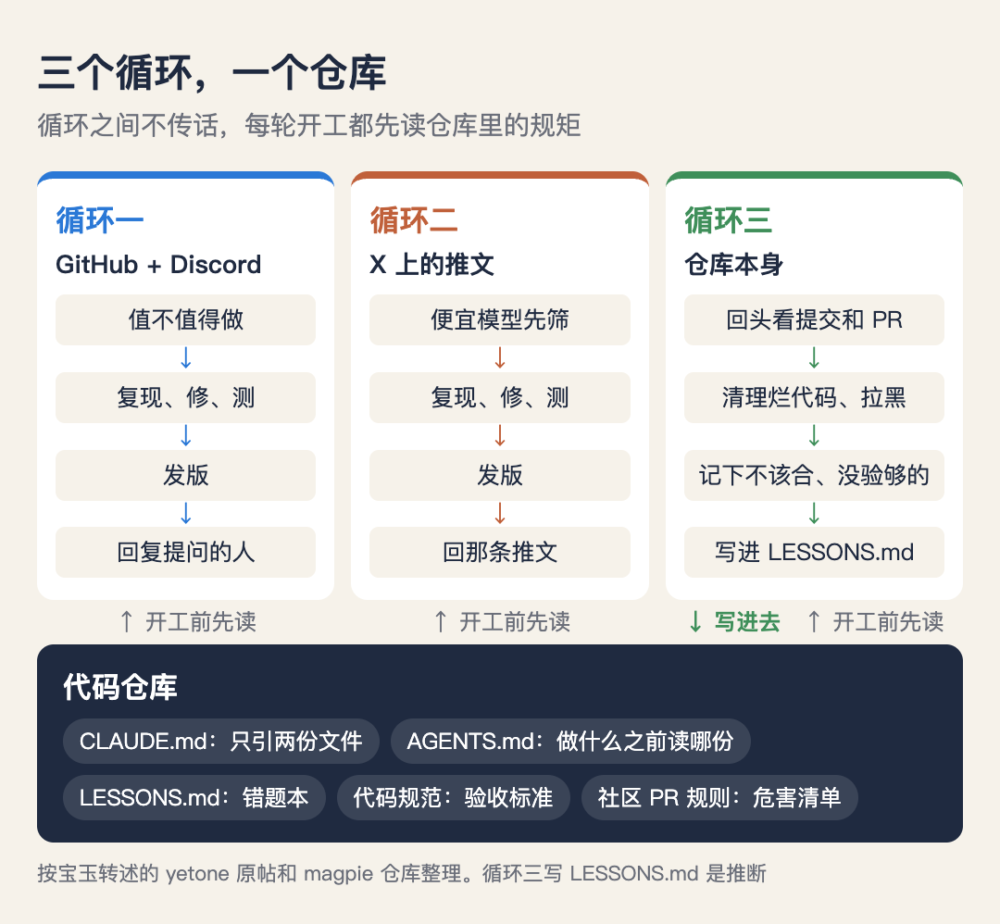
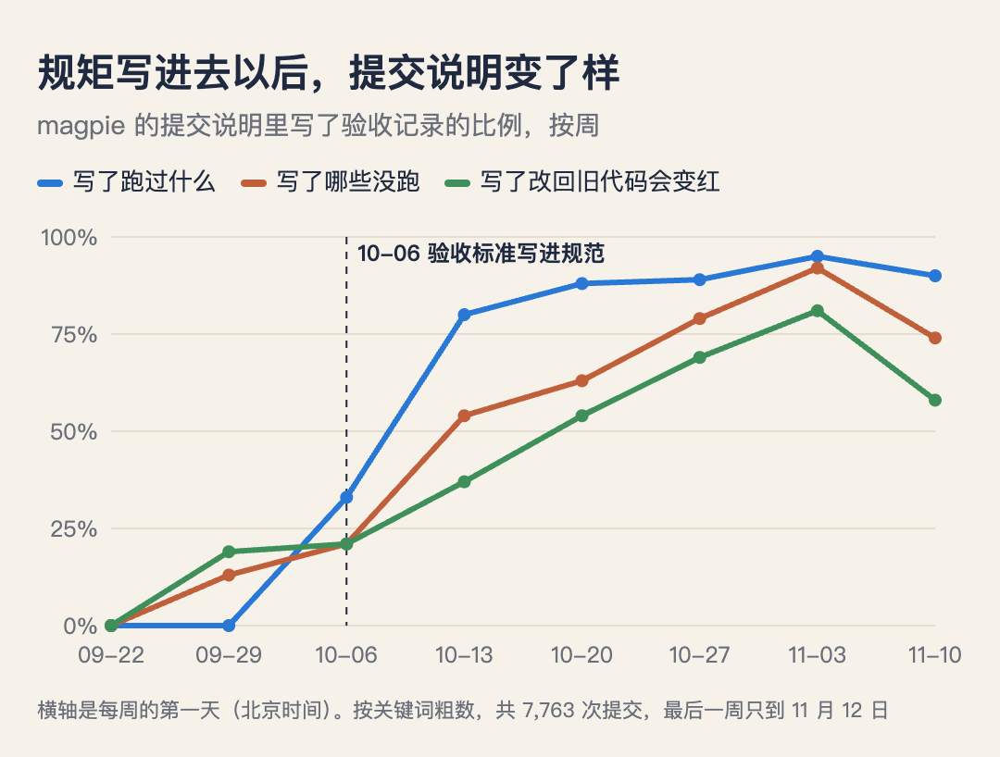
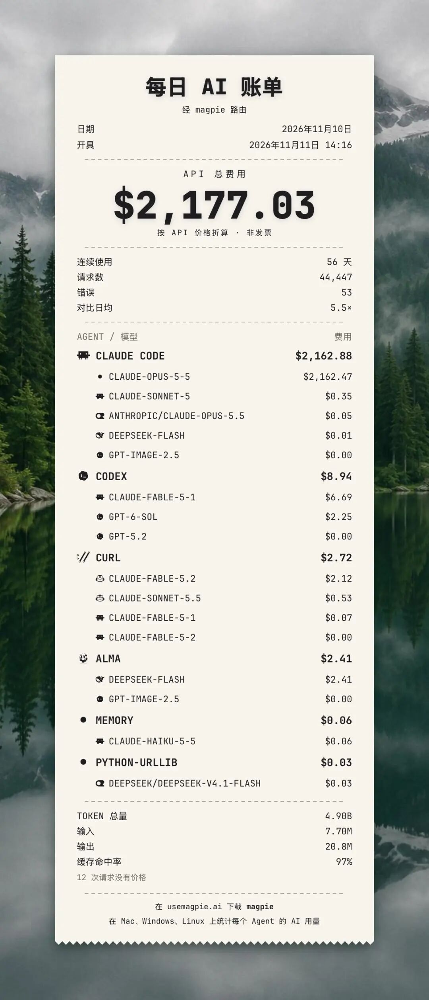

👆 点上方蓝字把酒聊AI关注一下用 AI 做产品，也写 Agent 实测

开源工具 magpie，11 月 1 日一天发了 204 个版本。

X 上有人说，他报了个小 bug，十几分钟就修好上线了。我去算了一下，它每提交一次代码，到含这次提交的正式版发出来，中位数是 16 分钟。

让 Agent 写代码，这两年已经不稀奇了。让我眼前一亮的，是代码写完以后的那一大截，接反馈、复现、修、测、发版、回用户，magpie 交给了作者 yetone 开着的三个 AI 循环，日夜不停地跑。

工作流的帖子已经传了好几轮，可三个循环怎么分工、凭什么没越改越乱，没人拆过。我把它的 7,763 次提交和写给 AI 的规矩翻了一遍，能搬进自己项目的做法在第 05 节。

## 01三个循环，互相不说话

先交代一句 magpie 是什么。它是个菜单栏小工具，管你电脑上每个编程 Agent 用哪家的模型、走哪个账号，本地开一个网关，在各家接口之间来回翻译。我也在用，不过只拿它当多供应商的插线板。

@yetone 10 月在 X 上公开过维护它的做法。原帖设了可见范围，我看不到，下面按宝玉的转述来。他用 Claude Code 加官方的 Opus 5.5，同时开三个 /loop。/loop 是 Claude Code 自带的命令，让同一段提示词隔一阵就跑一遍。

一、第一个守 GitHub 和 Discord。新 issue 先判断值不值得做，值得就修，修完发版、回复提问的人，不值得做的也要回一句。PR 要逐行看，再拉到本地真跑一遍，没问题才合并。

二、第二个守 X。按关键词抓来的推文，先交给一个便宜的决策模型，判断是不是在说 magpie、是不是反馈，不相关的直接扔，“不然太浪费 Token 了”。筛剩下的，它自己修、自己发版，上线后回那条推文。

三、第三个不接外面的活。它的提示词开头一句是，“现在 magpie 完全是自动化更改代码和合并社区里的 PR”。所以它专门回头看前两个干的活，清理屎山代码和恶意代码，把哪些 PR 不该合、哪些验证不够严写下来留给以后的 AI，总交烂代码的人拉黑。

第二个循环为什么非得先筛，我自己撞上过。我在 X 上搜 magpie，第一页全是英超纽卡斯尔的球迷号，那支球队外号就叫喜鹊，magpie 的英文本意也是喜鹊。全丢给 Opus 判断，钱就烧在球迷身上了。

这三个循环是按入口拆的，没有按工种拆。前两个各管一个入口，从看到反馈一路做到发版、回复，中间不交给别人。第三个不碰入口，只管回头挑前两个的毛病。求快的和求稳的，被分到了两个循环里。

更有意思的是，它们之间不传话，也没有一个总调度。我们 11 月 3 日写过 DeepSeek 的 Super-agent，那是一个 Router 给几个 Worker 派单，magpie 正好反过来。三个循环共享的，只有一个代码仓库。

仓库里给 Claude Code 的 CLAUDE.md 只有两行，一行引 AGENTS.md，一行引 LESSONS.md。AGENTS.md 本身也不写规矩，只说做什么事之前先去读哪份文档，改子系统先看设计文档，写代码先看代码规范，审社区 PR 先看社区规则，改代码之前先读 LESSONS.md。

第三个循环要记的那些东西，哪些 PR 不该合、哪些验证不够严，正是 LESSONS.md 开头写的每晚复盘要查的内容，我猜写这本册子的就是它。它夜里记下一条，前两个循环下一轮开工时就会读到。仓库就是它们的公告栏。

## 02一条反馈，怎么变成一个版本

开头那位说“十几分钟就上线修复了”的 X 用户，我在提交记录里找到了他。他的账号在 magpie 的提交说明里至少出现了 5 次。

挑 11 月 9 日凌晨那一条看。他在 0.1.3336 上报的问题，magpie 往 shell 配置里写的一段函数，到了一种用 dash 当默认 shell 的 NAS 系统上，会报语法错误。修复的提交说明分了五块。前四块是谁在 X 上报的、哪个版本，为什么会错，改了什么，在哪几台机器上跑过，一台 Mac，一个 WSL 里的 Ubuntu，那里的 /bin/sh 就是 dash。

第五块最值得看。它把旧写法改回去，新测试在 dash 里变红了，再换上新写法，变绿。最后一行写着 Not run，没跑的东西也列着，完整测试，还有真正的那台 NAS。

另一条给新订阅接画图功能的提交，第一句就是 UNTESTED，“against a real Muse account \(none available\)”，手上没有真账号，就照实写没测过。

这不是 AI 自己谦虚。magpie 的代码规范里有一段验收标准，一个改动要合并或发版，得拿出几样东西。

一、一个没有这次改动就会失败的测试。把旧代码放回去，测试必须真的报 FAIL，编译错误和跳过的测试都不算。

二、测试在临时目录里跑，绝不碰 ~/.claude 这类真实的配置。

三、跑了哪些检查、打出了什么，都写出来。原文是，“A check that wasn't run is listed as not run, never left out.” 没跑的检查要列成没跑，不能不提。

前两个循环一个人既修又验，等于自己给自己验收。这套格式就是用来防这个的，跑没跑、在哪跑、哪些没跑，都摊在提交说明里，第三个循环和 yetone 回头查的时候有据可对。

效果是快。我把每次提交和含它的正式版对了一遍，从提交到正式版发出来，中位数 16 分钟，来自 X 反馈的那些提交是 12 分钟。正式版还得经过另一个仓库签名、公证、打 16 个安装包，这 12 分钟里都包括了。

GitHub 上别人提的 issue，在有了对应修复的那些里，一半在 2.7 小时内就有了修复提交，四分之三在一天之内。提交说明里写明来自 X 的有 825 次，涉及 527 个不同的账号。

它也确实不睡觉。10 月 13 日以来，凌晨 3 点到早上 8 点，平均每个钟头也有四到六次提交，最忙的傍晚 6 点也不过十次。

我觉得快的原因，主要不在 AI 写代码有多快。以前一个 bug 从用户嘴里到新版本，要经过维护者看到、排优先级、开发复现、提 PR、review、等 CI、发版、回复，每一步都在等。团队里等下一个人接手，一个人维护的项目里，等作者睡醒、腾出手。在 magpie 这里，同一个循环从头做到尾，中间没有谁要等谁。

## 03翻车之后的 15 个小时

上面这套规矩，大部分是一夜之间长出来的。

10 月 5 日，magpie 一天 220 次提交、167 个版本。LESSONS.md 后来回头数过，大约 40 个版本是在修当天或前一天刚发出去的版本。推送一个接一个，上一轮测试还没跑完，就被下一次推送取消了，等于没人验过就发了。

接下来的 15 个小时，按提交记录排一下。10 月 6 日凌晨 1 点 37 分，仓库里有了代码规范，提交说明写着起因是一位 Discord 用户的建议。2 点 17 分，加上了前面那段验收标准。3 点 10 分，建了 LESSONS.md，写明 agent 改代码之前要先读它。3 点 56 分，CI 改成 main 分支上的测试一定跑完，不再被下一次推送取消。下午 4 点 24 分，CI 又多了一道 gofmt 检查，注释写着，没格式化的文件 10 月 1 日到 6 日进了 main 8 次。

LESSONS.md 就是那本错题本。每条都是一句规则、一段原因，后面挂着 commit 和 issue 号当证据，最后一行写着 Seen 几次，也就是在几天的复盘里被抓到过。比如有一条说，说修好之前，先在报告人用的那个界面上原样复现一遍，起因是一个 issue 返工了 4 次，每次都只修了截图里的那一个 Agent。

错题本是分级的。一条教训在三个不同的日子都被抓到，就从 LESSONS.md 挪进代码规范，以后每次合并都要逐条对。能用机器查的，再写进 CI，测试配置文件里那两处改动，注释里一处写着出处 LESSONS.md，一处写着“进了 main 8 次”。事故、教训、规范、CI，一级比一级硬。10 月 7 日深夜第一次升级，4 条教训挪进了规范。到 11 月 14 日，LESSONS.md 改过 86 次，记着 68 条。

规矩写进去了，AI 真的照做吗？提交说明能回答。

10 月 6 日之前，提交说明里几乎不写跑过什么。验收标准加进去的那一周，三分之一的提交开始写；再过一周，八成都写了。到 11 月第一周，九成五的提交写了跑过什么，九成写了哪些没跑，八成写了把旧代码改回去测试会不会变红。这是按关键词粗数的，可曲线的走向很清楚。

发版数也跟着变。翻车第二天掉到 41 个，第三天 13 个，之后两周多每天就几个到二十几个。

可到这里还没完。规矩收紧的那半个多月，十次提交里大约只有一次单独打成版本。10 月 24 日以后，提交又从每天几十次涨回两三百次，十次里有七次左右打成版本，比翻车前还高。11 月 1 日，一天 204 个。

规矩一条没松。现在的代码规范里还写着，被打版本的提交得有一次跑完的绿色测试，16 个安装包一个不少，标成 Latest，才算发布了一次。11 月 1 日那 204 个版本，就是在这条规矩底下发出来的。

## 04人守在哪几道门

yetone 没有完全撒手。他每晚抽点时间“铲铲屎”，主要管 UI/UX。提交说明里也能看到他下的指令，比如有一条写着，作者要求所有动画都照 Emil Kowalski 那篇“让 app 感觉更快”的规则来。好不好看，还是他说了算。

社区 PR 是另一道门。magpie 的社区规则第一句就是，社区 PR 由 agent 合并。可审之前，先查危害。改 CI 配置、发布脚本、官网的，新加网络地址、上传或者遥测的，往新地方发凭据、读写凭据文件的，加依赖、二进制或者一团编码过的代码的，碰到任何一条就停，等维护者看过再说。维护者放行之前，PR 的代码不准在有真实账号的机器上跑。

清单里还有一条，加中转站、经销商或推广链接的，也停。

这一条连着 magpie 的钱。加供应商那一页最上面，有一栏合作伙伴，是卖的。L 站有人贴出过报价，官网一个位置一个月 2000 美元，软件里 1000 美元，三类席位全满。按仓库里在位的名单粗算，一个月一万多美元。想进那一栏只能买，借 PR 塞是塞不进去的。

花销也有数。yetone 晒过一张 magpie 自己生成的每日 AI 账单。

11 月 10 日这一天，按 API 标价折算 2,177 美元，几乎全花在 Opus 5.5 上，卡片上还写着“对比日均 5.5×”。倒推下来，平均一个月一万出头。他实际按订阅付多少没有公开，可按标价算，赞助费差不多刚好养得起这三个循环。

## 05能搬走的，和搬不走的

能搬走的是设计，不用先有 3.6 万星。

一、按入口拆循环，靠仓库协调。一个循环管一个入口，从看到反馈一路做到交付，中间不交接。循环之间别互相传话，规矩和教训都写进它们每轮开工都要读的文件里。

二、开放入口前面放便宜模型。监听类的活，先让一个几乎不要钱的模型筛一遍，只把真反馈交给贵模型。产品名撞了常用词的，这一步省得最多。

三、错题本要分级。一条教训写规则、原因、证据，记下被抓到几次。三个不同的日子都出现，就升进规范；能用机器查的，再写进 CI。我们这个号的 AGENTS.md 也是这么记的，每条后面写着谁定的、依据哪次数据，只是还没走到 CI 那一级。

四、把验收写成格式。跑了什么，在哪台机器跑的，把旧代码改回去测试会不会变红，哪些没跑。写不出来，就不算做完。

五、人守会出大事的门。CI 配置、发布脚本、网络地址、凭据、依赖，碰到就停下等人。

搬不走的也有。三台真机日夜开着，账单按标价一天几百美元，得有用户量撑着赞助，才养得起。

还有两个代价，照抄之前得想清楚。

一个是功能会越长越多。流水线谁提需求就接谁的，我用了一个月，只用上了多供应商这一样。X 上也有人直说过 “magpie has too much in it”，循环的回应是开始把功能拆成可以关掉的插件，提交说明里写着照 DeepSeek Harness 的做法。可做哪个、不做哪个，最后还得有人拍板。仓库里现在还开着 4,100 多个 issue。

另一个是安全。PR 有一张危害清单，可推文和 issue 里的文字，怎么防有人夹带指令，公开材料里我没找到写明的规矩。X 那个循环读的是整个开放互联网，又能自己发版。要抄这一套，这一块得自己补上，读消息的权限和发版的权限，最好分给不同的循环。

回到开头那位用户。他报的问题十几分钟就修好了，修它的循环在提交说明里写清了跑过什么、没跑什么。这次提交夜里还会被第三个循环再翻一遍，挑出的毛病写进错题本，第二天三个循环开工前都得先读。

写代码交给 Agent，大家早就习惯了。**magpie 把写完代码以后那一大截也交了出去，跑了七千多次提交，翻过车，没散架。** 撑住它的，是仓库里那几份每轮开工都要先读的规矩，和人守着的几道门。人没有走开，只是从流水线上退到了门口，守审美，守会出大事的门，决定哪些需求不做。

我在这个号上写用 AI 做产品的全过程，也写 Agent 的实测和拆解。

💬 **把酒话 AI** ：写完代码以后的那些活，你最想先交给 Agent 跑的是哪一样？

—— 把酒聊AI