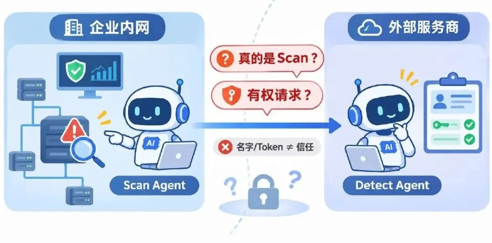
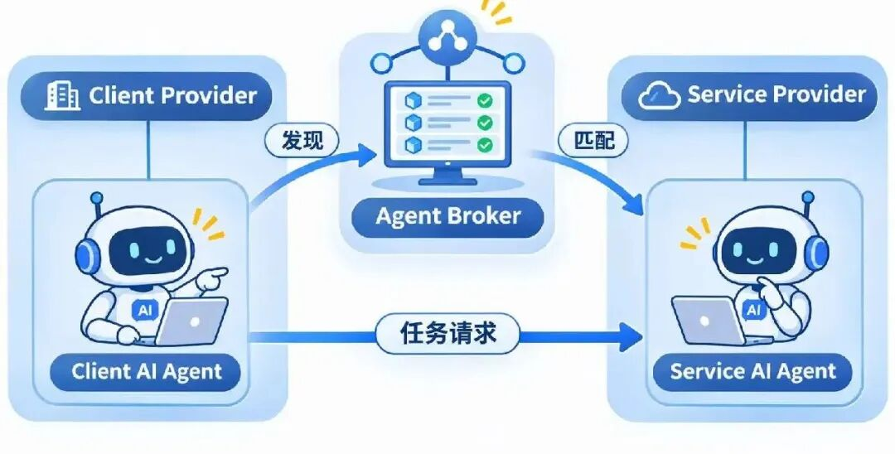
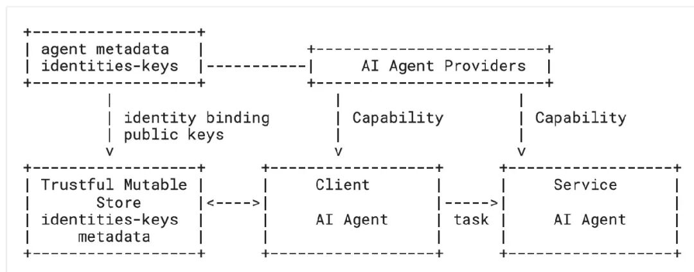

**标准草案：** Self-Certifying Identity and Capability-Based Delegation for Autonomous AI Agents （draft-duda-agent-id-framework-00）

**标准组织：** Internet Engineering Task Force，简称IETF，中文称互联网工程任务组，主要负责互联网技术标准的研发与制定，超过90%的互联网技术标准由其制定。

**注意：** 本标准草案为 Active Internet-Draft \(individual\)，不是官方组织的正式版本。

> **一句话看懂本文：** 当AI Agent跨组织协作时，如何证明对方身份真实、确实获得任务授权？本文提出一套结合自认证身份（Self-Certifying Identity）和基于能力的委托授权（Capability-Based Delegation）的框架，为Agent之间的安全委托提供可验证的协议设计。

> **今日书摘分享** ：
> 
> “原则千万条，利害关系是第一条。实质性问题，都是在这种微妙之处决定的。” ------《沧浪之水》阎真著

## 01 研究背景与问题

假设一家企业正在使用多个AI Agent处理安全事件。内部的Scan Agent负责扫描网络。当它发现可疑活动时，可能需要调用另一家服务商提供的Detect Agent进行深入分析。

问题随之出现：**Detect Agent怎么确认请求来自真正的Scan Agent？又怎么知道Scan Agent确实被允许执行这项任务？** 仅仅知道对方的名称或拥有一份访问令牌，并不意味着可以信任它。即使身份真实，也不能说明它有权执行任意操作。

更复杂的是，**这些Agent可能由不同组织管理、动态创建，甚至只在一次任务中存在。传统面向人类用户或相对稳定服务的身份机制，未必适合这样的协作方式** 。

本文将系统划分为客户端代理（Client AI Agent）、服务端代理（Service AI Agent）及各自的代理提供方（Agent Provider），并引入负责发现服务的代理中介（Agent Broker）。这里需要两次关键的信任建立：不同组织之间需要确认彼此认可的授权条件，而真正执行任务的Agent之间，又需要独立完成身份认证。

从安全威胁看，草案讨论了身份冒充、密钥替换、能力凭证盗用、消息重放，以及DNS欺骗、IPFS基础设施攻击等风险。攻击者可能尝试利用这些途径冒充合法参与者或获取未经授权的操作能力。需要注意，草案没有提供独立、完整的形式化Threat Model。作者希望同时实现身份可验证、权限受约束、跨组织信任可追溯，以及通信过程的机密性和完整性。

> **核心问题：如何在允许AI Agent自主跨组织协作的同时，仍然确保每次任务委托都具有可验证的身份和明确的授权边界？**

##  02 相关工作

### ❶ 传统身份认证：证书、联合身份与Bearer Token

传统系统主要使用数字证书、联合身份系统和持有即授权令牌（Bearer Token），建立用户或服务的身份与访问权限。

这些机制适合较稳定的身份和服务关系，但作者认为，对于数量庞大、生命周期短、能够自主委托任务的Agent，仍然缺少足够贴合其运行模式的身份与授权机制。

### ❷ Agent通信协议：解决如何交互

Agent-to-Agent（A2A）、模型上下文协议（Model Context Protocol，MCP）等机制，主要关注Agent之间如何发现服务、交换消息和执行任务。

现有系统还可能使用Agent Card、专有注册表或集中式目录发布服务信息。

但通信协议和任务描述本身，不等于跨组织的可信身份与授权体系。作者认为，这类机制通常需要额外的身份认证、信任建立和权限验证基础设施，而不是断言它们完全没有安全机制。

### ❸ 区块链：提供分布式完整性保护

Bitcoin、Ethereum等区块链系统通过共识机制提供分布式、完整性受保护的数据记录。

但作者指出，其不可变数据模型与Agent身份、元数据和授权关系频繁变化的需求存在冲突。

因此，区块链不是本文优先选择的身份绑定存储方案。

### ❹ DNSSEC与IPFS/IPNS：在完整性之外支持更新

域名系统安全扩展（DNSSEC）能够保护DNS记录的来源真实性与完整性，同时允许记录更新。

星际文件系统（InterPlanetary File System，IPFS）采用内容寻址保证数据完整性，星际命名系统（InterPlanetary Naming System，IPNS）则提供可更新的名称映射。

这两类基础设施具备作者需要的部分能力，但单独存储身份信息，并不能自动回答Agent是否获得某项任务授权。

## 03 Motivation

现有方案的核心矛盾在于：**Agent需要轻量、动态且可验证的身份，但跨组织合作又要求明确的信任来源和授权责任。**

作者提出了一个关键区分：

**能够证明“我是谁”，不等于能够证明“为什么应该信任我”，更不等于“我被允许做什么”。**

公钥可以证明身份控制权，却无法单独说明背后的组织是否可信。因此，作者将信任建立在具有组织语义的域名、Agent Provider及其可验证关系上，而不是要求每个短生命周期的Agent独立积累信誉。

进一步地，作者把任务授权协商交给双方Provider，把身份认证和实际执行留给Agent。

这样既能保留Agent的自主交互能力，又能让其操作受到事先协商的权限约束。

> **因此，作者没有继续设计单一的Agent访问令牌，而是选择将身份、信任、授权和安全通信拆成相互配合的层次。**

##  04 研究方案

> **💡 核心 Idea** : 作者的方案可以概括为：**用公钥自证身份，用可信组织建立信任，用双方签署的能力凭证限定任务权限，再让Agent在通信时验证这些条件。**

###  ❶ Step 1：让每个Agent拥有可验证的身份

传统身份标识只是一个名称。若不能可靠获得对应公钥，攻击者就可能通过替换公钥冒充其他Agent。

为解决这个问题，作者提出自认证标识符（Self-Certifying Identifier，SID）。

每个Agent首先生成一对公私钥，再根据公钥计算标识符：

其中，是公钥，描述密钥算法及相关参数，是由公钥哈希生成的编码标识。

直观理解，**Agent的身份标识与它拥有的公钥建立了密码学关联。**

验证方不仅可以检查标识与公钥是否对应，还可以通过数字签名验证对方是否持有相应私钥。

**但这里还有一个问题：第一次连接某个Agent时，应该从哪里可靠地获取它的公钥？**

作者为此引入可信可变存储（Trustful Mutable Store），要求其具备分布式、高可用、完整性保护和可更新等性质。

论文提供两种实现思路。

**方案A：DNS/DNSSEC** ：将SID、公钥以及服务元数据发布到DNS记录中，并利用DNSSEC保护记录的来源真实性与完整性。

例如，Provider可以通过TXT记录发布Agent的公钥、名称、支持的协议和服务描述。这种方案能够借助现有域名体系，将密码学身份关联到具有现实组织意义的名称。

**方案B：IPFS/IPNS** ：作者还提出基于IPFS的标识符（IPFS Identifier，IID）。其基本思路是：

  * 通过公钥关联一个稳定的IID；
  * 将公钥及Agent元数据存储为IPFS对象；
  * 使用IPNS记录指向当前的元数据对象；
  * 更新元数据时，发布新的IPFS对象，并更新经过签名的IPNS记录。

IPFS内容标识符（Content Identifier，CID）负责验证内容完整性，IPNS负责提供可更新的签名映射。

两种方案并非需要同时部署的两个独立身份系统。论文将它们作为可信可变存储的候选实现，并讨论了利用DNSSEC为IID增加组织信任背书的组合方式。

**这里最重要的设计不是哈希计算本身，而是把身份的密码学可验证性与身份信息的动态管理结合起来。**

###  ❷ Step 2：从“身份真实”进一步判断“是否可信”

即使某个Agent能证明自己持有对应私钥，也不代表其他组织应该信任它。

作者因此将身份（Identity）与信任（Trust）明确分离。

在框架中：

  * **Agent身份** 由标识符和公钥建立；
  * **组织信任** 来自Provider、Broker及可信域名等信任锚（Trust Anchor）；
  * **信任关系** 通过签名背书和可验证的委托关系连接起来。

例如，某个企业可能并不认识外部Detect Agent，却认识并信任管理它的Service Provider。如果该Provider对Agent的身份和元数据进行签名背书，企业就能够验证背书来源，再根据自身信任策略决定是否接受该Agent。

在服务发现阶段，Agent Broker维护可用Agent的描述、能力和服务端点索引。Client Agent可以先通过Broker找到适合执行任务的Service Agent，再进入授权流程。

Broker主要承担发现与信任辅助作用，并不必然参与后续任务执行。

该图展示了Agent Provider、可信可变存储及客户端、服务端Agent之间的基本关系。

### ❸ Step 3：DAP——先由双方Provider谈好授权条件

找到外部Agent后，不能立即让它执行任务。

**双方还需要约定：谁可以发起任务、由谁执行、允许执行哪些操作，以及任务受到什么限制。**

作者提出委托与授权协议（Delegation and Authorization Protocol，DAP）。

DAP运行在Client Provider（CP）和Service Provider（SP）之间。

**第一步：Provider之间相互认证。**

双方从可信可变存储获取彼此公钥，使用数字签名验证身份，并通过临时Diffie–Hellman密钥交换建立共享会话密钥。后续任务协商在加密且受完整性保护的通道中进行。

**第二步：协商任务权限。**

双方通过提议、修改、接受和最终确认等消息，确定任务范围与执行条件。协议最终生成能力凭证（Capability，CAP）：

其中：

  * 、：服务端和客户端Provider；
  * 、：参与任务的客户端和服务端Agent；
  * ：允许执行的动作、角色、配额、预算、时间窗口等权限限制；
  * ：一次性随机数（Nonce）、序列号、有效期、使用次数及其他协议控制要求。

可以把CAP理解为一份**具有密码学保护的任务授权协议** 。它既指定“谁可以委托谁”，也规定“这次委托最多允许做到什么程度”。

**第三步：双方签名并保护CAP。**

CAP需要由Client Provider和Service Provider共同批准，并分别签名。

随后，使用Service Agent的公钥加密签署后的CAP。 这样，Service Agent可以在后续执行阶段解密并验证任务授权，而未授权的观察者无法直接读取凭证内容。

**为什么采用双方Provider签名？** 因为这次合作跨越了两个管理域：客户端组织需要认可任务委托，服务端组织也需要认可Agent承担的任务。 双方签名使这份授权不再只是某一方的单方面声明。

### ❹ Step 4：IDAP——Agent执行前再次验证身份与权限

DAP解决的是组织之间的授权协商。

但真正执行任务时，Client Agent仍然需要向Service Agent证明：**发起请求的确实是获得授权的那个Agent。**

作者因此提出身份与认证协议（Identity and Authentication Protocol，IDAP）。 其核心流程如下。

**① Client Agent发起请求** ：Client Agent发送加密的CAP、双方Agent标识、临时DH公钥份额和Nonce，并使用自己的私钥对相关内容签名。

**② Service Agent验证请求** ：Service Agent从可信可变存储获取相关公钥，验证Client Agent签名，解密CAP，并检查：

  * CAP是否获得双方Provider的有效签名；
  * Agent身份是否与授权内容一致；
  * 请求的操作是否符合权限范围；
  * 凭证是否满足有效期及其他控制条件。

**③ Service Agent返回认证信息** ：验证通过后，Service Agent生成自己的临时DH公钥份额，并用私钥签名返回。Client Agent验证对方身份。

**④ 双方建立安全会话**

双方使用临时DH交换结果及协议交互记录，通过密钥派生函数（Key Derivation Function，KDF）生成会话密钥，并派生两个通信方向的加密密钥。

IDAP由此将身份认证、能力凭证校验和会话密钥建立结合起来。这里有两个重要安全设计。

**第一，持有证明（Proof of Possession）。**

仅仅窃取CAP，并不意味着攻击者就能使用它。请求者还必须证明自己掌握CAP所绑定身份的私钥。

**第二，前向保密（Forward Secrecy）。**

使用临时DH密钥交换，目标是在长期私钥日后泄露时，仍保护过去已经建立的会话密钥。

此外，Nonce、序列号和有效期等机制用于防范重放攻击，但其有效性依赖正确的协议实现与状态检查。

**最终，DAP负责“这次任务被允许做什么”，IDAP负责“现在发起请求的是不是被授权的Agent”。**

这种职责分离是整套方案的重要设计。它不要求修改MCP、A2A等通信协议的任务语义，而是为这些协议补充身份、信任和授权基础设施。

## 05 安全性论证

### ❶ 身份验证：能否证明Agent身份？

**设计目标：** 防止攻击者通过伪造身份标识或替换公钥冒充Agent。

**文中论证：** Sec. 4.1提出公钥派生标识符，Sec. 6要求Agent使用私钥签名证明身份控制权。

### ❷ 授权控制：能否防止凭证被任意使用？

**设计目标：** 将任务权限限制在特定Agent、操作和有效条件内。

**文中论证：** Sec. 4.4和Sec. 5定义双方Provider签署的CAP，Sec. 6要求Service Agent执行前验证凭证和请求者身份。

其设计逻辑是：即使凭证被窃取，攻击者仍需通过相应私钥的持有证明。

### ❸ 通信安全：能否抵抗重放并提供前向保密？

**设计目标：** 提供相互认证、通信机密性、重放保护及前向保密。

**文中论证：** DAP和IDAP使用临时DH密钥交换、签名、Nonce、序列号及有效期等机制。

### ❹ 系统可用性：能否支持大规模动态Agent？

**设计目标：** 支持身份和元数据的分布式发布、完整性验证与动态更新。

**文中论证：** Sec. 7给出DNS TXT记录示例，Sec. 8展示IPNS记录如何将稳定标识映射到可更新的IPFS元数据。

> **📊 Takeaway：** 论文给出了一条逻辑较完整的身份认证与权限委托协议设计路径，但尚未证明其在真实Agent系统中的安全性、效率和可扩展性优于现有方案。

## 06 总结

这篇草案提出了面向自治AI Agent的身份与授权框架，将自认证标识符、可信可变存储、组织信任关系，以及DAP和IDAP两套协议组合起来，支持跨组织任务委托。

它真正有价值的设计思路，是将**“身份真实”“组织可信”和“操作获得授权”** 视为三个需要分别验证的问题，而不是交给单一令牌解决。

但方案仍有明显的待验证空间。论文第12节讨论了密钥失陷、DNS和IPFS可用性攻击、凭证滥用、长委托链验证开销，以及公开元数据导致的隐私泄露风险。密钥轮换、凭证吊销和委托深度控制等仍需要具体实现机制。

此外，论文没有实验评估或形式化安全证明，不能据此认定方案已经具备生产环境的安全性与性能。

**我认为这篇工作值得关注的是它尝试建立一套适用于跨组织Agent协作的身份、信任与授权分层模型。**

* * *

不好意思各位，最近结了个婚，一直没来的及更新，之后就恢复定期更新了。