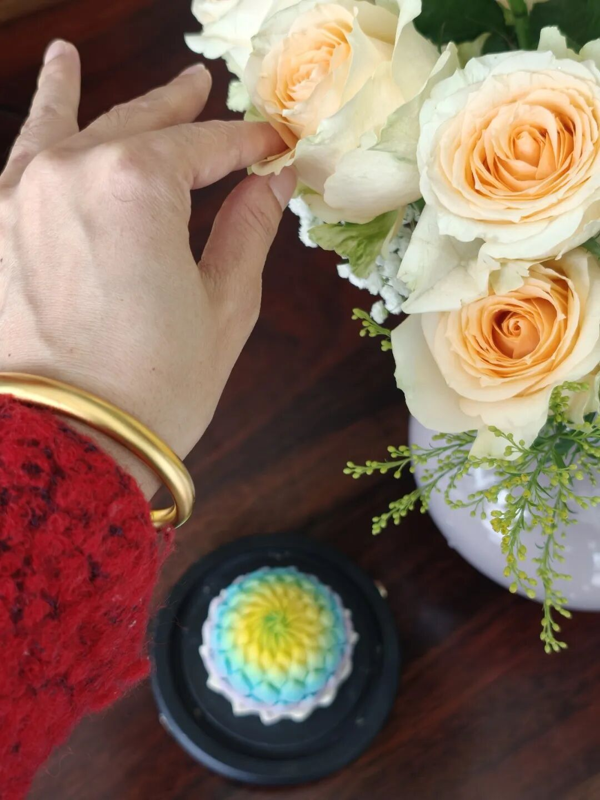

  

今天，刚满43周岁！

  

已有很多年，都是平平淡淡地过，不会特意去讲究仪式感，也很少静下心来写一段属于自己的生日感言。总觉得日子日复一日，烟火寻常，每天都好，就好！

  

但今年不一样。

本来没打算这么快、这么认真地写下一篇长长的心里话。可就在昨天和今天，两件温柔的小事，彻底戳中了我的内心。

  

昨天，我的陈先生发信息来说：“你准备一下，我一会下课到家接你去个地方”……

然后就有了一份超级惊喜，一份沉甸甸的生日礼物——一个大大的黄金手镯。

巧的是，今年也正好是我们结婚十五周年-水晶婚。

  

今天，又在闺蜜陪伴下整整深聊了快四个多小时。聊着聊着，心里特别多积压了好多年、从来没说出来的话，一下子全部涌上心头。

  

很多情绪，我隐忍了一年又一年，习惯不说、习惯藏心里、习惯默默感恩。可这一刻我突然很想好好写下来，好好说一说，这么多年，陈先生到底为这个家、为我、为孩子以及我们的生活，付出了多少。

  

戴上手镯的那一刻，我摸着沉甸甸的质感，心里感慨万千。

黄金有价，而我们携手走过十五年的这份感情，正是大家所说的水晶婚，水晶通透清亮，看得见彼此的真心，自带温润光泽，可它也需要细心呵护，经不起随意磕碰。就像我们这一路的婚姻，看透彼此，坦诚相对，在琐碎日常里慢慢打磨，才换来这份清澈长久的相伴。

他这么多年给我的偏爱、包容和托底，真的是千金不换。

  

以前我总觉得，婚姻就是平平淡淡过日子。可真正走过这么多年我才明白：我这辈子最大的运气，就是嫁给了一个愿意把所有琐碎、所有压力、所有重担，都默默自己扛起来的人。

  

朋友看到的我，好像活得很松弛、很自由。

有自己的爱好，喜欢非遗手工、喜欢做沙龙、喜欢分享，可以安心做自己喜欢的事，可以慢慢成长、慢慢发光。

很多人羡慕我：不用操心家里长家里短，不用被生活磨得狼狈，可以一直保持温柔、热爱……

  

但只有我自己最清楚：我不是天生洒脱，是有人替我负重前行。

这么多年，我真的是几乎没有操心过家里任何一件鸡毛蒜皮的小事，除了陪娃和教育。

  

从柴米油盐、三餐四季，到家里大大小小的采购、缴费、打理琐事，全部都是陈先生一个人在默默操劳、默默安排、默默打理得井井有条。

说句实话，特别惭愧也特别幸福！

  

你们要是问我：

物业费一个月多少钱？水电费一度多少钱？燃气费多少？……

我真的，全然不知

包括孩子从小到大的所有生活用品、所有刚需开销，从来没有真正让我操过心。孩子小时候的纸尿裤多少钱一包、奶粉多少钱一罐、什么时候要补货、家里物资够不够，全部是他一个人记着、一个人采购、一个人安排妥妥当当。

  

我好像从结婚、从有孩子开始，就被他好好保护着，硬生生被他宠成了一个“养多了个女儿”。

  

家里永远满满当当，日子永远安稳踏实，所有细碎繁琐、所有一地鸡毛，全部被他一个人悄悄收拾干净、扛在身上。

  

很多人说，一个男人的爱，藏在大的惊喜里。

可我想说，真正最顶级的偏爱，从来不是偶尔的浪漫，是日复一日、年复一年，把所有琐碎都替你挡完。

  

而且，他还一直默默包容我、成全我、托举我。

在我喜欢的事情上，他永远都是那句话：你喜欢，你就去做吧……

  

有很长一段时间，我学会了性格隐忍，不爱表达。

心里明明千万次感动、千万次心疼他的辛苦、千万次想好好谢谢他，可话到嘴边总是咽回去。

年复一年，我习惯了沉默，习惯了把所有感激藏心底，习惯了默默享受他给我的一切安稳和偏爱。

我总觉得，夫妻久了，心意不必言说，他应该都懂。

  

可今天和闺蜜长聊完我突然醒悟：

再好的付出，也值得被看见；

再深的陪伴，也值得被回应；

再沉默的温柔，也值得好好告白。

  

没有人天生就该辛苦，没有人天生就该扛起一个家。

  

他也是普通人，他也会累、会疲惫、会有压力、会有撑不住的时候。

只是因为太爱、太爱这个家，所以他硬生生把自己活成了我们的靠山、活成了家里的顶梁柱、活成了我永远的退路和底气。

  

这么多年，

我所有的从容，都是他无数个辛苦的日夜换来的；

我所有的底气，都是他日复一日的偏爱托起来的；

我所有能安心做自己、追热爱、慢慢变好的底气，全部来自于他。

  

今天生日，刚好水晶婚，借着这一份沉甸甸的手镯，借着此刻最真实的心情，我想把压抑了很多年的话说出来：

  

亲爱的陈先生，真的谢谢你！

谢谢你这十五年毫无保留的偏爱和包容。

谢谢你把所有辛苦自己扛，把所有温柔留给我。

谢谢你从不束缚我的喜好、不限制我的成长、不抱怨我的“天真”。

谢谢你让我结婚十五年，依然可以活得纯粹、活得热爱、活得不用世故不用沧桑。

  

相信在下一个十五年，和下下个十五年，我会勇敢的站出来，走在你前面，去为你遮风挡雨，分担你的疲惫，接住你的情绪，把这份双向的温柔慢慢延续下去……

  

谢谢你的礼物，也感恩此生，有幸被你一生偏爱、一生托底。