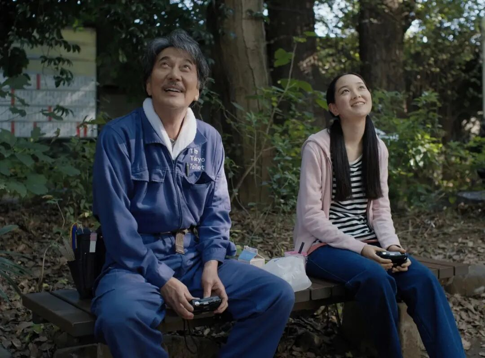

  

在一个鼓励人们「拿大结果」的时代，我们似乎越来越习惯用一些明确的目标衡量人生：考上名校、找到好工作、实现财富自由，最好还能超出预期，完成一次命运的跃迁。但在这些耀眼的结果之外，一个人的人生，还有多少不那么显眼、却同样重要的变化？

  

前不久，《人物》发起了一次关于「小结果」的征集。在收到的许多分享里，我们发现，有时候，「结果」未必意味着一个人得到了什么，反而可能是放弃了什么——放弃一份看起来稳定却让自己感到窒息的工作，放弃一段需要不断委屈自己的关系，放弃为了获得认可而设定的人生目标。这些选择未必让我们拥有更多，甚至意味着失去，但学会说「不」，不再勉强自己，已经是一个重要的结果。

  

有一些结果，听起来实在太小了。有人终于能睡上一个安稳觉，有人能够正常吃一顿饭，有人通过治疗看到病情评分一点点好转，有人重新拥有了逛菜市场、看日落的时间……对于长期被失眠、焦虑困住的人来说，好好吃饭、安稳睡觉，按照自己的意愿安排生活，已经是一件很了不起的事。

  

还有许多人用思辨的眼光看待「什么才算大结果」。他们曾经把考研、出国、光鲜的工作、获得别人的认可，当作衡量人生进展的重要标准，但后来慢慢发现，盲目的追逐越来越悖离内心的意愿。在希望落空、没有明确结果的日子里，他们仍然不知道路在何方，但不再强迫自己拿结果，而是顺其自然，「淡淡的，慢慢的」。

  

很多时候，我们急着解决问题，急着看到成果，但人生的河流是很缓慢的，往往没有那么多惊天动地的转折。就像读者@爱智所说，「眼前有什么，就先试着做点什么吧。只要让自己在某个场域里保持流动，故事就有可能发生。」当下看起来没有什么了不起的结果，隔5年、10年再回头看，或许会结出我们意想不到的果实。

  

  
  
**文｜ 程静之  
****编辑｜ 姚璐**  
  
  

这些小结果，让我有点喜欢上自己了

  

好好吃饭，好好睡觉。

  

@Miles 19岁 男

我人生中一个特别值得纪念的「小结果」，是终于睡了一个安稳觉。对很多人来说，这可能微不足道，但在那之前，我已经整整两年没睡过一个安稳觉了。

  

我在广西一个县城长大，是典型的「小镇做题家」。高中实行类似衡水中学的管理模式，每天早上6点开始，晚上11点结束，一周7天都在上课，每个月只有1天月假。学校要求两年学完3年课程，作业又多又难。我希望考上985、211高校，走出这座山城，但压力越大，越感到每天的任务难以完成，觉得自己又没用又笨，晚上躺在宿舍床上失眠，第二天精神更差，学习更吃力，陷入恶性循环。

  

那两年，我每天起床就觉得困，到了晚上又无法睡，晚自习时还会头痛，像有人拿着一根筷子，从额头插进脑子里，慢慢搅动、不断深入，每天持续4个小时左右。后来，我在医院诊断出严重的心理疾病，但没有治疗，继续在成绩最好的班级里痛苦地学习，满脑子都是「生命可以重来，高考只有一次」的想法。

  

到了高三，因为连续多次考班级倒数第一，我被分到低一层次的班级。那时候，我觉得学业彻底毁了，反而允许自己做一些开心的事，办理了走读，就在走读后的第一个周末，我终于睡了两年以来的第一个安稳觉。

  

没想到，压力减轻后，成绩反而好了。我重新找回信心，如今已经考入一所985高校。回头看，当年我把高考看得太重，承受了许多本不必要的压力，现在才明白，人生不是只有学习这一件事，好好休息，同样重要。

  

@fufu 本命年 女

今年1月左右，因为工作的压力和难度越来越大，我每天到了单位，都要在车里缓上好一会儿，有时甚至半个小时，才能鼓起勇气去上班。

  

我逐渐陷入焦虑抑郁状态，记忆力和理解力显著下降，工作效率很低，脾气不好，连最喜欢吃的东西都没兴趣了，瘦了很多。

  

直到有一天傍晚，我下楼时，在小区闻到一阵夜来香的花香，突然发现，世界上还有很多美好的东西啊！我有了向美好靠近的念头，积极寻找帮助，慢慢恢复食欲，整个人开心了很多，希望能吃好睡好，开开心心度过每一天。

  

@Edward 25岁 男

今年7月，我拿到了精神科医生给我的评价：病情2分，治疗效果2分。在这套评分标准里，0分代表完全康复，7分代表严重恶化。拿到这个结果，我开心了好久。

  

今年是我与双相情感障碍共处的第9年。漫长的治疗曾让我数次灰心，精神障碍有时让我动弹不得，也曾发病住过2次医院。但这些年，我一直没放弃，每天吃药，做过很多次MECT治疗，心理咨询也坚持到现在。回头看，这个小结果让我相信，变好的可能性真的存在，现在每次复诊，我都期待评分能变成两个1分。

  

@茜茜 28岁 女

我终于终于可以正常吃饭了！不再神经质地恐惧碳水了！！！

  

过去5年，我一直受进食障碍困扰，对碳水有着极度强烈的恐惧，不是简单觉得吃了会胖，而是真的觉得有毒，一种根本张不开口的抵触感。我因此暴瘦、营养不良，身体各项指标紊乱，骨量减少，消化功能出了问题，甚至多次晕厥。为了改变这种状态，我接受治疗，进行了长达5年的自我调适和斗争。

  

回头看，我的进食障碍，是精神困惑借由对碳水的恐惧表现出来了。但这5年，我看到了许多以前不了解的世界，回到具体的生活，这个「小结果」最直接的体现，就是能够重新享受食物了，吃了主食之后，脑子不再空虚，身体变得有力，月经也恢复了。带着醋饭的寿司真的很好吃！

  

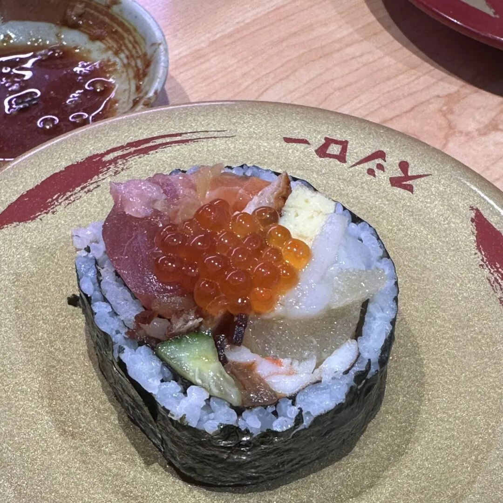

  

@爱吃饭的妮妮 30岁 女

最近，我有3个对自己来说特别有意义的「小结果」：失眠终于好了，拿到了驾照，学会了仰泳。

  

大学最后两年，我的睡眠一直不好，每天寝室关灯后，都要干躺很久才能睡着。备考研究生时期，失眠更加严重，一开始，我试着睡前听小说放松，根本没用；干脆破罐子破摔，熬夜学习，或者一直刷抖音，作息彻底混乱了。甚至有段时间，我严重到早上吃完东西，心脏就跳得厉害，什么事都做不了。

  

后来，我有意识地增加运动、多晒太阳，睡前也不再看手机，坚持了一年，突然有一天，我发现早上吃完东西后，心脏不再剧烈跳动了；又过了一段时间，躺下没多久，竟然能睡着了。用健康的方式对待自己，善待自己，我真真切切改善了身体状态和生活质量，也从原本最平凡的睡眠里，感受到了幸福。

  

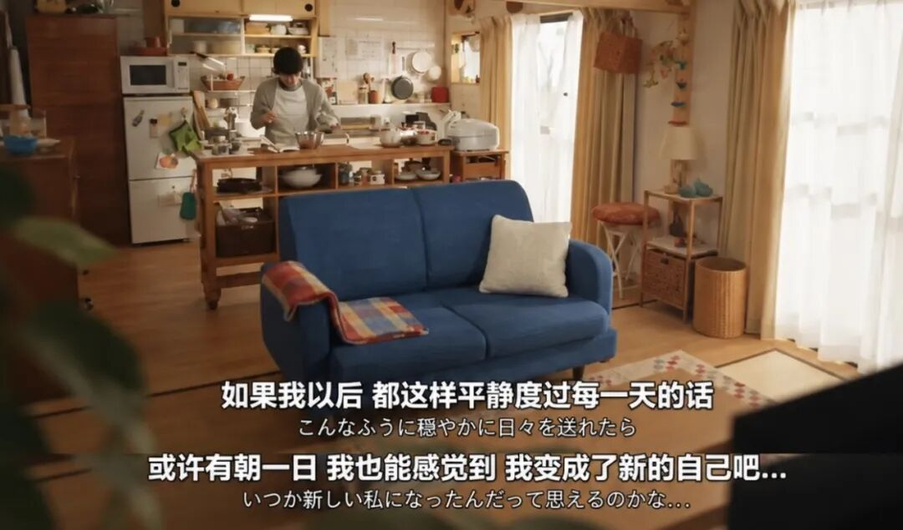

图源剧集《吃饱睡足等幸福》

  
  

干不了什么大事，那就先干点中不溜的事

  

生活是有盼头的。

  

@阿秀 25岁 女

上班快一年，我终于存够钱，可以去矫正牙齿了，甚至能够选择最贵的一款方案！

  

初中时，我曾经做过一次牙齿矫正，但因为家人不愿意让我拔掉四颗牙，加上当时遇到的医生技术不太好，矫正失败了。上大学后，我去三甲医院咨询，医生说，像我这种情况，二次矫正比较复杂，需要到研究型医院去做。我不想再让家人出钱，也不想让他们替我做决定，只好一直搁置。

  

上班之后做的第一件大事，我专门建了一个「整牙基金」，每个月往里面存钱，最终能够选择价格最贵、技术最好的三甲医院主任来做矫正。目前，我正在准备戴牙套，希望一切顺利！

  

@Diara

最近，我用实习和远程工作一点点攒下来的生活费，请妈妈住了一次豪华酒店，来了一次真正意义上的Staycation（宅度假）。

  

我读的是一年制硕士，时间非常紧张，毕业后想留在当地工作，生活成本又高，所以从入学第一天起就开始实习，一边应付5门课的巨大压力，一边考虑未来的生存问题，经常找不到努力的意义，但迫于现实又不得不疲于奔命。

  

那段时间，我也想过干脆躺平算了，毕竟努力也不一定能改变命运，但转念一想，努力至少可以让自己爱的人感到幸福，所谓的「大结果」还很遥远，但能拥有这样一点小小的、确定的幸福，也很好。

  

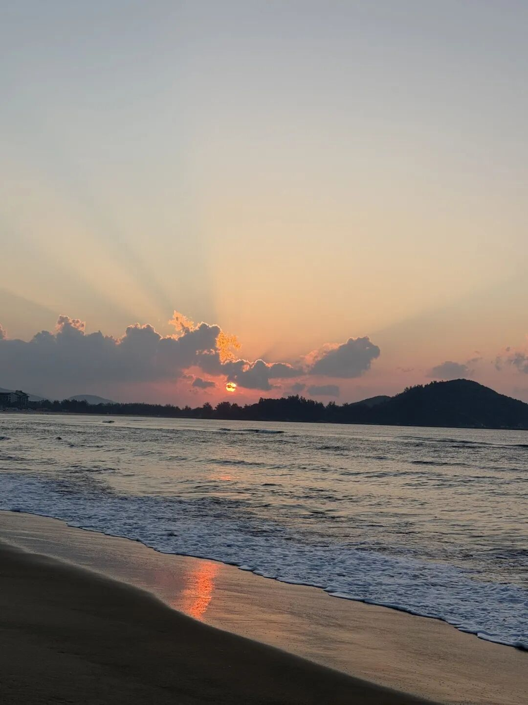

  

@悦然 26岁 女

2026年7月，我终于找到了一份稳定的工作，收到第一笔工资后，给妈妈买了一部新手机。

  

从2025年研究生毕业到正式入职，我经历了一年多的迷茫和焦虑，看着身边同学陆续找到工作，似乎只有自己原地踏步，承受了很大的同辈压力。我先在家乡找了一份见习工作，白天上班，下班后去自习室备考，但接连几次都失败了。直到找到这份工作，我才从不断怀疑、持续内耗的状态里走出来，进入人生下一个阶段。

  

妈妈收到手机后，特意给我发微信，说，「谢谢你的新手机」，我觉得这大概就是工作的意义吧。

  

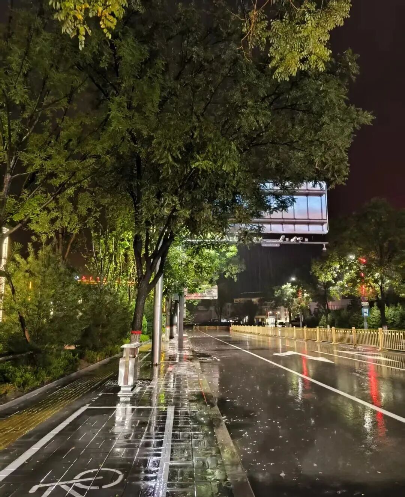

  

@Jenny 25岁 女

就在前几天，我终于决定不再向父母要生活费，正式实现经济独立了！

  

今年6月，我刚刚毕业，开始在上海工作，房租实在太贵，毕业前就和父母商量好，第一年希望他们能帮我承担一半房租。他们口头上答应了，但后来每次评价我的工作，总会流露出不满，还经常拿帮我付房租这件事贬低我的能力。

  

我知道，作为一个双非院校毕业的文科生，现在的工资确实不高，但这些话从父母嘴里说出来，还是特别难过。前几天，我们又爆发了一次激烈争吵，之后，我给他们发消息，说以后不需要再给我寄生活费了。

  

其实在这之前，我就考虑过经济独立，只是一直担心，万一穷到揭不开锅怎么办，这次也算逼了自己一把。读研期间，我加入过学校的家教群，现在找到了一份家教兼职，地点刚好在公司附近，下班后赚点小钱补贴生活。

  

经济独立最直观的变化，就是自己更有底气了，如果下次再有人说我的工作不好、工资太低，连自己都养不活，我可以理直气壮地回复一句，「你放屁！」

  

@小n 30岁 女

我有两个特别骄傲的小结果：一个是本科毕业工作一年后，成功考上研究生；另一个是研究生毕业后，顺利考上公务员。

  

考研之前，我的所有升学经历都是随大流，到了什么年龄就去什么学校读书。本科毕业后，我在一家很小的公司上班，住在一间很小的出租屋里，那时候才后悔，在学校时分不清主次，没能把握学习机会，出了社会才发现什么都不会。

  

我特别想拥有一次重新开始的机会，因此一边上班，一边准备考研，每天早上提前一小时起床学习；中午吃完饭再看会儿书，晚上回家继续学习，周末跟着网课直播学英语。第一次考研没考上，我又报名了，第二次进入面试，又被刷下来了。朋友看我年纪渐长，劝我不如调剂，我接受了建议，最后成功上岸。

  

重回校园后，我真的像一个「重生版」的自己。同学们还像本科时一样，争做班干部、拿奖学金、谈恋爱、聊八卦，但我只是一门心思学习，从不逃课，有时间就去图书馆备考公务员，最后顺利考上，实现了经济独立。

  

回头看，这些结果都不算了不起，但一点一点积累起来的成功，让我的内心变得强大。以前遇到困难，我总会嘀嘀咕咕劝自己放弃，但现在，我会给自己喊加油了，就算干不了什么大事，那就先干点中不溜的事，哪怕小小的成功也好，也许别人看不上，但它们支撑着小小的我，稳稳地生活。

  

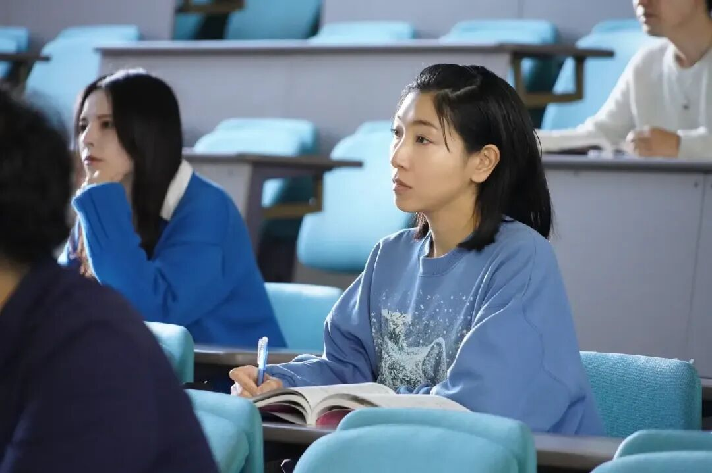

图源剧集《重启人生》

  

  

干脆「外耗」一次

  

早就应该这样吵一架了！

  

@可露露

我最值得纪念的「小结果」，发生在2022年的一次家庭聚餐上。那天，我终于鼓起勇气，和一直让我感到恐惧的哥哥大吵了一架。

  

哥哥的脾气非常暴躁，就像一颗定时炸弹，随时可能与人争吵，闹出非常不堪的场面。过去，只要和他待在同一个空间，我就会紧张，连吃饭都提心吊胆。恐惧甚至延续到了梦里，高中开始，我反复做着充满暴力和冲突的噩梦，甚至梦见自己和哥哥拔刀相向。直到2022年那次聚餐，我终于忍无可忍，第一次爆发，狠狠骂了他一顿。奇妙的是，从那之后，我再也没有做过类似的噩梦了。

  

@青和 19岁 女

高三那年5月初，距离高考还有30天左右，我来月经了，却发现学校超市竟然没有卫生巾卖。那天中午，我因为这件事一直睡不着，反复想着，为什么学校超市不能卖卫生巾？我写了一篇900字左右的建议信，希望学校能够解决这个问题，投稿到了校园墙。文章被采用了，但没想到校园墙后来删除了这封建议信。

  

不过，事情还是有了一点改变，小卖部开始售卖卫生巾，虽然只是放在货架后，学生主动询问，店员才会拿出来。这就是我的一个小结果，不过这件事让我意识到，所有的「结果」，都是一步一个台阶走出来的。

  

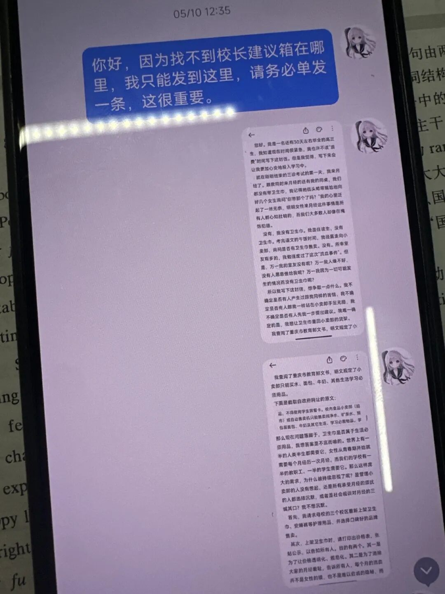

  

@绿色橘子 33岁 女

最近，我完成了一个小小的突破：和部门领导吵了一架，彻底闹掰了。

  

我的领导是一位50多岁的女性，性格古怪，特别爱训人，总是一副不开心的样子。以前，我一直努力讨好她，也不懂得拒绝无理的工作。但后来，我实在忍不下去了，她一边不断给我加活儿，一边说我手里没活儿，还经常阴阳怪气地挖苦我。

  

实在太内耗了！与其让自己一直焦虑、抑郁，不如干脆「外耗」一次。于是，我终于和她大吵了一架，关系彻底闹僵了。现在，她开始对我冷处理，不和我说话，安排工作也让其他同事传话。但说实话，我反而觉得整个世界都宁静平和了，目前看来，这次闹翻并没有带来什么不好的影响，甚至我觉得，早就应该这样吵一架了！

  

@图图 26岁 女

就在前几天，我做出了一个重要决定：离职！

  

这是我毕业后的第一份工作，已经做了3年多，在外人眼里，稳定、双休、有五险，好像没什么不知足的，但实际上早已千疮百孔。最近几个月，公司效益不好，我拿到的工资比刚入职时还少，工作却只增不减。有一次开会，领导说，以后周末要加班，可能直接改单休。为了节省开支，公司甚至辞退了保洁，让员工轮流打扫卫生间。

  

我越来越焦虑，每天下班回家，什么都不想做，只想瘫在沙发上，第二天醒来，又要重复同样的生活。反复考虑后，我觉得这份工作所谓的「好处」，已经远远抵不上它对我的消耗，于是果断提交了离职申请。离职后，我可以逛菜市场，每天都能看到日落，终于觉得自己「活过来」了，而且终于不用打扫公司的卫生间了！

  

@莽驴 22岁 男

最近两个月，我终于明白了一件事：不讨好别人，大大方方做自己，也一样可以拥有朋友。

  

以前，我觉得人与人之间的关系就是一种交易，只有自己足够有价值，才值得别人关注。为了获得认可，我主动帮别人干杂活，每逢过年过节，会给微信好友挨个发祝福。还有一次心血来潮，我整理了一份复习资料，发给所有加过微信的同学，没想到有人直接问我是不是诈骗。那一刻我忍不住问自己，明明是释放善意，为什么要表现得这么窝囊？

  

我上网搜索，才知道这叫「讨好型人格」。读了《被讨厌的勇气》、《当下的力量》这两本书，我逐渐改变自己，退出内耗的群聊，删了一些微信好友。不讨好之后，我发现生活并没有变差，反而快乐变多了。

  

就在今天，我还对不合理的工作说了「不」，觉得特别轻松。这段经历让我明白，人是有权利说「不」的，都是第一次来到这个世界，最重要的是自己开心，而不是时刻把别人的感受放在自己前面。

  

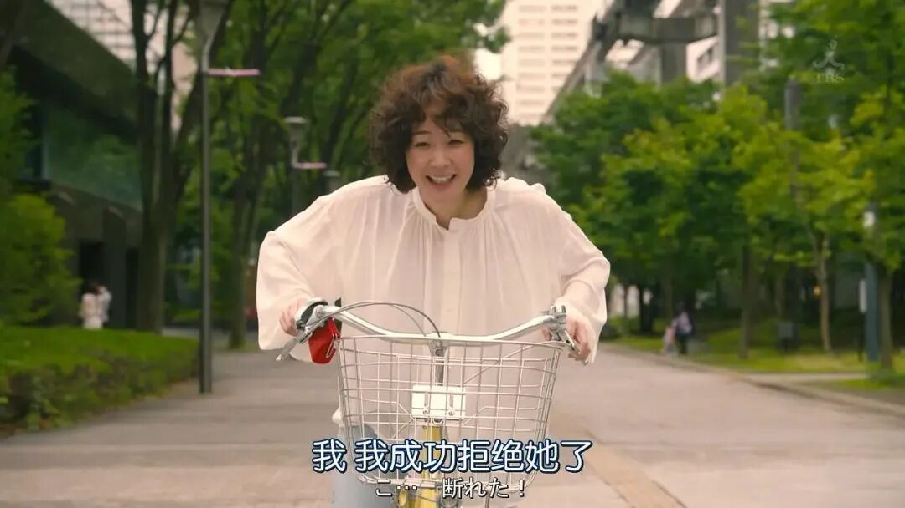

图源剧集《凪的新生活》

  
  

顺其自然，淡淡的，慢慢的

  

生活不是演给别人看的。

  

@王梓 23岁 女

今年6月左右，我终于想明白了一件事：生活不是演给别人看的，前途也不是为了向谁证明自己，才去努力的。对我来说，这是一个特别重要的小结果。它让我开始真正和自己和解，不再那么拧巴、内耗。

  

我是河南考生，高考时没能考上理想的大学，读了专科，后来通过专升本考试，进入一所本科院校。升本之后，我又告诉自己，一定要继续考研，但现在回头看，并不是因为喜欢某个专业，或者有明确的学术追求，而是因为太要面子，「无缝衔接」进入下一所学校，让同学和老师觉得我厉害。

  

我还寻找过另一条路：申请国外大学，觉得出国更厉害、更有面子，为此花了不少钱学雅思。直到课程结束，模拟考试不理想，我才认真思考：为什么非要在一门不擅长的语言上花费这么多时间？难道要为了几句赞美，把未来交给一条并不喜欢的道路吗？

  

临近毕业，身边的人陆续有了新去处，而我既没有考上研究生，也没有收到工作offer。我开始出去旅行，调整状态，重新思考自己究竟想要什么。但父母觉得我是半途而废的逃兵，轮番劝我回去继续学雅思。起初，我总是声嘶力竭和他们争吵，后来平静地解释自己的想法，说出这些话时，我突然意识到，自己已经拿到了一个小结果。

  

或许有人会觉得，我还是一个待业青年，好像什么结果都没有拿到。但过程和经历的意义，并不比世俗意义上的结果的意义更小。我不再被别人的评价和眼光困住了，而是思考未来真正想要的生活。

  

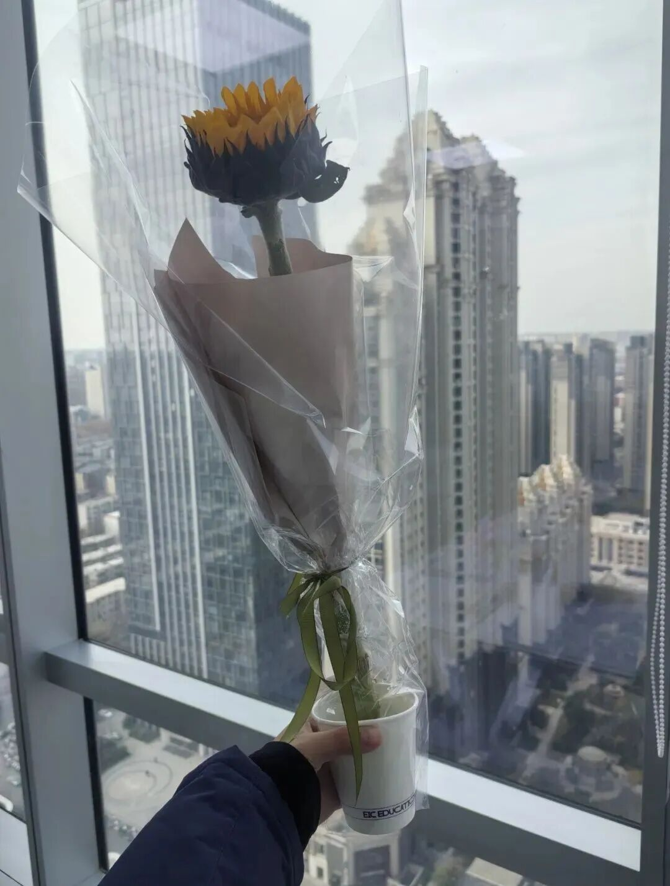

  

@多多 女

最近，我一直在想，究竟什么样的结果，才能算是「大结果」？

  

按照网络上的说法，一个结果只有超出预期，才能称得上「大」。如果投入了很多时间和精力，最后得到的只是预期之内的回报，那大概只能算「小结果」。

  

从读书到工作，我好像很少在取得某个结果的当下，觉得它有多么了不起。因为大多数时候，结果都在自己的预期之内。但每隔5年、10年再回头看，我又会发现，当年那些看似普通的结果，以及为了得到它们而付出的努力，其实已经带来了远超预期的回报。

  

年少时，我独自在一座城市求学。那时候，身边的环境特别强调读书的重要性，获取信息也没有现在这么方便。对当时的我来说，如果想帮助母亲，也帮助自己逃离有毒的原生家庭环境，高考几乎是唯一能够改变命运的机会，而且似乎只有一次。

  

我给高考赋予了太多特殊的意义，压力也成倍增加。整个求学阶段，我都被失眠、心悸和过敏困扰。每天最害怕的事情不是去学校，而是晚上该怎么睡觉。明明身体已经到了极限，精神却始终无法放松。每天晚上，我都听着自己擂鼓一般的心跳声，逼迫自己赶快睡着。

  

那时候，身边没有什么可以提供帮助的人。我需要独自处理情绪问题、料理生活、保证学习不落下，还要应付学校里的语言霸凌。没有别的办法，只能硬生生地熬，渴望拿到清北的「大结果」，最后高考没有超常发挥，也没有严重失误，只是一个符合预期的985大学。

  

但随着年岁渐长，我发现，当年那些难熬的岁月，虽然留下了伤痕，却也让我获得了更强的抗压能力。后来工作不好找，客户难伺候，我也觉得辛苦，但至少知道人生还有很多种选择，不必再像高考时那样孤注一掷。我还养成了持续学习的习惯。不管是从书本、工作，还是从其他人身上，总能学到一些新的东西。遇到问题时，我更习惯先想解决办法，而不是抱怨；面对捷径的诱惑，也会认真考虑，因为我知道，自己曾经一步一个脚印地走过来，虽然慢，但足够踏实。

  

那些读过的书、走过的弯路，也一点点拓宽了我的认知，让我放下过去的执念，不再那么在意别人的期待和目光，慢慢回归自己。直到十年后的某一天，我突然发现，当年拼命想要实现的目标——逃离原来的环境，竟然早就已经实现了。不仅是身体上的离开，也是精神上的离开。

  

我很喜欢一句古语：「善战者无赫赫之功」，还有一句类似的话：「善弈者通盘无妙手」。不一定非要有力挽狂澜的「妙手」，也不一定非要取得惊天动地的「大结果」，一步一步走下去，同样可以走出属于自己的一片天地。

  

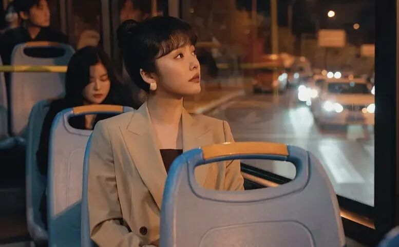

图源剧集《装腔启示录》

  

  

三十美丽，四十也美丽

  

无条件地爱自己、接纳自己。

  

@RosyW

工作快7年了，除了疲惫的心灵，留给我的还有不断上涨的体重。今年，我马上就要30岁了，回头看，自己最美好的7年几乎都用在了工作上。看着肥胖的身体和臃肿的脸，我突然觉得很悲哀，为什么最美好的年华，却没有最好的姿态？

  

2026年4月底，我开始请私教健身。哪怕晚上8点才下班，我也坚持每周去健身房4到5天。就这样坚持了6个月，正常吃饭、正常加班、频繁锻炼，终于瘦了15斤！可能对很多人来说，这不算什么大结果，但对我而言，这是过去7年里一个非常重要的改变。现在，我可以在即将到来的30岁生日里尽情绽放了。三十而丽！

  

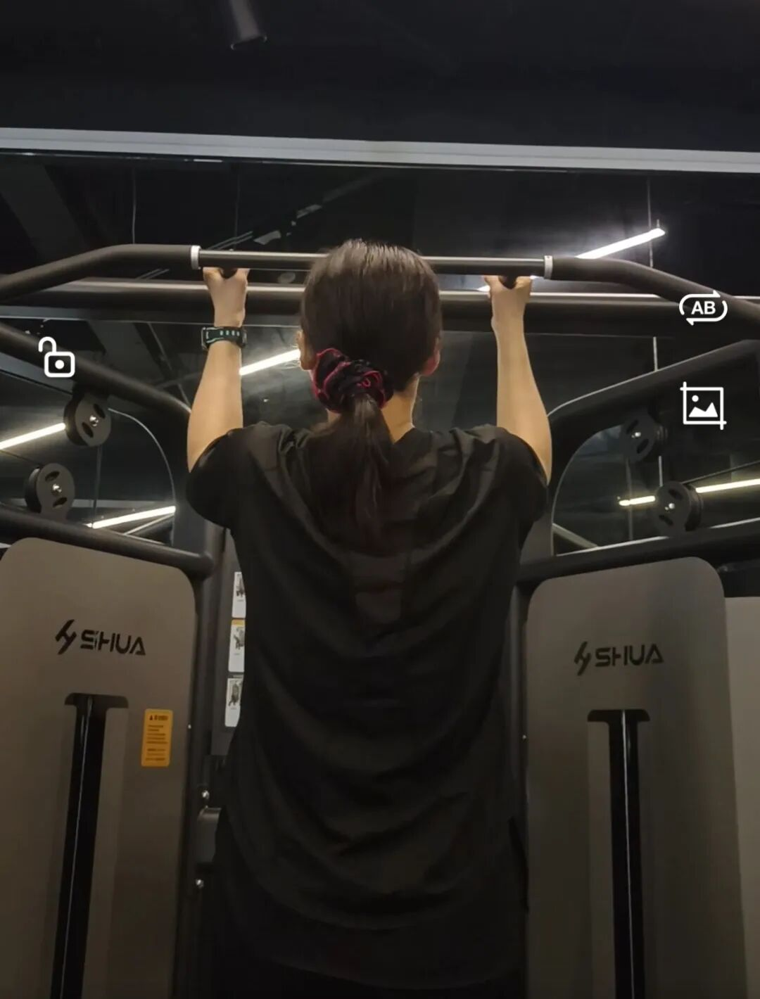

  

@亚子 51岁 女

2015年，我40岁，刚刚博士毕业，离开职场7年后，终于重新找到了一份工作，虽然工资和职位都比以前低，但对我来说，是一个非常重要的小结果。

  

当年，我选择成为全职妈妈时，曾向家人承诺，未来一定会重新回到职场。但这条路并不顺利，因为女性身份和40岁的年龄，我投给高校的简历基本没有回音，企业求职也很困难，因为年龄和职业空窗期被拒绝。

  

后来，好在一位熟人介绍了工作，我很珍惜，虽然只是个普通职员，但和同事建立了友谊。两年后，因为一些机缘巧合，公司不再需要我，我被裁员了，但仍然很感激那份工作，感激职场重新接纳了我。

  

@潇杨 34岁 女

2025年，我终于考下了中级会计证。

  

我本科毕业于一所三本院校，2022年失业之后，就开始生孩子、带孩子，前后有3年的职业空窗期。其实，我一直不太相信自己真的能考下这个证，每天都要带娃、洗衣服、做饭、做家务，真正学习的时间，只有中午和晚上孩子睡着之后，有时候都不知道自己到底在努力个什么劲儿，但就是想把这个证考下来。

  

最后，我真的考过了，也重新上班了，这段学习经历对我影响深远。备考时，我一直跟着马勇老师学习，他常说两句话，「相信重复的力量」、「慢就是快」。我当时已经32岁了，过去的成长和生活中，从来没有人对我说过这些话，某种程度上，感到内心的一部分褶皱被抚平了。

  

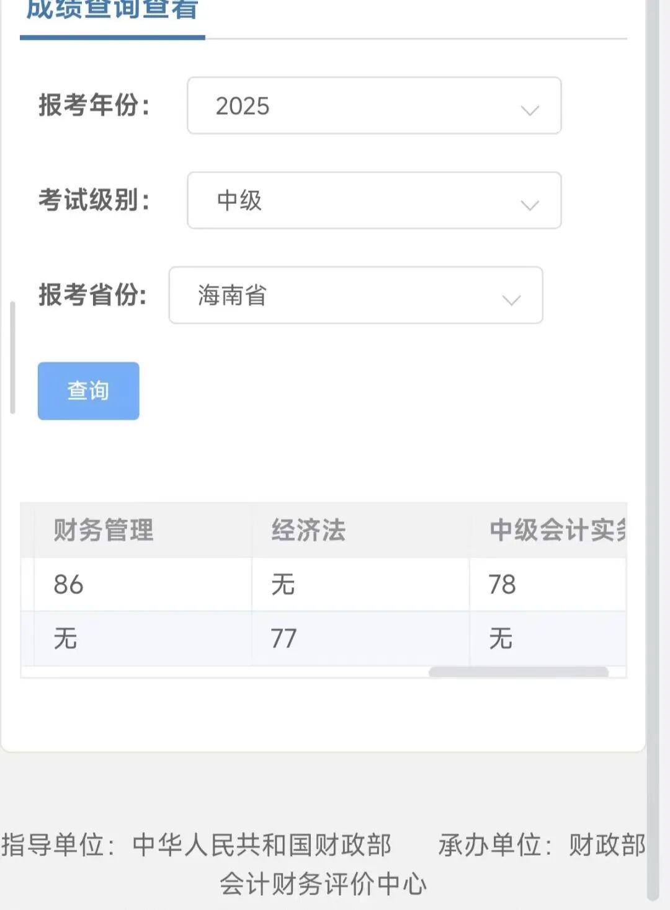

  

@拾贝 37岁 女

今年8月，我终于下定决心离婚，并从那个让我感到窒息的家里搬了出来。

  

我是一名高中教师，一直以来，都在为工作、孩子和原生家庭忙碌，很少顾及自己的感受。今年暑假，我结束了连续两年的毕业班教学工作，走出了过去一直生活的小圈子，重新思考真正想要的是什么，也开始审视一直以来的家庭和婚姻关系。最终在8月底，我搬离了原来的家，决定离婚。

  

这个决定让我重新认识了自己，也变得更加明媚、自信。对我来说，这是一次自我觉醒，37岁还很年轻，人生依然可以重新开始。

  

@爱智Edge 38岁 女

37岁那年，我成为了一名普通的英语脱口秀商演演员，没想到，这个小结果竟然给我带来了工作、友谊和爱情。

  

几年前，我离开了一份很有毒的工作，离职后也不知道干什么，读了几百本书，后来短暂回过职场，新工作不适合自己，还是辞职了。

  

那段时间，唯一坚持下来的，就是stand-up comedy，英文脱口秀。曾经有前辈告诉我，「不要浪费你的天赋」，但爹味的前男友却说，「你没天赋，不适合干这个」。我自己也不知道究竟有没有天赋，想来想去，决定认真尝试一年，免得以后老了后悔。

  

刚开始的日子并不轻松。我记得有一年冬天，去Paddy参加开放麦，现场坐满了喝酒的外国人，闹哄哄的，观众的声音甚至比演员大，根本没人认真听我讲。晚上10点半，我还要打车20公里回通州，坐在车上忍不住想：「我这是在干嘛？」但最后还是坚持了下来，没想到，竟然收获了3个完全意想不到的回报。

  

有一次我去看英语开放麦，台上站着一个长发飘飘、穿长裙、化妆涂口红的男人。他已婚，在使馆做IT工作，曾经在伊拉克当过10年兵，喜欢玩枪，讲的段子也不怎么好笑，怎么也想不到，他竟然成为了我的人生好友。

  

还有一次，我在台上讲自己找不到工作的段子，演出结束后，一位观众问我：「你说的是真的吗？」后来，我就去了他开的机构教英语，逐渐转型成为一名英语老师。这份工作非常适合我，时间自主，帮助别人进步，还能和不同的人深入交流，几乎没有以前工作中的内耗。

  

最意想不到的，是爱情。有一次，我主持一场普通商演，一位演员朋友演出结束后，有事先走了，没想到遭遇了车祸。后来，我去参加她的葬礼，认识了她的丈夫。再后来，我和她的丈夫组建了一个幸福的新家庭。

  

也因此，我认识了丈夫的妈妈，一位81岁的英国老太太。她做了一辈子小学老师，还兼职做了20年的酒吧服务员，从20岁开始，一直做到39岁怀孕生子。也正是这份兼职，让她结识了一位维持了60年友谊的闺蜜，遇到了自己的两任丈夫，虽然两段婚姻都算不上理想，但她拥有了两个非常优秀、贴心的孩子。

  

这让我想起自己讲英语脱口秀的经历。或许，我们这些普通人，终其一生也不一定能找到所谓的热爱，但眼前有什么，就先试着做点什么吧。只要让自己在某个场域里保持流动，故事就有可能发生。

  

最后，祝我的朋友们，也祝我自己，能够以更好的心态，面对每天具体的生活。

  

图源剧集《了不起的麦瑟尔夫人》

  

* * *

* * *

  

**亲爱的读者们，不****星标《人物》公众号****，不仅会收不到我们的****最新推送****，还会看不到我们****精心挑选的封面大图****！ 星标《人物》，不错过每一个精彩故事。****希望我们像以前一样，日日相伴。**

  

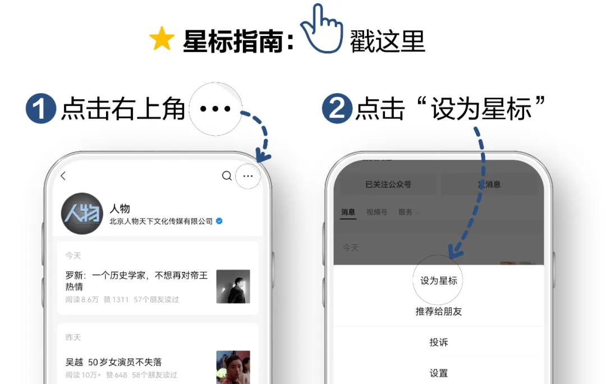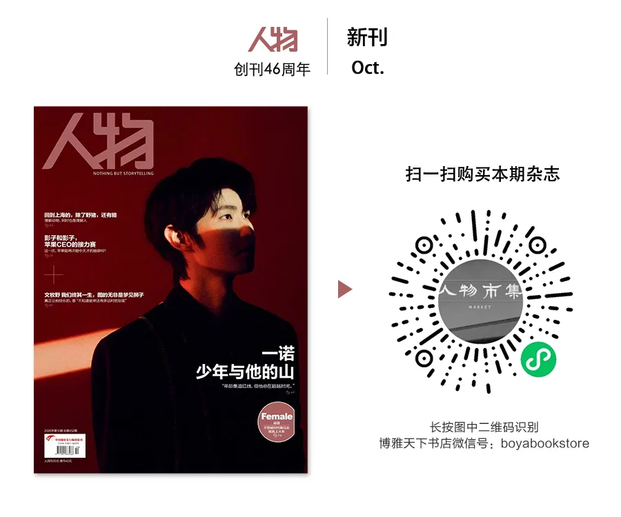