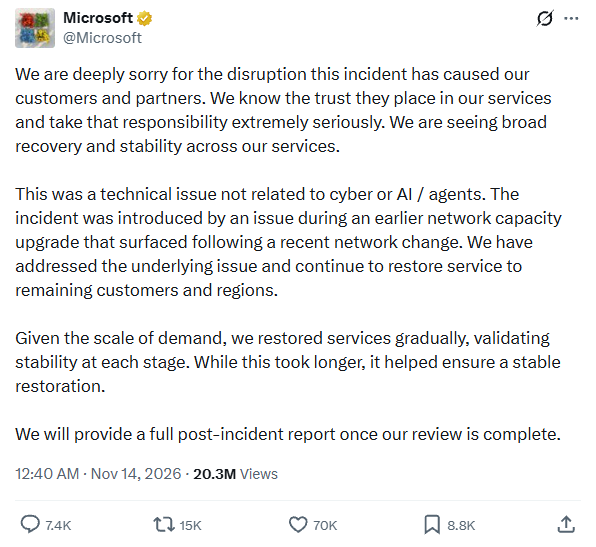
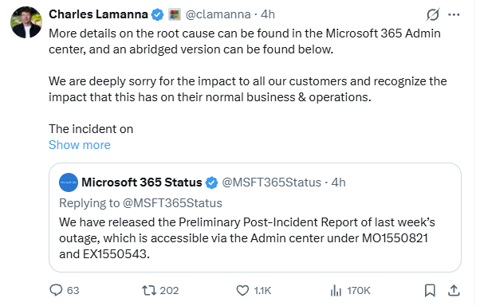

11 月 12 日，微软 Microsoft 365 发生大规模服务中断，Outlook、Teams、OneDrive、Copilot 等一众应用同步受影响。这场故障横跨北美、欧洲、亚太、澳洲，波及 74 个国家和地区，一直持续到 13 日。  

  

全球无数打工人盯着不停转圈的 Outlook、发不出消息的 Teams，猝不及防体验了一场史诗级的 “赛博停工”。

  

**一、全球大规模宕机：网友戏称“Microsoft 364”**

  

这场宕机的破坏力究竟有多大？ 

  

根据 Downdetector 监测数据，故障高峰时，Outlook 故障上报量一度达到 13.8 万条，累计收到全球 74 个国家和地区超 740 万条故障反馈，峰值上报速度接近每分钟 2 万条，达到日常水平的 1500 多倍。

  

这次宕机击穿了现代办公的多个核心链路：

  

  * 核心消息与存储服务：Exchange Online（全平台 Outlook 客户端）、OneDrive、SharePoint Online 无法访问；

  

  * 协作与 AI ：Teams 的日历、会议排期、新建聊天功能失效（已有聊天、会议尚能正常使用），Microsoft 365 Copilot 不可用；

  

  * 安全平台：Defender XDR 控制台与后端连接中断；

  

  * 第三方集成：OpenAI、Anthropic 对接 365 数据的 AI 连接器同步故障；

  

  * 公共部门业务：澳大利亚外交贸易部（DFAT）、农业、渔业和林业部等政府机构发布公开预警，部门邮件系统无法收发外部邮件，只能改用电话作为应急沟通手段。

  

大量跨国贸易企业出现业务延误，部分上市公司财报发布被迫推迟，航空公司也向客户预警沟通延迟。相对而言，本地部署版本的 Office 受冲击很小。

  

事件爆发初期，不少人猜测是黑客攻击、AI 失控。微软 Copilot、智能体与平台执行副总裁 Charles Lamanna 很快出面确认，没有迹象表明故障由恶意活动或网络攻击导致。

  

  

随后，微软官方也正式表态：“这是一起技术问题，与网络攻击或 AI / 智能体无关。故障由更早一次网络扩容升级中遗留的问题引入，并在近期一次网络变更后显现。”同时，微软承诺将在审查完成后提供完整的事后报告。

  

  

微软的澄清并没有平息大家的焦虑，但在漫长的等待中，网友们很快在评论区玩起了梗。在微软致歉帖下方，有网友发了一张被手工涂改的图片，既然365天里有一整天掉线，“请改名Microsoft 364，这是规矩。”

  

  

网友的调侃可以一笑了之，但一个不容回避的问题是：微软的底层网络网关为什么会集体“罢工”？

  

**二、官方复盘：三重条件叠加，引爆潜伏锁竞争 Bug**

  

11 月 16 日，Microsoft 365 管理中心发布了初步的事后复盘报告。随后，Charles Lamanna 转发该帖子，揭开了事故的完整链条：它并非单一失误，而是三个条件恰好叠加，最终引爆了潜藏已久的锁竞争 Bug。

  

  

**1、埋了三个月的潜伏 Bug**

  

有一个专门给 M365 网络网关服务器做的补丁，里面藏了隐性问题，只影响这一批网关服务器，普通 Windows 不受影响。这个 Bug 的本质是进程锁竞争，一旦遇上特定负载，CPU、内存就会被吃光，服务器直接卡死。

  

这个补丁早在 7 月就开始灰度推送，按微软标准的安全发布节奏，几周内慢慢全量铺开。上线之后连续三个多月，一切看起来都很正常，没有爆出任何故障。

  

之所以测试阶段没查出问题，是因为测试环境和真实线上环境不一样：锁竞争在多核新服务器上更容易爆发。但当时压测用的都是核心更少、配置更低的机器，流量模型也和真实业务有差别，没能触发这个隐患。

  

**2、一次常规切流，抬升网关负载**

  

Microsoft 365 内部部署了两套相互独立、异构的网络网关系统，用于故障隔离与高可用设计，保障多数 365 服务在故障时可以在两套网关之间切换。

  

在宕机发生前约 15 小时，Teams 从备用网关切流至同时承载 Exchange Online 流量的主网关。这一动作抬高了主网关负载，同时改变了流量特征。这类切流属于常规运维动作，也是微软标准容灾体系的一部分。

  

**3、一部分服务器提前离线，余量变薄**

  

有一批服务器因前一起无关故障处于下线状态，这批服务器原本计划通过常规维护与健康巡检流程恢复上线。单独来看，服务本身留有充足容量余量，这部分容量缩减本身并不会造成故障。

  

但三者叠加：**负载上涨、可用服务器变少，网络网关终于触发了 7 月上线的这个潜伏 Bug。请求不断堆积，最终服务器停止响应。**

  

服务器失联后，流量调度系统会自动将用户导流至其他健康节点。这套机制是常态，也是抵御软硬件故障、保障服务韧性的核心手段。

  

但这一次，被导流过来的流量，让剩余健康节点也更容易触发同一个缺陷。同样的负载分摊到更少的服务器上，故障在服务器之间形成连锁传导。不到两小时，整个集群大量节点触发该未知缺陷，全部失去响应。故障最严重阶段，超过 80% 的服务器无法对外提供服务。

  

通常常情况下，网关由数千个按地域划分的容量单元组成，分区之间设有隔离屏障。但本次事故中，隔离机制没能拦住连锁失效，故障最终扩散至全球。

  

Teams、OneDrive、SharePoint 等服务支持路由切换，因此恢复更早；故障期间多数用户的 Teams 聊天、会议功能可用。而 Exchange Online 无法脱离这套网关，受影响更久。

  

本次恢复耗时远超常规：

  

  * 服务器一旦恢复上线，会立刻被积压流量打垮，再次无响应。原有自动化恢复流程，没有针对这种大规模集群集体卡死的场景做设计。

  

  * 核心代码缺陷是数月前就埋下的潜伏 Bug，常规的回滚、灰度发布、功能开关机制，都无法快速撤销变更。

  

工程师定位根因之后，开发了修复包，将 Windows 内这条代码路径回退到之前验证稳定的版本。为稳妥上线修复、逐步恢复服务，团队分批将服务器下线、打补丁、重启，再重新接入流量；该操作按区域批量执行（例如单次处理一个区域 50% 以上的节点）。

  

Charles 表示，完整的事后复盘报告将于本周发布更多细节。

  

而这场由多重巧合叠加催生的级联故障，也让外界再次审视微软持续暴露的稳定性问题。

  

**三、年内二度宕机：敲响单一供应商风险警钟**

  

这场事故其实是微软今年的第二次宕机。

  

今年1月，Microsoft 365 就曾因配置更改错误发生过一次服务中断，导致 SharePoint Online、Exchange Online 及管理员中心等无法正常访问；同月上旬，Azure 美东区域的网络故障也曾短暂波及多项云服务。

  

eToro 市场分析师 Josh Gilbert 对此提出警示：“这已经不是微软今年第一次出故障。如果可靠性问题反复出现，各家 IT 部门在把更多业务托付给单一厂商之前，都需要慎重权衡。”

  

但也有分析师持不同看法：这类宕机未必会直接推动客户转向竞品。Teams、Exchange 这类工具已经深度嵌入企业日常流程，迁移替换的切换成本极高。

  

这次宕机事件非常糟糕，不少人开始重新审视上云的取舍。当然，本地部署的 Exchange Server 同样会出重大故障，二者核心差别在于影响规模。本地出问题，受影响的往往只是单家企业；而云平台一旦发生严重故障，成千上万的机构会同步停摆，事件迅速扩散、全网可见。

  

更重要的是，这次故障引发了一个问题：当企业把核心业务高度依赖同一家云厂商，也就是“鸡蛋放在同一个篮子” 时，该如何搭建自己的风险预案？不同地域、不同业务的企业在本次故障里遭遇的影响各不相同，这次事件也倒逼不少团队重新复盘、修订灾备方案。

  

值得一提的是，Exchange Online 本身的邮箱数据库具备成熟的弹性能力，依托 DAG（数据库可用性组）架构，租户数据分散部署在多组集群之中。本次暴露出短板的，并不是邮箱存储层，而是负责消息接收、流量转发的底层网关基础设施。

  

如果架构、隔离机制不做优化，一旦未来微软大量 Agent 智能体落地，流量和调用复杂度进一步暴涨，那将会发生什么？

  

****>****>****>****>****

**参考链接**

  

  * https://shieldworkz.com/blogs/cascading-failure-in-the-cloud-core-investigative-assessment-of-the-november-2026-global-microsoft-outage-and-systemic-infrastructure-risk

  * https://www.reddit.com/r/sysadmin/comments/1xxiasy/microsoft\_postincident\_report\_is\_up\_for\_the/

  * https://www.reuters.com/technology/microsoft-365-outlook-down-thousands-us-users-downdetector-shows-2026-11-12/

  * https://office365itpros.com/2026/11/16/exchange-online-outage-nov26/

  

整理丨dbaplus社群\*仅为提供参考和学习交流，不代表dbaplus社群立场！dbaplus社群欢迎广大技术人员投稿，投稿邮箱：editor@dbaplus.cn  
