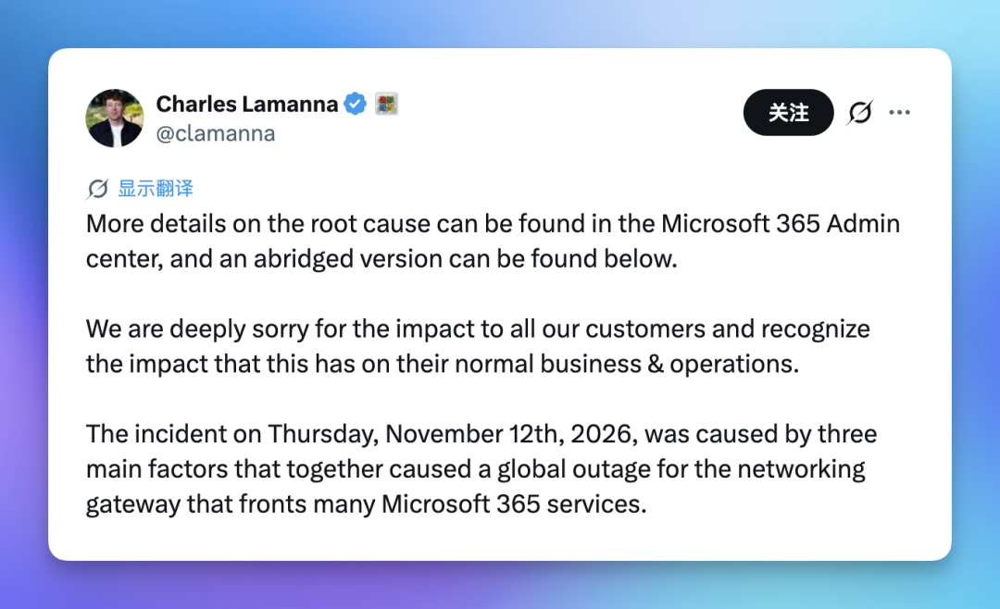

**就在前几天（2026年11月12日），全球无数打工人的早晨是从“兵荒马乱”开始的。Teams发不出消息，OneDrive文件打不开，Exchange邮件系统直接无响应。对于打工人来说，这可能是带薪摸鱼的半天；但对于微软的工程师来说，这绝对是职业生涯里最惊心动魄、冷汗直冒的至暗时刻。**

事故发生后，微软副总裁 Charles Lamanna 社交媒体上发布了一份针对此次 M365 全球网关大宕机的初步复盘报告。

看完这份报告，作为技术同行的我只能说：**后背发凉，简直是分布式系统灾难级连锁反应的教科书。**

它完美诠释了什么是“墨菲定律”——如果事情有变坏的可能，不管这种可能性有多小，它总会发生。这次干趴微软核心基建的，不是什么黑客高手的零日攻击，而是三个看似完全独立、毫无关联的“小概率事件”，在同一个时间点、以最致命的方式撞在了一起。

今天，我们就来扒一扒，这场技术灾难到底是怎么发生的？我们又能从大厂的“血泪史”里学到什么？

* * *

### 第一重暴击：一颗潜伏了四个多月的“惊天巨雷”

所有的灾难，往往都有一个不起眼的开端。

时间倒回今年 7 月份。当时的微软研发团队针对 M365 的网关服务器推送了一个常规的修复补丁。谁也没想到，这个看似人畜无害的代码变更，在底层进程里悄悄埋下了一个关于“锁竞争（Lock Contention）”的致命隐患。

更有戏剧性的是，这行带有隐患的代码，极其顺利地通过了微软内部极其严格的安全部署流程，不仅在全球平稳上线，而且连续跑了三个多月，愣是一点毛病都没出。

**为什么日常的自动化压测没把这个Bug揪出来？**

复盘报告里透露了一个让无数运维和测试人员直呼“太真实”的细节：硬件代差。

微软实验室里的压测环境，大多采用的是核心数量较少、配置相对老旧的低端服务器（Weaker hardware SKUs）；而这个由“锁竞争”引发的Bug，其特性偏偏是——**机器核心数越多、硬件配置越新，锁竞争的冲突反而越恶化。**

这就像是一个十字路口的红绿灯逻辑有瑕疵。在测试环境里（双车道小马路），车流量少，大家随便开开也不会撞车；但一放到生产环境（双向十六车道的高速枢纽），车道一多，抢行现象瞬间爆发，直接导致全线交通瘫痪。

测试环境和生产环境的算力错位，就这样硬生生地把一个致命Bug给掩护了过去。

* * *

### 第二重暴击：当“天灾”遇上“人祸”，流量洪峰的精准狙击

雷虽然埋好了，但要想引爆它，还需要极为苛刻的条件。非常不幸，11月12日这天，老天爷把引爆的引线全部接齐了。

首先是**算力折损** 。在宕机发生的前一天，大约 14% 的网关服务器因为一个完全无关的独立故障，被下线维护了。其实在超大规模的云原生架构里，14%的容量波动属于常规现象，系统本身的冗余算力完全Hold得住。

但这只是第一把火。紧接着，**流量突变** 来了。

在宕机前 15 个小时，Teams 系统触发了一次常规的容灾切换（Failover），大量原本走备用网关的流量，被全部导流到了这套主网关上（这套网关同时还要支撑庞大的 Exchange Online 业务）。

大家可以想象一下这个画面：一家生意火爆的网红餐厅，今天刚好休假了几个厨师（14%算力下线），结果隔壁分店还在搞装修，把大批旅游团全导流到了你这家店（Teams流量切换）。

这还没完。算力减少了，流量变大了，最后迎头撞上了**美国工作日的早高峰** ——全美数以千万计的白领在同一时间打开电脑，登录M365。

三股庞大的压力叠加在一起，7月份埋下的那个隐藏Bug瞬间被激活。过高的负载触发了严重的锁竞争，部分高配服务器开始出现僵死，大量请求在网关处堆积，系统彻底破防。

* * *

### 第三重暴击：“雪崩”降临与“防波堤”的全面溃败

做过高并发架构的兄弟们看到这里，脑子里肯定已经浮现出两个字：**雪崩** 。

当第一批服务器因为负载过高而失联时，智能流量调度系统立刻做出了它的本能反应：为了保证用户体验，马上把这些断联用户的请求，疯狂导向剩下的“健康”节点。

然而，在这个级别的并发下，所谓的“健康”节点也早已是在苦苦支撑。新涌入的流量成为了压死骆驼的最后一根稻草。一传十，十传百，同样规模的庞大流量被分摊到了越来越少的服务器上，死亡螺旋正式开启。

通常来说，为了防止这种跨区域的全局灾难，大厂都会设计“隔离舱（Bulkhead）”机制，就像船舱底部的隔水板，一个舱进水了，封死它，保住整艘船。但当天最荒诞的一幕发生了——**由于另一个完全独立的未具名问题，大区之间的隔离舱机制竟然失效了！**

故障畅通无阻地跨越了原本应该存在的物理和逻辑边界。不到两个小时，这个未知的Bug就横扫了微软全球的网关舰队。在情况最惨烈的时候，自家超过 **80%** 的网关服务器全部“躺板板”，拒绝响应任何请求。

* * *

### 地狱难度的救援：为什么修了那么久？

故障发生了，拉起机器赶紧修不就完了吗？其实，恢复的过程比系统崩溃更加折磨人。

通常遇到发版引发的故障，SRE（站点可靠性工程师）的第一反应就是一键回滚（Rollback）或者关闭功能开关（Feature Flag）。但这次不行。引发问题的是7月份的老代码，早就过了回滚的安全窗口。如果强行回滚三个月前的底层网关代码，鬼知道会引发什么更可怕的兼容性灾难？

那就重启服务器？更绝望的来了——这就是著名的“惊群效应（Thundering Herd）”。

工程师好不容易把服务器重启，机器刚一开机，门外积压了几百万、上千万个正在疯狂重试的客户端重连请求。这股流量瞬间涌入，刚刚活过来的服务器连一秒钟都没撑住，当场又被“锤”死了。

常规的自动化恢复流程面对这种全局性的死锁完全无计可施。最后，微软的工程师们只能被迫采用最原始、最暴力的“外科手术式”抢修：  
他们生生地把各个大区里 50% 以上的基础设施强行断网，手动从服务池里摘出来；然后紧急编写并打上回退代码路径的补丁；最后，像拧水龙头一样，极其小心、缓慢地一点点把流量放进来，这才慢慢把整个M365服务从死亡线上拉了回来。

值得一提的是，Teams 和 OneDrive 因为底层架构的优势，能在这次事故中提前“逃离”这套故障网关，所以恢复得相对较快；而像 Exchange Online 这种和该网关深度绑定的“老伙计”，就只能硬抗到底，成了重灾区。

* * *

### 大厂的“底裤”与我们的反思

不得不说，看完整个复盘，真的很难去单纯地嘲笑微软是个“草台班子”。在超大规模的分布式基建里，系统的复杂性本身就是最大的技术债。

一个平时根本引不起注意的测试环境硬件差异，一次常规的容灾流量切换，一个潜伏百天的高并发Bug，再加上关键时刻掉链子的隔离机制……哪一条单独拎出来都防不胜防，凑在一起就是毁天灭地的史诗级灾难。

但微软这次的处理态度，确实值得国内很多技术团队学习。能把“测试环境和生产环境硬件不匹配”、“隔离机制关键时刻失效”这种几乎等于暴露“底裤”的失误坦诚公布，没有强行找借口甩锅，这本身就需要极大的勇气。站直了挨打，用技术人的坦诚去面对技术问题，才是工程文化该有的样子。

毕竟，只要代码还是人写的，分布式系统的墨菲定律就永远不会迟到。下一次轮到谁？谁也说不准。大家平时写代码，还是多加几层try-catch，少立点Flag吧！

  

> 关注我，我会每天分享有趣的干货知识 \!