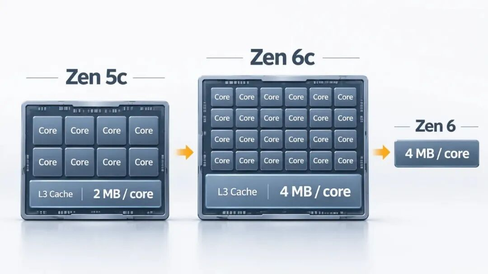
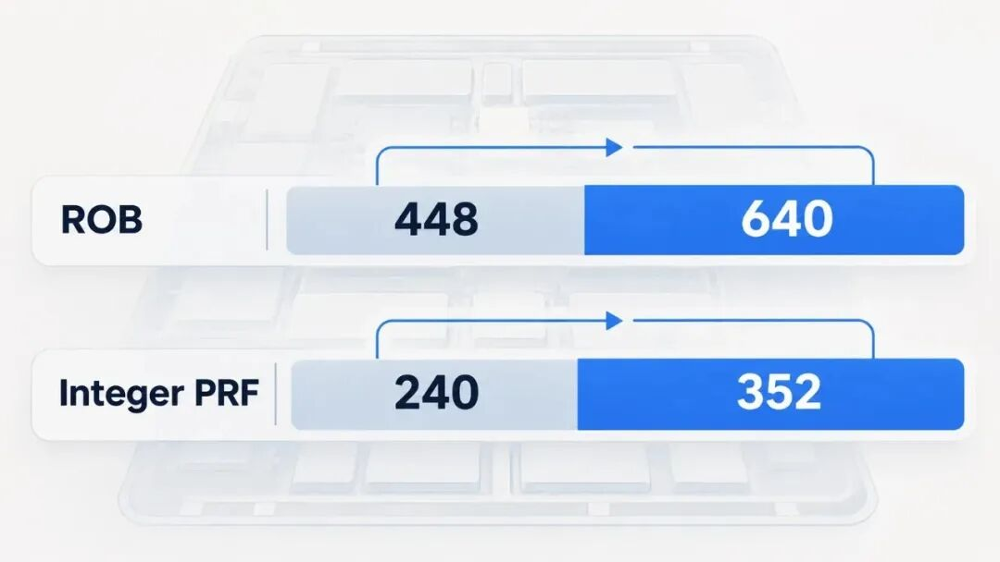
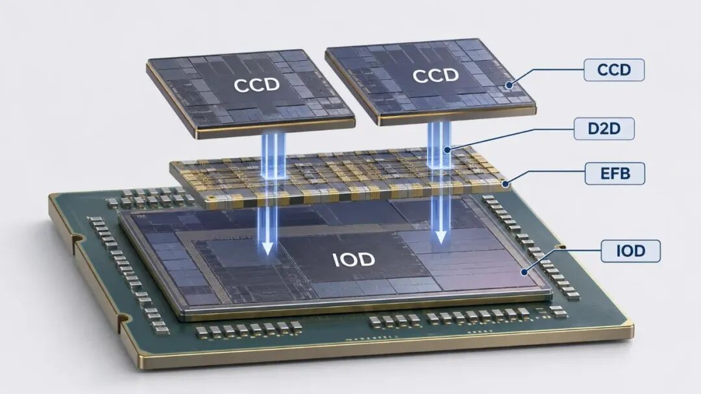

AMD披露第六代EPYC 9006“Venice”服务器处理器的Zen 6、Zen 6c微架构细节。官方称Zen 6c较Zen 5平均IPC提升27%，该数据来自特定16核配置的固定频率对比，并非单核或消费级产品的通用结论。

近期，AMD披露了第六代EPYC 9006系列服务器处理器（代号Venice）的Zen 6、Zen 6c微架构技术细节。

作为面向数据中心与AI负载的新一代平台，Venice在核心微架构、缓存配置、芯粒互连与平台I/O层面均有调整，最高可扩展至256核心、512线程。

AMD给出的核心性能指标是：Zen 6c相较Zen 5实现平均27%的IPC提升。不过这一数据有明确的测试边界：

在固定频率条件下，以单个CCD（核心复杂芯粒）中的16个活跃Zen 6c核心，对比分布在两个CCD中的16个Zen 5核心。

从负载拆分来看，企业与云端应用的提升约为20%，AI负载约为31%，两者综合得到27%的平均提升。这并非传统意义上的单核IPC对比，也不能直接推导至未来的消费级Ryzen产品。

核心与缓存

AMD延续了标准核心与高密度核心并行的产品路线，两者在CCD配置上有明确区分：

\- 标准Zen 6 CCD集成12个核心，配备48MB L3缓存，单核心L3缓存为4MB；

\- Zen 6c CCD设计有33个核心（32个活跃核心+1个冗余核心），配备128MB L3缓存，单核心L3缓存同样达到4MB。

这是AMD首次让高密度的c系列核心获得与标准核心相同的L3缓存配额——上一代Zen 5c的L3缓存仅为每核心2MB。缓存扩容带来的收益，已经包含在官方公布的27% IPC提升数据中。

微架构扩展

Zen 6的性能提升来自微架构各环节的同步扩容，而非单一模块的改动，核心目标是提升指令吞吐与乱序执行效率。

前端方面，操作缓存（Op Cache）容量从Zen 5的6000项增至6750项，每周期可交付的操作数从12个提升至18个，以减少后端执行单元的指令等待时间，延续了Zen 5引入的双解码路径（Dual Pipe）设计思路。

后端整数执行资源同样扩容：重排序缓冲区（ROB）从448项增至640项，整数物理寄存器文件从240项增至352项；

AMD还调整了整数调度资源，为地址生成单元（AGU）与算术逻辑单元（ALU）提供更多共享及专属调度空间，以提升乱序执行的并行挖掘能力。

向量与AI能力是此次更新的重点方向。Zen 6支持完整的AVX-512 FP16指令集，新增位矩阵乘法（BMM）指令，同时加强了VNNI-INT8处理能力；

在适配场景下，处理器还可并行执行四路256位AVX操作，替代传统的两路512位模式，以适配不同的负载特征。

芯粒与平台

Venice继续采用CCD加I/O芯粒（IOD）的芯粒设计，新引入Elevated Fanout Bridge（EFB）作为CCD与IOD之间的直接裸片间（D2D）连接，以提升互连效率并降低功耗。

平台按插槽分为两个不同定位，以适配不同的服务器部署需求：

\- SP7插槽：面向高性能计算与通用服务器场景，提供16通道DDR5内存支持，最高兼容12800 MT/s的JEDEC标准MRDIMM，配备PCIe 6.0与CXL 3.1，单插槽最高功耗为600W；

\- SP8插槽：面向I/O密集型场景，采用8通道DDR5内存配置，支持每通道两条DIMM（2DPC），同时提供更多PCIe通道，单插槽最高功耗为400W。

此外，Zen 6与Zen 6c均保留同步多线程（SMT）设计，每个核心可提供两个线程，以适配多线程密集的服务器负载。

消费级边界

此次AMD仅披露了服务器级EPYC产品的Zen 6架构细节，未提及消费级Ryzen系列的相关产品计划。

标准Zen 6的12核CCD设计虽为未来桌面产品留下了配置空间，但服务器与消费级产品在核心选型、缓存组织与目标负载上均存在差异，27%的IPC数据无法直接套用。

整体来看，Zen 6架构的调整方向明确：通过更宽的执行路径、更均衡的缓存配置与更完善的平台I/O能力，应对数据中心日益增长的吞吐与AI负载需求。

信息来源

\[1\] ComputerBase｜AMD Zen 6 im Detail: Mit +27 Prozent IPC zum schnellsten AMD-Prozessor

\[2\] amd.com｜AMD EPYC TM SERVER CPU ARCHITECTURE AND PERFORMANCE OVERVIEW

* * *

26年11月显卡天梯榜 | 26年11月CPU天梯榜

合作联系： *topcpu888@gmail.com*