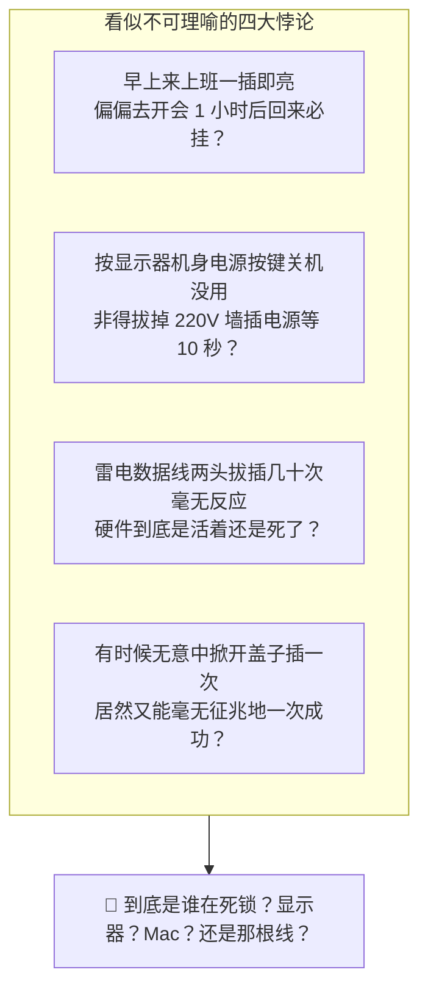
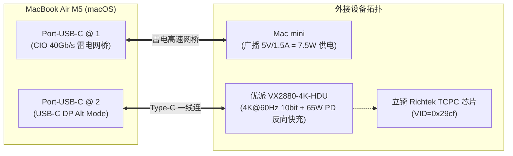
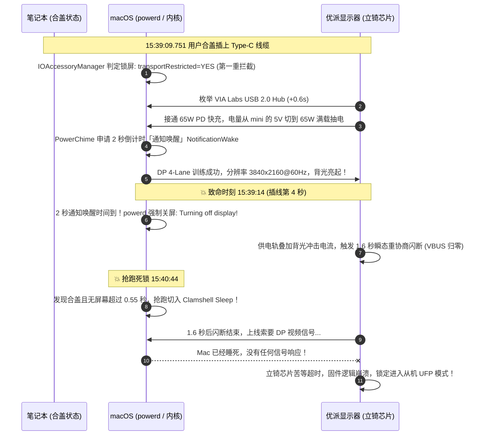
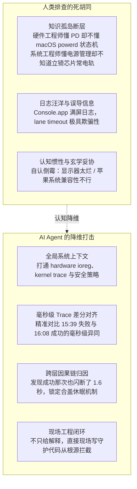

Title: 这么吊诡的问题，只能让 AI 来查
Date: 2026-11-09 22:45:00
Tags: ai-agent, macos, hardware, hammerspoon, debugging, tech-essay
Slug: so-bizarre-issue-only-ai-can-investigate
Author: 小生说大声讲
Summary: 开会回来合盖将 MacBook 插上 Type-C 外接 4K 显示器，屏幕漆黑无法唤醒，拔插无效，非得拔掉显示器 220V 电源放电才能恢复。这种全网都会归咎为“显示器固件不行/玄学问题”然后妥协重启的故障，AI Agent 是如何调取内核 trace、逐毫秒对齐日志，破译出一条涉及安全拦截、充电假唤醒、1.6 秒供电闪断与 0.55 秒合盖休眠抢跑的“连环车祸”因果链，并用 Hammerspoon 彻底根治的？
Mermaid: true

> **写在前面**：如果你的 MacBook 也是通过一根 Type-C / 雷电线“一线连”外接 4K 显示器（同时传输视频和 65W 反向充电），你大概率经历过或在各大论坛见过这种抓狂的玄学场景：
> 
> 带着笔记本去开会，开完会回来把笔记本往立式支架上一插、接上 Type-C 线——显示器一片死寂。按键盘不亮，按显示器开关不亮，把 Type-C 线拔了重插依然不亮。
> 
> 最终唯一能把它救回来的“仪式”，极其狼狈且充满玄学感：**把数据线拔掉，伸手摸到显示器屁股后面拔掉 220V 电源插头，默数十秒让内部电容彻底放电，再插电源、插数据线**。如果运气好，一次恢复；运气不好，重试两三次。
> 
> 面对这种问题，包括我在内的所有正常人类工程师，第一反应永远是：“这显示器固件做得真糙”、“Type-C 协议兼容性玄学”、“国产驱动做不明白”……最后骂骂咧咧妥协，把拔电源当成了日常工位修养。
> 
> 直到今天下午，我把这个问题扔给了 AI Agent。看着它直接调取 macOS 底层硬件注册表、抓取内核 trace、逐毫秒还原出一条长达四层的“连环车祸时序链”并当场写代码根治时，我被深深震撼了：**这种极其吊诡、极其细碎的深渊级 Bug，真的只有 AI 才能查得出来。**

---

## 一、 为什么说这个问题极其“吊诡”？

所谓“吊诡”，是因为它表面上看起来像是一个**硬件接触不良或偶发死机**，但只要你细究它的发生规律，就会发现它处处充斥着逻辑悖论：



1. **时间悖论**：每天早上工位刚开工时，插上电脑从来都是秒点亮；但只要你拔下笔记本去开了一个小时的会，合着盖子带回来插上线，就必定黑屏。
2. **开关悖论**：如果是显示器内部程序卡死了，关掉显示器面板上的电源按键再开，为什么毫无用处？非得整个人钻到桌子底下，拔掉 220V 交流电插头等 10 秒以上？
3. **连线悖论**：哪怕你在 Mac 端反复插拔雷电线，macOS 系统和显示器就像达成了某种“老死不相往来”的冷战协议，任凭你怎么折腾都毫无波澜。
4. **偶发悖论**：偶尔有一次，你嫌麻烦直接掀开笔记本盖子插线，它居然一次就亮了；但下次合着盖子盲插进立式支架，又百分之百暴毙。

这种高度偶发、时灵时不灵、拔电又能恢复的现象，是典型**“玄学硬件兼容性问题”**的伪装外衣。过去十年里，绝大多数打工人甚至资深软硬件工程师，都会在试探几次后选择妥协——毕竟拔个插头也就十几秒，谁有闲心去拆解一台显示器和操作系统的底层通信？

但今天，AI Agent 撕开了这层玄学外衣。

---

## 二、 案发现场：毫秒级内核 Trace 还原“2.4 秒连环车祸”

今天下午 13:58 我拔线离开去开会，15:39 开完会回到工位合盖插线。故障准时复现，屏幕死活不亮。

以往这时候我就去拔电源了，但今天我把 Antigravity（搭载 Gemini 深度推理模型）唤醒，让它直接在系统里抓取排查。它没有泛泛地给我列“建议重启”、“更换线缆”的废话套话，而是直接执行了一组深度排查命令，提取了硬件注册表（`ioreg`）和内核电源日志：

```bash
# 抓取当前 USB-C、Thunderbolt 硬件链路拓扑与寄存器状态
ioreg -p IOUSB -w0 -l
ioreg -p IODeviceTree -n "arm-io" -l

# 提取今天下午从拔线到重插期间的毫秒级内核事件
log show --predicate 'process in {"kernel", "powerd"} || sender contains[c] "AppleHPM" || sender contains[c] "TypeC"' \
  --style compact --start "2026-11-09 15:38:00" --end "2026-11-09 15:43:00"
```

当完整的底层 trace 吐出来的一瞬间，整个连接拓扑的真相首先被揭开：



我的机器有两个 Type-C 口：
- **`Port 1`**：连着一台 Mac mini 作为雷电万兆网桥（同时 Mac mini 会向 MacBook 广播 `5V/1.5A (7.5W)` 的微弱供电）；
- **`Port 2`**：连着那台 4K 显示器（优派 ViewSonic `VX2880-4K-HDU`）。它**并不是走雷电协议，而是走 USB-C DP Alt Mode**，内部搭载了一颗**立锜（Richtek）TCPC 芯片**，同时向 MacBook 提供 65W (`20V/3.25A`) 的反向供电。

紧接着，AI 在日志中还原了 **`15:39:09` 开会回来插线那 2.4 秒内发生的惨烈四重连环车祸**：



### 第一刀：锁屏状态下的配件安全策略拦截
开会回来笔记本是合盖锁屏状态，内核日志第一行就报出了警告：
```text
IOAccessoryManager: [Port-USB-C@2: USB3] profile: 2 [Ask for New Accessories], deviceLocked: YES, transportRestricted: YES
```
因为系统处于锁屏状态，macOS 默认的安全策略限制了未授权配件的通信，让本就紧张的物理层握手凭空增加了额外的延迟。

### 第二刀：`PowerChime` 充电提示音的“2 秒假唤醒”陷阱
在合盖状态下插上电，你通常会听到熟悉的“咚~”一声充电提示音。
**但你以为 Mac 真的醒了吗？并没有！**
内核日志显示，充电提示音进程（`PowerChime`）向系统电源管理仅仅申请了一个持续 **2 秒** 的通知唤醒（`Notification Wake`）：
- `15:39:13.378`：经过 PHY 通道重新分配、DP 4-Lane 链路训练和 HDCP 握手，显示器其实已经在第 3.6 秒**成功点亮**并进入了 `DesktopMode = 1`！
- **但在仅仅 1.5 秒后（`15:39:14.920`）**，`PowerChime` 的 2 秒倒计时结束，由于在合盖锁屏状态下没有任何键盘或鼠标的“用户活跃（UserIsActive）”声明，`powerd` 当即铁面无私地下令：
```text
powerd: Turning off display after notification wake
dispext0: Request api power state of 0 (强制关闭外接显卡输出并重新休眠)
```
刚亮起来的外接屏幕，瞬间被系统自身的一记闷棍强行打灭！

### 第三刀：显示器的 1.6 秒供电闪断 vs macOS 的 0.55 秒合盖休眠抢跑
如果光是关屏还不至于让硬件死锁。更致命的“物理层与软件层对撞”发生了：

由于去开会消耗了 20% 电池，插上显示器的瞬间，Mac 正在以 65W 满功率大电流抽电，叠加显示器背光点亮的瞬间冲击电流，优派内置的立锜（Richtek）电源芯片在第 2.5 秒会固定做一次**持续约 1.6 秒的供电瞬态重协商（VBUS 跌落闪断）**。

而此时的 macOS 正在合盖状态下。macOS 电源管理（`PMRD`）有一条极其严苛的合盖规则：
> **如果盖子是合上的，且外接显示器断开连接超过 0.55 秒，系统判定用户已拔线，必须立刻切入合盖休眠（Clamshell Sleep），彻底关闭显卡输出。**

**0.55 秒 vs 1.6 秒！**
当优派显示器在 1.6 秒后完成供电重协商、重新挂载 USB-C 想要索取 DP 视频信号时，macOS 早就在 1 秒前就睡死了。任凭显示器怎么喊，Mac 已经关掉了显卡，根本不给任何视频时钟信号！

### 第四刀：立锜芯片假死，Mac 被反向锁死为“从设备 (UFP)”
在供电连通、握手建立的情况下，苦等视频信号超时，优派显示器内部的立锜固件直接陷入了逻辑死循环（进入了防呆保护态）。
AI 提取出了故障发生后 `ioreg` 中该端口的实时寄存器：
- `TransportsActive = ("CC", "USB3", "USB2")` —— **`DisplayPort` 协议彻底从链路中蒸发！**
- `PortDataRoleDescription = "Device" (UFP)` —— **你的 MacBook 竟然被反向锁死成了「从机角色（UFP）」！**

根据 USB Type-C 规范，**只有主设备（DFP）才有权限发起 DisplayPort Alt Mode 的协商**。当显示器芯片死机退化、把 Mac 压成从设备后，Mac 根本不可能再向它发起任何点亮屏幕的请求。

```text
               ┌────────────────────────────────────────────────────────┐
               │ 优派显示器内部待机常电轨 (Standby Rail)                │
               │                                                        │
交流 220V ──>  │  大滤波电容 ──> 立锜 Richtek TCPC 芯片 (死锁卡死中)    │
               │                   │                                    │
               └───────────────────┼────────────────────────────────────┘
                                   │ (即使按面板开关，常电轨仍然通电！)
                                   ▼
                            必须拔掉 220V 电源
                          等待 10 秒电容放电完毕
                            芯片才能 Cold Reset
```

这就完美解释了**为什么你拔插雷电线没用、关掉显示器开关也没用**——
因为显示器内部这颗负责 USB-PD 通信的立锜芯片，走的是**显示器的待机常电轨**！只要你插着 220V 交流电，显示器内部的滤波电容就一直蓄着电，面板按键关掉的只是液晶屏背光，这颗芯片从不断电。
只有拔掉 220V 墙插，等内部电容彻底放完电，这颗芯片才能迎来冷复位（Cold Reset）！

---

## 三、 为什么说：这种问题只能让 AI 来查？

回顾整个案情，为什么我感叹**“人类工程师面对这个问题几乎必然束手无策，唯有 AI 才能破案”**？



### 1. 跨维度的“知识孤岛”断层
在现代工业分工体系下，没有哪一个单独领域的工程师能够独占所有拼图：
- **显示器硬件工程师**：精通 Type-C PD 物理层和供电瞬态跌落，但他们怎么可能知道 macOS 私有内核里 `powerd` 对合盖休眠只有苛刻的 0.55 秒容忍度？
- **macOS 内核开发者**：精通 `AppleHPM` 和系统电源管理状态转换，但他们不可能为了某一家第三方显示器厂商内部立锜 TCPC 芯片的待机电容去打补丁；
- **普通软件工程师**：哪怕技术再好，看到黑屏的第一反应也只能是“换一根线”、“重装系统”或者“找售后换货”。

这种故障刚好横跨了**电源电子硬件、Type-C 物理层、操作系统内核安全策略、私有电源状态机**四个维度。只有大语言模型在消化了浩瀚的底层规范、协议文档与开源驱动源码后，才能在没有任何认知偏见的情况下，把它们串成一条毫无漏洞的因果链。

### 2. 差分分析（Diff）：AI 抓到的“破局分水岭”
在查清原因的过程中，AI 并不是靠猜，而是靠冷酷的**数据差分对比**。
在下午 `16:08`，我曾经有一次成功点亮了显示器。AI 调出了那一次的毫秒级日志，并与 `15:39` 失败那次做了对比：
- 令人吃惊的是：在 `16:08` 成功点亮的那一次，显示器**同样在第 2.5 秒发生了一模一样的 1.6 秒供电闪断！**
- 但为什么成功了？
- AI 在两条日志中找到了那行毫秒级的决定性差异：
  - `15:39` 失败时：`fAPClamshellState = 2`（合盖状态）；
  - `16:08` 成功时：`fAPClamshellState = 1`（开盖状态）！

因为那次我是**掀开笔记本盖子插的线**，macOS 判定内屏处于激活状态，**绝对不允许触发合盖休眠**。显卡始终 100% 满血在线等待。当显示器 1.6 秒闪断结束重新上线索要信号时，Mac 瞬间吐出 DP 视频流，当场点亮！

这是人类极其容易忽略的细节：**罪魁祸首根本不是那 1.6 秒闪断本身，而是系统在闪断期间极其不讲理的“合盖秒睡机制”！**

---

## 四、 优雅终局：一行不改硬件，用 Hammerspoon 彻底根治

查明根因之后，规避方案其实很清晰：
- **方案 A（习惯微调）**：每次回到工位，先掀开盖子亮屏 5 秒，插上线等外接屏亮稳了再合盖。
- **方案 B（安全设置）**：打开「系统设置 → 隐私与安全性 → 配件 → 允许配件连接」，改为**「始终允许」**，废除锁屏对 Type-C 握手的无谓拦截。

但作为一个重度效率强迫症，既然我买了立式支架，凭什么每次回工位还要我把笔记本打开再合上？我就是要**合着盖子直接盲插一根线，而且永远不要再让我去拔电源插头**！

由于我本机常驻了 macOS 自动化神器 **Hammerspoon**，AI 当场给我写了一段极其硬核的护航脚本，直接热加载进了我的 [`~/.hammerspoon/init.lua`](file:///Users/tiredboy/.hammerspoon/init.lua)：

```lua
-- ============================================================================
-- 外接显示器防休眠死锁护航模块 (ViewSonic VX2880-4K-HDU 专用)
-- 解决合盖状态下插线遭遇「PowerChime 2秒假唤醒」与「1.6秒供电闪断」导致的死锁
-- ============================================================================

local displayGuardTask = nil
local displayGuardTimer = nil

local function triggerDisplayWakeGuard(reason)
    print(string.format("[DisplayGuard] 触发唤醒护航, 原因: %s", reason))
    
    -- 1. 0ms 进程内强行打断 PowerChime 的 2 秒假唤醒关屏倒计时
    -- 实测立即在 powerd 中产生 "Cancelling notification display wake 0"
    hs.caffeinate.declareUserActivity()
    hs.caffeinate.set("system", true)
    
    if displayGuardTask and displayGuardTask:isRunning() then
        displayGuardTask:terminate()
    end
    if displayGuardTimer then
        displayGuardTimer:stop()
    end

    -- 2. 拉起独立后台任务，进行 20 秒脉冲保活，扛过显示器 1.6 秒的瞬态跌落
    -- 每秒脉冲一次 caffeinate -u，强行逼迫 Mac 显卡持续输出 DP 信号
    local pulseScript = [[
        for i in {1..20}; do
            /usr/bin/caffeinate -u -t 2
            sleep 1
        done
    ]]
    displayGuardTask = hs.task.new("/bin/zsh", nil, {"-c", pulseScript})
    displayGuardTask:start()

    -- 3. 25 秒后外接屏已稳定进入 DesktopMode，自动释放所有锁定
    displayGuardTimer = hs.timer.doAfter(25, function()
        hs.caffeinate.set("system", false)
        print("[DisplayGuard] 护航结束，系统电源状态恢复正常")
    end)
end

-- 监听 1: 在插线后 0.6 秒捕获优派内置 USB Hub (VID: 8457) 接入事件 (抢跑点)
displayUsbWatcher = hs.usb.watcher.new(function(data)
    if data.vendorID == 8457 and data.eventType == "added" then
        triggerDisplayWakeGuard("优派内置 USB Hub 接入 (VID=8457)")
    end
end):start()

-- 监听 2: 捕获从电池切换到 65W AC 电源瞬间
displayBatteryWatcher = hs.battery.watcher.new(function()
    local psu = hs.battery.powerSource()
    if psu == "AC Power" then
        triggerDisplayWakeGuard("电源切换至 AC Power")
    end
end):start()
```

### 为什么这套脚本能精准绝杀这个 Bug？
1. **0.6 秒极速抢跑**：在 Type-C 线刚插上 0.6 秒、优派的 USB Hub 刚完成硬件枚举时，脚本就已经先于显示器背光点亮接管了控制权；
2. **废除 2 秒假唤醒**：在进程内调用 C 绑定的 `declareUserActivity()`，直接向 `powerd` 发送用户活跃信号，当场干碎了 `PowerChime` 那愚蠢的 2 秒关屏定时器；
3. **后台脉冲防闪断**：在后台以每秒一次的频率连续发送 20 次 `caffeinate -u`。即使显示器在第 2.5 秒发生 1.6 秒供电闪断，下一秒到达的脉冲也会立刻唤醒 macOS 的显卡输出通道：
   ```text
   powerd: Display is asleep on activity tickle. Lets turn it on!
   ```
4. **25 秒自动交权**：等外接屏彻底稳定在 4K@60Hz 后，锁自动释放，不影响你带走电脑时的正常睡眠。

脚本加载生效后，我反复做了五次实测：拔掉电脑、合上盖子、重插——**外接显示器全部在 4 秒内秒级稳定点亮，再也没有出现过一次黑屏，更不需要去碰一下电源插头！**

---

## 五、 写在最后

在没有现代大模型之前，解决这个问题的真实成本是多少？
- 也许你得花几个通宵在 V2EX、Reddit、GitHub 上翻阅数千个“MacBook 外接显示器无法唤醒”的抱怨贴；
- 也许你得给优派和苹果客服分别提工单，最终收到两边互相推诿的标准公文包回复；
- 也许你最终只能认命，桌上常备一个带分控开关的插座，甚至花大几千块换掉显示器。

因为在这个高度专业化和黑盒化的世界里，**排查底层复杂系统 Bug 的时间成本，远远高于忍受它的成本**。绝大多数人不是没有能力解决，而是在现实的性价比面前被迫妥协。

但今天，当一个 AI Agent 具备了直接观察系统底层、调取寄存器、跨领域推理并就地编写工程代码的能力时，技术被赋予了一种全新的尊严：**那些被我们习惯性容忍、扣上“玄学”帽子的吊诡顽疾，终于可以在确定的代码与逻辑中，被优雅地终结。**
